# NEXUS AI Database Design

- Status: Phase 0 logical design
- Target: PostgreSQL through Prisma
- Last reviewed: 2026-11-07

This document is an implementation contract, not an applied migration. The repository was empty when it was written. Phase 1 must pin a mutually compatible stable PostgreSQL, Prisma, and Better Auth set before Phase 2 turns this design into `prisma/schema.prisma` and migrations. At this review, Better Auth's official Prisma adapter supports Prisma 7 and does not yet support Prisma 8, so Prisma 7 is the provisional baseline and must be rechecked before installation. This is important because Prisma's schema, index, extension, and migration capabilities are version-sensitive.

## 1. Design goals

- Make a workspace the tenant boundary for every collaborative resource.
- Make cross-workspace references impossible in the database where practical, not merely unlikely in application code.
- Keep Better Auth's core tables compatible with the installed Better Auth version.
- Preserve immutable usage, execution, and audit evidence while allowing product content to be deleted.
- Keep provider-specific AI details out of the relational core while retaining the model and cost snapshot needed for reproducibility.
- Use PostgreSQL full-text search first and leave an explicit, non-destructive path to pgvector.
- Keep external side effects, including Redis jobs and object deletion, outside database transactions and coordinate them with a transactional outbox.

## 2. Physical conventions

### 2.1 Identifiers, names, and times

- Domain IDs are opaque UUID strings in TypeScript and native PostgreSQL `uuid` values. The Prisma form should be equivalent to `String @id @default(uuid()) @db.Uuid`, unless the pinned Prisma/Better Auth release generates a different compatible form.
- Better Auth IDs must stay strings at its API boundary even when backed by native UUID columns. Generate the Better Auth schema from the pinned CLI, diff it against this design, and do not hand-edit token semantics.
- Prisma models use singular `PascalCase`; tables and columns use `snake_case` through mappings. Constraint and index names are explicit so migration diffs remain intelligible.
- All timestamps are `timestamptz`, stored in UTC. Normal mutable rows have `created_at` and `updated_at`; append-only rows only need `created_at`.
- IDs never encode authorization. A UUID that is known to a caller is still subject to membership checks.
- Counters that can grow without a small upper bound use `bigint`; token counts use non-negative `bigint`. Currency is stored as integer micros in a `bigint` plus a three-letter currency code, avoiding floating-point arithmetic.
- User-entered titles use bounded `varchar`; long content uses `text`; flexible snapshots use `jsonb`. JSON is not used when a field participates in authorization, uniqueness, ordering, retention, or frequent filtering.

### 2.2 Tenant key propagation

Every workspace-owned table contains `workspace_id`, including nested tables such as messages, document chunks, citations, workflow versions, executions, and logs. A parent exposes `UNIQUE (id, workspace_id)` and a child uses a composite foreign key such as:

```text
messages (conversation_id, workspace_id)
    -> conversations (id, workspace_id)
```

This deliberate redundancy prevents a child from being attached to a parent in another tenant. Every tenant table has a leading B-tree index on `workspace_id` followed by the columns used for its principal list order. Service queries must still start from an authorized `WorkspaceMember`; the composite keys are defense in depth.

### 2.3 Deletion and concurrency

- Product roots that users may recover (`Workspace`, `Conversation`, `Document`, `KnowledgeItem`, `Workflow`) have `deleted_at`, `purge_after`, and `purge_started_at`. Cleanup does not begin before the recovery window expires; the purge worker atomically claims `purge_started_at` so restoration cannot race irreversible cleanup. Normal reads include `deleted_at IS NULL`.
- A monotonically increasing `version Int @default(1)` is present on user-editable roots. Updates use `WHERE id = ? AND workspace_id = ? AND version = ?`, incrementing `version`; a zero-row update is a stale-write error.
- Foreign-key actions are always explicit. `Cascade` is used only for true containment, `Restrict` for invariants that need an application workflow, and `SetNull` for retained history. Prisma maps these through relation referential actions; do not depend on connector defaults.
- Purge of a workspace or document begins only after its approved recovery window. Hard deletion happens only after object-storage cleanup has succeeded or an auditable retry state exists. Database cascade cannot delete S3 objects.

## 3. Enumerations

Use PostgreSQL/Prisma enums for small, stable state machines and strings plus validation for provider- or plugin-extensible values.

| Enum | Values |
| --- | --- |
| `PlatformRole` | `USER`, `ADMIN` |
| `UserStatus` | `ACTIVE`, `SUSPENDED`, `PENDING_DELETION`, `DELETED` |
| `ProvisioningStatus` | `PENDING`, `RUNNING`, `READY`, `FAILED` |
| `WorkspaceStatus` | `ACTIVE`, `PENDING_DELETION` |
| `WorkspaceKind` | `PERSONAL`, `TEAM` |
| `WorkspaceRole` | `OWNER`, `ADMIN`, `MEMBER` |
| `WorkspaceInvitationStatus` | `PENDING`, `ACCEPTED`, `REVOKED`, `EXPIRED` |
| `ConversationStatus` | `ACTIVE`, `ARCHIVED` |
| `MessageRole` | `SYSTEM`, `USER`, `ASSISTANT`, `TOOL` |
| `MessageStatus` | `PENDING`, `STREAMING`, `CANCEL_REQUESTED`, `COMPLETED`, `CANCELLED`, `FAILED` |
| `DocumentStatus` | `UPLOADING`, `UPLOADED`, `QUEUED`, `PROCESSING`, `READY`, `FAILED`, `QUARANTINED`, `DELETING` |
| `ProcessingStatus` | `QUEUED`, `RUNNING`, `SUCCEEDED`, `FAILED`, `CANCELLED` |
| `KnowledgeSourceType` | `MANUAL`, `DOCUMENT`, `CONVERSATION`, `MESSAGE` |
| `UsageStatus` | `SUCCEEDED`, `FAILED`, `CANCELLED`, `TIMED_OUT` |
| `WorkflowStatus` | `DRAFT`, `ACTIVE`, `ARCHIVED` |
| `WorkflowExecutionStatus` | `QUEUED`, `RUNNING`, `SUCCEEDED`, `FAILED`, `CANCEL_REQUESTED`, `CANCELLED`, `TIMED_OUT` |
| `LogLevel` | `DEBUG`, `INFO`, `WARN`, `ERROR` |
| `NotificationType` | extensible string, validated by the notification service |
| `OutboxStatus` | `PENDING`, `PUBLISHED`, `FAILED` |
| `IdempotencyStatus` | `IN_PROGRESS`, `COMPLETED`, `FAILED` |
| `AccountDeletionStatus` | `PENDING`, `CANCELLED`, `RUNNING`, `COMPLETED`, `FAILED` |
| `DataExportScope` | `MY_DATA`, `WORKSPACE` |
| `DataExportStatus` | `QUEUED`, `RUNNING`, `READY`, `FAILED`, `EXPIRED` |

## 4. Logical model

Fields called out below are the required logical columns. Phase 2 may add relation-only Prisma fields and explicit mappings without changing the contract.

Unless a section explicitly says otherwise, attribution fields such as `created_by_user_id`, `attached_by_user_id`, and `requested_by_user_id` are required by the service on creation but nullable in storage with `ON DELETE SET NULL`. This lets shared workspace history survive account erasure. Ownership, membership, notification recipient, quota owner, and Better Auth core relations follow their stricter rules below.

### 4.1 Authentication, users, and preferences

#### `User` — Better Auth core plus product account state

Required Better Auth fields: `id`, `name`, `email`, `email_verified`, `image`, `created_at`, and `updated_at`. Product fields: `platform_role`, `status`, `suspended_at`, `deletion_requested_at`, `deleted_at`, and `version`.

- Keep `UNIQUE (email)` exactly as Better Auth expects. During the Phase 2 auth spike, verify the pinned release's documented email normalization and duplicate-address behavior; only then add a compatible migration-managed `UNIQUE (lower(email))` defense-in-depth index if its generated schema uses plain text. Do not layer an independent normalization rule that could make the library and database disagree or silently merge addresses.
- Indexes: Better Auth-compatible unique email index; `(status, created_at DESC, id DESC)` for administration; `(deletion_requested_at)` where status is `PENDING_DELETION`.
- `platform_role` is a global role and is never inferred from a workspace role. The first platform administrator is provisioned out of band, not through public registration.
- If the pinned Better Auth version supports these product fields through `additionalFields`, configure them there; otherwise move them to a one-to-one `UserProfile` without changing authorization behavior.

#### `Session` — Better Auth core

Fields: `id`, `user_id`, `token`, `expires_at`, optional `ip_address`, optional `user_agent`, `created_at`, and `updated_at`.

- Constraints/indexes: `UNIQUE (token)`, `(user_id, expires_at DESC)`, `(expires_at)` for cleanup.
- Relation: `user_id -> users.id ON DELETE CASCADE`.
- The token's representation is library-owned. Do not hash, truncate, or reinterpret it unless the pinned Better Auth adapter explicitly supports that transformation. Treat database access and logs containing it as sensitive.

#### `Account` — Better Auth authentication method

Fields: `id`, `user_id`, `account_id`, `provider_id`, optional `access_token`, `refresh_token`, `id_token`, `scope`, `password`, `access_token_expires_at`, `refresh_token_expires_at`, `created_at`, and `updated_at`.

- Constraints/indexes: `UNIQUE (provider_id, account_id)` and `(user_id, provider_id)`.
- Relation: `user_id -> users.id ON DELETE CASCADE`.
- Password hashing and OAuth token behavior belong to Better Auth. The pinned at-rest OAuth token-encryption option is enabled as defense in depth, and database hooks discard OAuth access, refresh, and ID tokens before persistence because NEXUS requests identity only. Provider secrets remain server-only and credential fields are never duplicated in another model.

#### `Verification` — Better Auth one-time verification state

Fields: `id`, `identifier`, `value`, `expires_at`, `created_at`, and `updated_at`.

- Indexes: `(identifier)`, `(expires_at)`; add only the uniqueness required by the generated Better Auth schema.
- Expired rows are purged by a scheduled cleanup. Token/value semantics are Better Auth-owned and must match its generated migration.

#### `UserPreference`

One row per user. Fields: `user_id` (PK/FK), `theme`, `locale`, `time_zone`, optional `default_workspace_id`, optional `default_model_key`, `ai_preferences jsonb`, `notification_preferences jsonb`, `created_at`, `updated_at`, and `version`.

- Relation to user: `ON DELETE CASCADE`. `default_workspace_id` uses `ON DELETE SET NULL`; the service must also verify current membership before using it.
- JSON values are parsed through versioned application schemas. Secrets and provider API keys are forbidden.

#### `UserProvisioning`

One durable, idempotent personal-workspace provisioning state per verified user. Fields: `user_id` (PK/FK), `status`, optional `personal_workspace_id`, `attempt_count`, optional `next_attempt_at`, optional `lease_expires_at`, optional `last_error_code`, optional `ready_at`, `created_at`, `updated_at`, and `version`.

- Constraints/indexes: `UNIQUE (personal_workspace_id)` when non-null, `(status, next_attempt_at)`, and checks that counters are non-negative and `READY` requires both `personal_workspace_id` and `ready_at`.
- The user relation uses `ON DELETE CASCADE`; the personal-workspace pointer uses `ON DELETE SET NULL`. The workspace transaction creates a `PERSONAL` workspace, its Owner membership, storage quota, preference/default link, audit/outbox state, and sets this row to `READY`. Retries lock this row and reuse the linked/uniquely owned personal workspace rather than creating duplicates.
- Email verification is the trigger. If the pinned Better Auth hook can join the product transaction, provisioning completes there. Otherwise the hook upserts `PENDING`, an idempotent worker claims `RUNNING` with a lease, and protected product access remains blocked until `READY`; failures store only a safe code and retry schedule.

#### `AccountDeletionRequest`

One governed lifecycle record per deletion attempt. Fields: `id`, optional `user_id`, `subject_id_hash`, `status`, `requested_at`, `scheduled_for`, optional digest-only cancellation capability and expiry, optional `cancelled_at`, `started_at`, `completed_at`, `failed_at`, safe `failure_code`, attempt/lease scheduling fields, `manifest jsonb`, `created_at`, `updated_at`, and `version`.

- Constraints/indexes: a partial `UNIQUE (user_id) WHERE status IN ('PENDING', 'RUNNING')`, a check that active states have non-null `user_id`, `(status, scheduled_for)`, and `(user_id, created_at DESC)`.
- The manifest contains only typed resource counts/identifiers needed for reconciliation, not content or credentials. `PENDING -> CANCELLED|RUNNING -> COMPLETED|FAILED` transitions use compare-and-set updates.
- The user relation uses `ON DELETE SET NULL`; service/transaction checks prohibit user purge while the request is active. The terminal row is retained with only `subject_id_hash` and approved deletion evidence after the user is purged. `scheduled_for` is the effective date returned by the API; cancellation is permitted only before `started_at` is set.

### 4.2 Workspaces and membership

#### `Workspace`

Fields: `id`, `kind`, `name`, optional `slug`, `owner_user_id`, optional `created_by_user_id`, `status`, `created_at`, `updated_at`, `deleted_at`, optional `purge_after`, optional `purge_started_at`, and `version`.

- Constraints/indexes: `UNIQUE (slug)` when non-null; one active personal workspace per owner through a partial `UNIQUE (owner_user_id) WHERE kind = 'PERSONAL' AND deleted_at IS NULL`; `(owner_user_id, deleted_at)`; `(created_at DESC, id DESC)`.
- `owner_user_id` uses `ON DELETE RESTRICT`; ownership must be transferred or the workspace deleted before purging the owner. `created_by_user_id` may become null with `ON DELETE SET NULL`.
- An owner must also have exactly one `WorkspaceMember` row with role `OWNER`. PostgreSQL cannot express “exactly one owner member and it matches `owner_user_id`” with an ordinary unique constraint. The workspace service enforces it in a serializable transaction; an optional deferred constraint trigger can be added after integration testing.
- Public workspace creation always creates `TEAM`. A `PERSONAL` workspace is created only by the verified-user provisioner, remains private with exactly its Owner membership, and is deleted only through the governed account-deletion workflow. Membership/invitation/ownership-transfer transactions lock the workspace and require `kind = TEAM`; service and integration tests prove that a personal workspace cannot gain an invitation or non-owner membership. This cross-row rule may use a deferred constraint trigger only after integration testing.

#### `WorkspaceMember`

Fields: `id`, `workspace_id`, `user_id`, `role`, `joined_at`, optional `invited_by_user_id`, `created_at`, `updated_at`, and `version`.

- Constraints/indexes: `UNIQUE (workspace_id, user_id)`, a partial `UNIQUE (workspace_id) WHERE role = 'OWNER'`, `(user_id, joined_at DESC)`, and `(workspace_id, role)`.
- Relations: workspace and member user `ON DELETE CASCADE`; inviter `ON DELETE SET NULL`.
- Role changes lock the workspace and relevant membership rows. No API may demote or remove the sole owner; any membership mutation also requires a `TEAM` workspace.

#### `WorkspaceInvitation`

Fields: `id`, `workspace_id`, `email`, `role` (only `ADMIN` or `MEMBER`), `status`, `token_digest`, optional `invited_by_user_id`, `expires_at`, optional `closed_at`, optional `accepted_at`, optional `accepted_by_user_id`, `created_at`, `updated_at`, and `version`.

- Constraints/indexes: `UNIQUE (token_digest)`, one active invite per `(workspace_id, lower(email))` via a partial functional unique index where `status = 'PENDING'`, `(status, expires_at)`, `(email, expires_at)`, and `(workspace_id, created_at DESC)`.
- Store only a digest of the invitation token. Workspace deletion cascades; inviter/acceptor deletion sets null.
- Invitation creation locks its workspace and requires `kind = TEAM`; personal workspaces can never have invitation rows.
- Acceptance/revocation atomically sets `status` and `closed_at`. A scheduled job changes elapsed `PENDING` rows to `EXPIRED`; retained expired/accepted rows therefore do not block reinvitation.

### 4.3 Conversations and messages

#### `Conversation`

Fields: `id`, `workspace_id`, optional `created_by_user_id`, `title`, `status`, optional `model_key`, optional `system_prompt_version`, optional `active_leaf_message_id`, `created_at`, `updated_at`, `last_message_at`, `deleted_at`, optional `purge_after`, optional `purge_started_at`, and `version`.

- Constraints/indexes: `UNIQUE (id, workspace_id)`, `(workspace_id, deleted_at, last_message_at DESC, id DESC)`, `(created_by_user_id, last_message_at DESC)`.
- Workspace hard deletion cascades. Creator deletion sets null; workspace access, not creator identity, controls reads.
- `active_leaf_message_id` uses a tenant-safe optional relation with `ON DELETE SET NULL`, supports regeneration branches, and is updated in the same transaction that finalizes a successful response.

#### `Message`

Fields: `id`, `workspace_id`, `conversation_id`, optional `created_by_user_id`, `role`, `status`, `sequence bigint`, optional `parent_message_id`, optional `supersedes_message_id`, optional `client_message_id`, optional `client_generation_id`, `content text`, optional `parts jsonb`, optional `provider`, optional `model`, optional `finish_reason`, optional `error_code`, optional `started_at`, optional `cancel_requested_at`, optional `cancel_requested_by_user_id`, optional `completed_at`, `created_at`, and `updated_at`.

- Constraints/indexes: composite FK to conversation; `UNIQUE (conversation_id, sequence)`, `UNIQUE (conversation_id, client_message_id)` when non-null, `UNIQUE (conversation_id, client_generation_id)` when non-null, `UNIQUE (id, workspace_id)`, `UNIQUE (id, conversation_id, workspace_id)`, `(conversation_id, created_at, id)`, and `(workspace_id, created_at DESC)`.
- `parent_message_id` points to the preceding branch message; a regenerated assistant message shares the same user parent and sets `supersedes_message_id`. Both self-relations use composite foreign keys containing `(referenced_message_id, conversation_id, workspace_id)` so they cannot cross conversations. Individual referenced messages use `ON DELETE RESTRICT`; aggregate conversation purge removes its complete message graph in dependency-safe order.
- `sequence` is allocated atomically per conversation. Do not compute it with an unlocked `MAX()+1`.
- `parts` holds validated UI/tool part snapshots; authorization-significant tool calls get first-class workflow records instead of relying on JSON.
- Stream text may be checkpointed in bounded batches, but the completed row is canonical. A failed or cancelled message can retain partial content and a safe error code, never raw provider errors or secrets.
- A cancellation request atomically changes an eligible assistant row to `CANCEL_REQUESTED`, records requester/time, and publishes the cancellation signal. The finalizer then records `CANCELLED`, `COMPLETED`, or `FAILED` idempotently; the durable requested state survives process/Redis failure.

#### `ConversationDocument`

Explicit join for documents attached as chat context. Fields: `workspace_id`, `conversation_id`, `document_id`, optional `attached_by_user_id`, and `created_at`; primary key `(conversation_id, document_id)`.

- Composite tenant-safe FKs point to both parents; all parent deletes cascade.
- Index `(workspace_id, document_id)` supports impact checks before document deletion.

#### `MessageCitation`

Fields: `id`, `workspace_id`, `message_id`, optional `document_chunk_id`, `document_id_snapshot`, `chunk_ordinal_snapshot`, `chunk_content_sha256`, `excerpt`, `ordinal`, optional `quote_start`, optional `quote_end`, optional `label`, optional `relevance_score decimal`, and `created_at`.

- Constraints/indexes: tenant-safe message FK, `UNIQUE (message_id, ordinal)`, `(document_chunk_id)`, and `(document_id_snapshot)`. Message deletion cascades; chunk deletion sets `document_chunk_id` null so canonical message history survives document reprocessing.
- `excerpt` is a bounded immutable citation snapshot with source IDs/hash/ordinal, not a second uncontrolled copy of the document. It remains protected by the conversation's workspace authorization and follows conversation retention even when the source chunk is superseded or deleted.

### 4.4 Documents and extraction

#### `Document`

Fields: `id`, `workspace_id`, optional `created_by_user_id`, `name`, `original_filename`, `status`, optional `status_before_deletion`, `storage_key`, optional `storage_version_id`, `mime_type`, `size_bytes bigint`, optional `sha256`, optional `detected_mime_type`, optional `page_count`, optional `language`, optional `summary`, optional `active_processing_run_id`, optional `failure_code`, optional `uploaded_at`, optional `processed_at`, `created_at`, `updated_at`, `deleted_at`, optional `purge_after`, optional `purge_started_at`, and `version`.

- Constraints/indexes: `UNIQUE (storage_key)`, `UNIQUE (id, workspace_id)`, `(workspace_id, deleted_at, created_at DESC, id DESC)`, `(workspace_id, status, updated_at)`, optional dedup lookup `(workspace_id, sha256)` without making it unique.
- The storage key is generated server-side and never contains the raw filename. The private bucket is authoritative for bytes; PostgreSQL is authoritative for ownership and processing state.
- `active_processing_run_id` uses a same-document/workspace composite foreign key to `DocumentProcessingRun` and changes only when a complete run is promoted.
- Delete is two-stage: save the current status in `status_before_deletion`, mark `DELETING`/`deleted_at`, and set `purge_after`; deny ordinary access immediately but keep bytes/chunks during the approved recovery window. An authorized restoration clears deletion fields and restores the saved status. After `purge_after`, atomically claim `purge_started_at`, delete the private object/derivatives through an idempotent outbox job, and hard-delete only after confirmed cleanup or an auditable retry state.
- A state check requires `status_before_deletion` only while `status = DELETING`; restoration clears it after restoring the prior status.
- `DOCUMENT_MAX_BYTES = 25 MiB` and 500 pages are provisional engineering/test baselines only. Phase 1 configuration and extraction enforce the effective values; final launch limits remain an approved product/security decision.

#### `DocumentChunk`

Fields: `id`, `workspace_id`, `document_id`, `processing_run_id`, `ordinal`, `content text`, `token_count`, optional `page_start`, optional `page_end`, optional `char_start`, optional `char_end`, `content_sha256`, optional `language`, `created_at`, and `updated_at`.

- Constraints/indexes: tenant-safe document/run FKs, `UNIQUE (document_id, processing_run_id, ordinal)`, `UNIQUE (id, workspace_id)`, `(workspace_id, document_id, processing_run_id, ordinal)`, and `(content_sha256)` for processing diagnostics. Document deletion cascades.
- Chunk boundaries and extraction version are deterministic within a processing run. Do not accept chunk content from the browser.

#### `DocumentProcessingRun`

Fields: `id`, `workspace_id`, `document_id`, `status`, `attempt`, `extractor`, `extractor_version`, `chunker_version`, optional `queue_job_id`, optional `started_at`, optional `finished_at`, optional `error_code`, optional `error_detail_redacted`, `metrics jsonb`, and `created_at`.

- Constraints/indexes: `UNIQUE (document_id, attempt)`, `UNIQUE (id, document_id, workspace_id)`, `(status, created_at)` for workers, `(workspace_id, document_id, attempt DESC)`. Document deletion cascades.
- On retry, write a new run and a new immutable chunk set. After complete extraction succeeds, atomically point `Document.active_processing_run_id` at the new run and update its summary/search state. Superseded, uncited chunk sets can be purged after a bounded grace period; citations remain valid through their immutable excerpt/provenance snapshot.

### 4.5 Knowledge base

#### `KnowledgeCollection`

Fields: `id`, `workspace_id`, `name`, optional `description`, optional `parent_id`, optional `created_by_user_id`, `created_at`, `updated_at`, `deleted_at`, and `version`.

- Constraints/indexes: tenant-safe self-parent FK, `UNIQUE (id, workspace_id)`, a partial unique `(workspace_id, parent_id, lower(name)) WHERE deleted_at IS NULL`, and `(workspace_id, parent_id, name)`.
- Parent deletion is `Restrict` until children are moved or deleted, avoiding accidental subtree loss.
- After it is empty, API deletion is irreversible: `deleted_at` is a short-lived internal tombstone for concurrency/list exclusion, not a user recovery promise, and the cleanup job may hard-delete it without the recoverable-root grace state.

#### `KnowledgeItem`

Fields: `id`, `workspace_id`, optional `collection_id`, optional `created_by_user_id`, `title`, `content`, `source_type`, optional `source_document_id`, optional `source_conversation_id`, optional `source_message_id`, `source_metadata jsonb`, `created_at`, `updated_at`, `deleted_at`, optional `purge_after`, optional `purge_started_at`, and `version`.

- Constraints/indexes: `UNIQUE (id, workspace_id)`, `(workspace_id, collection_id, deleted_at, updated_at DESC, id DESC)`, and indexes on each optional source FK.
- Collection deletion uses `RESTRICT` until items are explicitly moved or unfiled; source document/conversation/message deletion uses `SET NULL` so a deliberately saved knowledge item survives its source. Store a provenance snapshot in `source_metadata` without secrets or large source text.

#### `KnowledgeTag` and `KnowledgeItemTag`

`KnowledgeTag` has `id`, `workspace_id`, `name`, `normalized_name`, timestamps, and `version`, with `UNIQUE (workspace_id, normalized_name)` and `UNIQUE (id, workspace_id)`. `KnowledgeItemTag` has `workspace_id`, `knowledge_item_id`, `tag_id`, and `created_at`, with primary key `(knowledge_item_id, tag_id)` and tenant-safe composite FKs. Parent deletion cascades.

### 4.6 Usage and quotas

#### `UsageRecord`

Immutable record for one attempted provider operation. Fields: `id`, `operation_id`, `logical_operation_id`, optional `workspace_id`, optional `user_id`, optional `conversation_id`, optional `message_id`, optional `workflow_execution_id`, `request_id`, `attempt`, optional `provider_request_id`, `operation`, `provider`, `model`, `status`, `usage_source`, token fields, `estimated_cost_micros`, `currency`, `pricing_status`, `pricing_version`, optional model-price relation, immutable price-rate snapshot fields, optional `latency_ms`, `occurred_at`, and allowlisted `metadata jsonb`.

- Constraints/indexes: `UNIQUE (operation_id)`, `UNIQUE (logical_operation_id, attempt)`, optional partial uniqueness for `(provider, provider_request_id)` when present, `(request_id, occurred_at)`, `(user_id, occurred_at DESC, id DESC)`, `(workspace_id, occurred_at DESC, id DESC)`, `(provider, model, occurred_at)`, and `(status, occurred_at)`.
- All resource relations use `ON DELETE SET NULL`; usage evidence follows the configured financial retention policy. Metadata is allowlisted and must not contain prompts, document text, tokens, or provider credentials.
- `request_id` is a non-unique correlation ID because one HTTP request or workflow can perform multiple provider operations. `logical_operation_id` identifies a message generation or workflow step across retries; `operation_id` uniquely identifies one actual provider call, and `attempt` orders its retries. Requests rejected before a provider attempt are recorded as quota/audit events, not fabricated zero-token usage records.
- `usage_source` distinguishes provider-reported usage, the local/test deterministic estimate, and unavailable provider usage. Missing provider usage is not treated as a reported zero. `pricing_status` independently distinguishes a cost backed by a complete immutable rate snapshot from an unpriced record.

#### `AiModelPrice`

Operator-imported price version. Fields: `id`, `provider`, exact provider `model`, unique `version`, `currency`, input/cached-input/output micro-currency-unit rates per one million tokens, `effective_from`, optional `effective_to`, required HTTPS `source_url`, and `created_at`. The application and migrations seed no prices. Rates/source/start are immutable; the importer may atomically close an open `effective_to` while creating its successor. Historical usage snapshots remain immutable.

#### `WorkspaceUsagePolicy`

One policy row per workspace. Nullable request, input-token, output-token, and estimated-cost limits mean unlimited. `updated_by_user_id`, timestamps, and `version` support ETag concurrency and audit attribution. Owner/Admin mutation is server-authorized and the active period snapshot is updated atomically.

#### `UsageQuotaPeriod`

Materialized workspace-wide UTC-calendar-month counter and limit snapshot. Fields: `id`, `workspace_id`, `period_start`, `period_end`, `policy_version`, optional limits, non-negative consumed and reserved request/input/output/cost counters, `currency`, timestamps, and `version`.

- Constraint: `UNIQUE (workspace_id, period_start, period_end)`.
- A null limit means unlimited for that dimension; counters remain non-null and non-negative. Enforcement locks this row, checks/reserves capacity, and increments reserved counters atomically. Provider calls never run inside that transaction. Settlement moves the actual amount from reserved to consumed, releases unused capacity, and is idempotent. Expiry/reconciliation releases abandoned reservations and compares consumed counters with immutable `UsageRecord` aggregates.

#### `UsageReservation`

One row per logical provider operation with a unique `logical_operation_id`, quota-period/workspace/user references, optional price snapshot reference, reserved request/input/output/cost amounts, optional actual amounts, `RESERVED | SETTLED | RELEASED` status, expiry, settlement, and audit timestamps. A workspace-scoped advisory transaction lock serializes reservation, policy updates, expiry release, and settlement. The provider call is never made while the lock or database transaction is open.

#### `WorkspaceStorageQuota`

One row per workspace for upload/storage concurrency accounting. Fields: `workspace_id` (PK/FK), optional `byte_limit`, optional `document_limit`, `used_bytes`, `reserved_bytes`, `document_count`, `reserved_document_count`, `created_at`, `updated_at`, and `version`.

- All counters are non-negative; null limits mean unlimited. Upload-intent creation locks the row, reserves the declared bytes/document slot, and creates the `UPLOADING` document in the same transaction.
- Verified completion settles the reservation to used counters. Expired/failed intents release reservations; confirmed document purge decrements used counters. A reconciliation job compares counters against authoritative non-purged `Document` rows and alerts on drift.

### 4.7 Notifications

#### `Notification`

Fields: `id`, `user_id`, optional `workspace_id`, validated `type`, `title`, `body`, optional allowlisted application-relative `action_url`, bounded `data jsonb`, optional event `deduplication_key`, optional `read_at`, `created_at`, `updated_at`, optional `expires_at`, and `version`.

- Indexes: `(user_id, read_at, created_at DESC, id DESC)`, `(user_id, created_at DESC, id DESC)`, `(expires_at)`.
- User deletion cascades; workspace deletion sets null. `action_url` is an application-relative allowlisted path, never arbitrary script or external HTML.

### 4.8 Workflows

#### `Workflow`

Fields: `id`, `workspace_id`, optional `created_by_user_id`, `name`, optional `description`, `status`, optional `active_version_id`, `created_at`, `updated_at`, `deleted_at`, optional `purge_after`, optional `purge_started_at`, and `version`.

- Constraints/indexes: `UNIQUE (id, workspace_id)`, partial unique `(workspace_id, lower(name)) WHERE deleted_at IS NULL`, `(workspace_id, status, updated_at DESC, id DESC)`.
- `active_version_id` uses a composite relation `(active_version_id, id, workspace_id) -> WorkflowVersion(id, workflow_id, workspace_id)` so a workflow cannot activate another workflow's version. It uses `ON DELETE SET NULL` and is set only by the publish transaction. A workflow definition is data interpreted by an allowlisted engine; there is no arbitrary JavaScript, shell, SQL, template evaluation, or unrestricted network node.
- Allowed direct lifecycle changes are `DRAFT -> ARCHIVED`, `ARCHIVED -> DRAFT`, and `ACTIVE -> ARCHIVED`. Only publication may enter `ACTIVE`. Executions require `status = ACTIVE` and atomically snapshot the published `active_version_id`; no API caller selects a draft or historical version.

#### `WorkflowVersion`

Immutable saved definition with separately recorded publication metadata. Fields: `id`, `workspace_id`, `workflow_id`, `version_number`, `schema_version`, `definition jsonb`, optional `created_by_user_id`, optional `published_at`, `created_at`, and `definition_sha256`.

- Constraints/indexes: `UNIQUE (workflow_id, version_number)`, `UNIQUE (id, workspace_id)`, `UNIQUE (id, workflow_id, workspace_id)`, `(workflow_id, definition_sha256)` for duplicate diagnostics, and `(workspace_id, workflow_id, version_number DESC)`. Workflow deletion cascades. An intentionally identical definition can be a distinct version; request idempotency, not digest uniqueness, prevents accidental duplicate creation.
- Validate node types, edge shape, acyclicity/loop limits, input schemas, secret references, allowed destinations, and execution budgets before insert. Secrets are referenced by opaque IDs and are never embedded in `definition`.
- Definition content and digest never change after save. Publication may set `published_at` once and may select an already-published version as the workflow's active pointer without altering its definition.

#### `WorkflowVersionDocument`

Normalized document dependencies discovered while validating a workflow version. Fields: `id`, `workspace_id`, `workflow_id`, `workflow_version_id`, optional `document_id`, `document_id_snapshot`, `usage_kind`, and `created_at`; uniqueness `(workflow_version_id, document_id_snapshot, usage_kind)`.

- Composite foreign keys prove that the version belongs to the workflow/workspace and the live document belongs to the same workspace. Index `(workspace_id, document_id)` supports deletion impact checks. Document purge sets the nullable FK to null only after no active published workflow depends on it; the opaque snapshot preserves historical explainability.
- The JSON definition remains the immutable execution snapshot, while this join is the authorization and lifecycle index. Publication fails if a referenced document is unavailable.

#### `WorkflowExecution`

Fields: `id`, `workspace_id`, `workflow_id`, `workflow_version_id`, optional `requested_by_user_id`, `status`, `input jsonb`, optional `output jsonb`, optional `error_code`, optional `error_detail_redacted`, `idempotency_key_id`, `run_number`, optional `started_at`, optional `finished_at`, optional `cancel_requested_at`, `created_at`, and `updated_at`.

- Constraints/indexes: tenant-safe FKs including `(workflow_version_id, workflow_id, workspace_id) -> WorkflowVersion(id, workflow_id, workspace_id)`, `UNIQUE (idempotency_key_id)`, `UNIQUE (id, workspace_id)`, `UNIQUE (id, workflow_id, workspace_id)`, `(workspace_id, workflow_id, created_at DESC, id DESC)`, `(status, created_at)` for workers, and `(requested_by_user_id, created_at DESC)`.
- User deletion sets requester null only after any running execution ends. Definitions are immutable, so history remains reproducible.
- `idempotency_key_id` references the generic actor/workspace/method/route-scoped `IdempotencyKey`; execution uniqueness therefore matches the HTTP idempotency contract instead of using a narrower workspace-only hash.

#### `WorkflowExecutionDocument`

Documents resolved for one execution. Fields: `id`, `workspace_id`, `workflow_id`, `execution_id`, optional `document_id`, `document_id_snapshot`, `usage_kind`, optional `document_version`, and `created_at`; uniqueness `(execution_id, document_id_snapshot, usage_kind)`.

- Tenant-safe composite FKs bind the execution and live document to the same workspace. Index `(workspace_id, document_id, execution_id)` lets document deletion atomically reject or cancel a conflicting active execution. A terminal execution can retain the opaque snapshot after document purge while the FK is set null.
- The row records actual runtime dependencies, including document IDs supplied through validated execution input rather than the published definition.

#### `WorkflowExecutionLog`

Fields: `id`, `workspace_id`, `execution_id`, `sequence bigint`, optional `node_id`, `level`, `event`, `message`, `data jsonb`, and `created_at`.

- Constraints/indexes: `UNIQUE (execution_id, sequence)`, `(workspace_id, execution_id, sequence)`, `(execution_id, level, created_at)`. Execution deletion cascades after log retention.
- The logging service redacts prompts, extracted document content, credentials, authorization headers, and raw provider errors.

### 4.9 Administration, reliability, and platform support

#### `AuditLog`

Append-only fields: `id`, optional `workspace_id`, optional `actor_user_id`, `actor_kind`, `action`, `target_type`, optional `target_id`, `outcome`, `request_id`, optional `ip_hash`, optional `user_agent_family`, `changes jsonb`, `metadata jsonb`, and `created_at`.

- Indexes: `(workspace_id, created_at DESC, id DESC)`, `(actor_user_id, created_at DESC)`, `(target_type, target_id, created_at DESC)`, `(action, created_at DESC)`, and `(request_id)`.
- User/workspace deletion uses `SET NULL`; retained target IDs are opaque historical values without a foreign key. Audit rows are insert-only to the application role. Sensitive before/after values are allowlisted and redacted.

#### `PlatformSetting`

Fields: `key` (PK), `value jsonb`, `schema_version`, optional `updated_by_user_id`, `created_at`, `updated_at`, and `version`.

- Administrator changes require optimistic concurrency and an `AuditLog` row in the same transaction. Secrets are stored in the deployment secret manager, never here.

#### `IdempotencyKey`

Fields: `id`, `actor_user_id`, optional `workspace_id`, `key_hash`, `method`, `route_template`, `target_path_hash`, `request_hash`, `status`, optional `response_status`, optional `response_body jsonb`, optional `resource_type`, optional `resource_id`, `locked_until`, `expires_at`, `created_at`, and `updated_at`.

- Constraint/indexes: `UNIQUE (actor_user_id, workspace_id, key_hash, method, route_template, target_path_hash)` using a non-null scope discriminator if needed, `(expires_at)`, `(status, locked_until)`.
- Store a keyed digest, not the raw client key. Cache only bounded, non-sensitive JSON responses. Streaming routes use domain idempotency (`client_message_id` or `client_generation_id` plus the pending assistant row) rather than storing a stream body.

#### `DataExportJob`

Durable state for one workspace-scoped portable export. Fields: `id`, `workspace_id`, optional `requested_by_user_id`, `scope`, `status`, `archive_schema_version`, `cutoff_at`, `idempotency_key_id`, optional `storage_key`, optional `storage_version_id`, optional `artifact_size_bytes bigint`, optional `artifact_sha256`, optional `manifest jsonb`, optional `failure_code`, optional `started_at`, optional `completed_at`, optional `artifact_expires_at`, optional `purge_started_at`, optional `purged_at`, `created_at`, `updated_at`, and `version`.

- Constraints/indexes: `UNIQUE (id, workspace_id)`, `UNIQUE (idempotency_key_id)`, `UNIQUE (storage_key)` when non-null, a partial `UNIQUE (workspace_id, requested_by_user_id) WHERE status IN ('QUEUED', 'RUNNING')`, `(workspace_id, requested_by_user_id, created_at DESC)`, `(status, created_at)`, and `(artifact_expires_at)` for cleanup. Active jobs require a non-null requester; `READY` requires storage/checksum/manifest/expiry fields.
- `MY_DATA` is restricted to the requester's portable data within this workspace; `WORKSPACE` is Owner-only. Authorization is re-evaluated for status and download, never inferred from an opaque job ID. The requester relation uses `ON DELETE SET NULL`; account/workspace deletion moves an interrupted job to `FAILED` or a ready job to `EXPIRED` and removes any artifact before purging its subject.
- The archive is a private `application/zip` using fixed `nexus-export-v1` manifest/entity schemas, non-proprietary UTF-8 JSON/JSONL, and authorized original files. `manifest` stores only bounded counts/checksums and reconciliation metadata, never exported content, credentials, signed URLs, or tokens. `storage_key` is server-generated and is never returned.
- The worker moves `QUEUED -> RUNNING -> READY|FAILED`; expiry moves `READY -> EXPIRED` before an idempotent object cleanup claim. Artifacts expire no later than seven days after `READY`, signed URLs are minted separately for at most 60 seconds, and ready-job metadata is purged no later than 30 days after artifact expiry. Failed/terminal jobs without an artifact are purged no later than 30 days after becoming terminal. A stale queued/running job is failed by a bounded watchdog rather than remaining active indefinitely.

#### `OutboxEvent`

Fields: `id`, `topic`, `aggregate_type`, `aggregate_id`, optional `workspace_id`, `payload jsonb`, `status`, `attempts`, `available_at`, optional `published_at`, optional `last_error_redacted`, `created_at`, and `updated_at`.

- Indexes: `(status, available_at, created_at)` and `(aggregate_type, aggregate_id, created_at)`; optional unique deduplication key in the payload must instead become a real column if needed.
- The business transaction inserts the event. A worker claims rows with `FOR UPDATE SKIP LOCKED`, publishes to Redis or performs the external action, then marks success. Consumers are idempotent because delivery is at least once.

## 5. Relationship diagram

The diagram omits some audit/set-null links and repeated `workspace_id` tenant keys for readability.

```mermaid
erDiagram
    User ||--o{ Session : has
    User ||--o{ Account : has
    User ||--|| UserPreference : configures
    User ||--o| UserProvisioning : provisioned_by
    User ||--o{ AccountDeletionRequest : requests
    User ||--o{ WorkspaceMember : joins
    User ||--o{ Notification : receives
    Workspace ||--o{ WorkspaceMember : contains
    Workspace ||--|| WorkspaceStorageQuota : limits
    Workspace ||--o{ WorkspaceInvitation : invites
    Workspace ||--o{ DataExportJob : exports
    Workspace ||--o| UserProvisioning : personal_for
    Workspace ||--o{ Conversation : owns
    Conversation ||--o{ Message : contains
    Conversation ||--o{ ConversationDocument : attaches
    Document ||--o{ ConversationDocument : attached_to
    Message ||--o{ MessageCitation : cites
    DocumentChunk ||--o{ MessageCitation : supports
    Workspace ||--o{ Document : owns
    Document ||--o{ DocumentChunk : chunks
    Document ||--o{ DocumentProcessingRun : processed_by
    Workspace ||--o{ KnowledgeCollection : organizes
    KnowledgeCollection ||--o{ KnowledgeItem : contains
    KnowledgeItem ||--o{ KnowledgeItemTag : tagged
    KnowledgeTag ||--o{ KnowledgeItemTag : tags
    Workspace ||--o{ Workflow : owns
    Workflow ||--o{ WorkflowVersion : versions
    WorkflowVersion ||--o{ WorkflowVersionDocument : references
    Document ||--o{ WorkflowVersionDocument : referenced_by
    WorkflowVersion ||--o{ WorkflowExecution : executes
    WorkflowExecution ||--o{ WorkflowExecutionDocument : uses
    Document ||--o{ WorkflowExecutionDocument : used_by
    WorkflowExecution ||--o{ WorkflowExecutionLog : logs
    User ||--o{ UsageRecord : consumes
    User ||--o{ UsageQuotaPeriod : limited_by
    User ||--o{ DataExportJob : requests
    Workspace ||--o{ AuditLog : audits
```



## 6. Authorization and ownership rules

1. Resolve the authenticated user from Better Auth on the server. Never accept a `user_id`, actor role, or platform role from request JSON. Protected product access also requires `email_verified = true` and `UserProvisioning.status = READY`; the auth flow and safe account/provisioning status read are the only pre-ready exceptions.
2. For a workspace route, load `WorkspaceMember` by `(workspace_id, session.user.id)` and reject a deleted workspace before loading the target resource. The explicit restoration commands are the only tombstone-read exception: they authorize through retained membership/original ownership, lock the deleted row, and require `purge_started_at IS NULL` and an unexpired `purge_after`.
3. Read/write the target with both `id` and `workspace_id`. Nested IDs are never looked up globally and then trusted.
4. `OWNER` has full tenant control. `ADMIN` can manage content and ordinary members but cannot transfer ownership, remove/demote the owner, manage another Admin, or delete the workspace. `MEMBER` can read shared workspace content, create ordinary content, mutate their own ordinary content, and execute allowed published workflows. Workflow authoring/publishing and mutations of another member's content require Admin or Owner authority by default.
5. `PlatformRole.ADMIN` is checked separately for `/admin`; it does not grant hidden workspace membership for ordinary workspace APIs. Support access, if later required, needs an explicit audited impersonation/access design.
6. All list, search, citation, export, and download queries apply the same tenant and soft-delete predicates. A `MY_DATA` export is restricted to the requester within that workspace; a whole-workspace export requires its current Owner. Both polling and signed-URL issuance recheck authorization. Search rank and export/job IDs never substitute for authorization.
7. Database row-level security is not a Phase 2 requirement. It remains a possible second layer, but only after a safe connection-local tenant context is designed for Prisma pooling and background jobs.

## 7. Transaction boundaries

- **Verified-user provisioning:** after email verification, lock/upsert `UserProvisioning`; create the `PERSONAL` workspace, Owner membership, storage quota, preference/default link, and audit/outbox rows and set provisioning `READY` in one transaction. Use the Better Auth verification hook only if it can safely join that transaction; otherwise it records durable `PENDING` work for a leased, idempotent worker and product access remains blocked until completion.
- **Workspace creation:** create a `TEAM` workspace, owner membership, initial quota/policy snapshot, and audit/outbox rows atomically.
- **Ownership transfer:** serializable transaction; lock workspace and both memberships; make the new owner `OWNER`, downgrade the old owner, update `owner_user_id`, and audit. Retry serialization failures with bounded jitter.
- **Invitation acceptance:** lock the invitation; verify digest, email, expiry, and unused state; upsert membership; mark accepted; audit in one transaction.
- **Chat start:** short transaction verifies quota, reserves capacity, creates the user message and pending assistant message, and advances sequence. The provider call and stream occur outside a transaction. A second transaction finalizes the assistant message, usage record, quota counters, conversation leaf/time, and audit/outbox event. Cancellation/failure uses the same finalization path.
- **Chat cancellation:** compare-and-set the assistant message to `CANCEL_REQUESTED`, persist requester/time, and insert the cancellation outbox event atomically. Completion and cancellation race through one idempotent terminal-state transition.
- **Upload reservation/finalization:** upload intent creation locks `WorkspaceStorageQuota`, reserves declared bytes/count, and creates the `UPLOADING` document atomically. After storage metadata verification, finalization settles storage reservation, changes `UPLOADING -> UPLOADED/QUEUED`, and inserts the outbox event. Worker extraction occurs outside a transaction. Successful chunks and their processing run are promoted through `active_processing_run_id` atomically.
- **Workflow version save/publication:** saving writes the immutable definition and normalized document dependencies atomically. Publication separately locks the workflow/version, validates all live dependencies, sets `published_at` once, updates the active pointer/status, and audits atomically; it never mutates definition content.
- **Workflow execution:** lock the `ACTIVE` workflow, resolve and validate its published `active_version_id`, reserve quota, and create execution/outbox rows atomically. The API does not accept a caller-selected version. Each node checkpoint is short and idempotent; no network call is inside a transaction.
- **Recoverable deletion/restoration:** deletion sets `deleted_at`, `purge_after`, and any status snapshot atomically. Restoration locks the tombstone, proves caller authority, rejects an expired or claimed purge, revalidates uniqueness/parent/dependency invariants, clears deletion fields, returns a workspace to `ACTIVE` or a document to its saved status where applicable, increments `version`, and audits in one transaction. An already-active target is an idempotent success only for an authorized caller.
- **Data export request:** authorize the workspace and scope, claim the idempotency key, enforce one active job, create `DataExportJob`, and insert its outbox event atomically. Archive reads and object upload happen outside the transaction; completion records checksum/expiry only after private storage confirms the artifact.
- **Account deletion request:** lock/check every owned workspace before changing the account. If any `TEAM` workspace is neither transferred nor already `PENDING_DELETION`, reject without creating the request, changing `User.status`, or revoking sessions. Otherwise create/cancel/claim the active `AccountDeletionRequest` and update `User.status` in one transaction; `scheduled_for` is no earlier than both the approved account grace and the latest owned team-workspace `purge_after`, and purge cannot begin before it.
- **Admin setting or role change:** update with expected version and insert audit row atomically.
- **Idempotent mutation:** claim/insert `IdempotencyKey` and create the resource in the same transaction; identical completed requests replay, hash mismatches fail.

Use PostgreSQL's normal `READ COMMITTED` for simple writes. Use serializable isolation or explicit row locks for ownership transfer, quota reservation, sequence allocation, and other check-then-write invariants. Interactive transactions must remain short and must not contain provider, object-store, mail, or Redis calls.

## 8. Search design and vector evolution

### 8.1 Initial full-text search

Use migration-managed generated `tsvector` columns and GIN indexes for:

- `Conversation`: weighted title.
- `Message`: content, searched to return conversations.
- `DocumentChunk`: chunk content, joined to visible documents.
- `KnowledgeItem`: weighted title plus content.
- `Workflow`: name plus description.

Each query includes an authorized `workspace_id` B-tree predicate and `deleted_at`/status predicate, uses `websearch_to_tsquery`, ranks results, and applies a stable ID tie-breaker. Start with PostgreSQL's `simple` configuration for mixed technical/multilingual text; record per-document language before enabling language-specific dictionaries. Functional/generated indexes that the pinned Prisma schema cannot represent stay in reviewed SQL migrations and are covered by migration tests. PostgreSQL recommends GIN for regular text-search indexing.

### 8.2 pgvector evolution

Do not add embeddings until semantic retrieval is a product milestone. When introduced:

1. Add `embedding_model`, `embedding_dimensions`, `embedding_version`, `embedded_at`, and a nullable vector column to `DocumentChunk` and, if justified, `KnowledgeItem`.
2. Backfill asynchronously by model/version; never compare vectors from different models or dimensions.
3. Keep lexical search as a fallback and implement hybrid rank fusion. Authorization and workspace filtering happen in the SQL query before results leave PostgreSQL.
4. Begin with exact cosine search and measure. Add HNSW only after corpus/latency benchmarks, with a B-tree tenant/filter index and model-specific partial vector indexes where supported.
5. Use a custom migration plus parameterized raw/typed SQL, or the pinned Prisma release's official pgvector extension if stable. Never interpolate user text or vector literals into raw SQL.

Prisma's extension support has changed across releases, so Phase 1 must choose one documented mechanism rather than mixing generations of APIs.

## 9. Retention and erasure baseline

These are safe engineering defaults, not a legal policy; product/legal owners must approve them.

| Data | Proposed retention/action |
| --- | --- |
| Expired sessions/verifications | purge within 24 hours; active sessions cascade on user purge |
| Invitations | purge 30 days after expiry/acceptance |
| Deleted workspaces | inaccessible immediately; recoverable 30 days; then purge tenant content/objects and hard delete after reconciliation |
| Soft-deleted conversations/knowledge items/workflows | recoverable 30 days through the documented restoration command, then hard delete after an atomic purge claim |
| Documents | inaccessible immediately; retain private object/chunks during a 30-day recovery window; then purge and hard delete after confirmed object cleanup |
| Failed/incomplete uploads | remove object/row after 24 hours unless processing is active |
| Read notifications | 90 days; all notifications no longer than 365 days unless required |
| Workflow execution logs | 90 days by default; keep execution summary longer |
| Idempotency rows | 24 hours normally; execution keys may be retained through the workflow retry window and data-export keys through the export job metadata window |
| Outbox rows | published payload 7 days; failures retained until resolved plus 30 days |
| Data-export artifacts/jobs | private artifact no more than 7 days after ready; ready-job metadata no more than 30 days after artifact expiry; failed/terminal metadata without an artifact no more than 30 days after terminal state; earlier cleanup on account/workspace purge |
| Usage records | proposed 24 months, then aggregate/anonymize; confirm billing/tax needs |
| Audit logs | provisional engineering baseline 365 days; actor/workspace FKs set null on erasure and sensitive metadata redacted; legal/security approval remains required |

Account-deletion confirmation first rejects without side effects unless every owned team workspace has been transferred or explicitly entered `PENDING_DELETION`. It then marks the user `PENDING_DELETION`, revokes sessions, blocks new work, and sets the effective purge time to the later of the approved account grace and every owned deleted team workspace's recovery deadline. Personal workspaces are deleted with the account content. Retained usage/audit rows set `user_id`/`actor_user_id` to null and retain only the approved de-identified evidence. Object-store deletion and database purge are coordinated by outbox events with retries.

## 10. Migration and operational rules

- Migrations are forward-only, reviewed, and applied through the deployment pipeline. Production uses the migration deploy command supported by the pinned Prisma version, never schema push.
- Destructive column/table changes use expand/backfill/switch/contract releases. Large indexes are created with a reviewed PostgreSQL strategy; Prisma schema limitations do not justify blocking writes for an unsafe duration.
- Add database `CHECK` constraints for non-negative counters/costs, valid time ranges, and state-specific invariants that Prisma cannot express.
- Restrict the application database role from changing extensions, schemas, audit rows, or migration history. Use a separate migration role.
- Backups are encrypted and restoration is tested. Object-storage versioning/lifecycle and database point-in-time recovery must be documented together.
- Use parameterized Prisma queries. Any raw SQL for FTS/vector operations is centralized, typed where supported, reviewed, and tested for tenant predicates.

## 11. Unresolved decisions for later milestones

1. Managed PostgreSQL vendor/version, connection pooler mode, and extension availability (`citext`, `vector`).
2. Exact stable Prisma generation and whether current extension/index features are production-ready; do not mix classic and newer Prisma APIs.
3. Better Auth plugins and generated schema, OAuth providers, session duration, token encryption, email-change verification, and whether product fields live on `User` or `UserProfile`.
4. Whether all workspace content is shared or whether private conversation/document ACLs are required. The current contract assumes workspace-visible content.
5. Pricing plans, quota period/time zone, reservation/refund rules, cost source, currency, and retained billing evidence.
6. Final launch file-size/page limits (25 MiB/500 pages is only the engineering/test baseline), malware scanning service, object-store vendor, checksum support, and supported extractor versions.
7. Search languages, stemming, highlighting policy, and relevance benchmarks.
8. Embedding provider/model/dimensions, hybrid ranking, and vector index thresholds.
9. Workflow node allowlist, network egress policy, maximum graph/loop/run duration, secret store, and retry semantics.
10. Approved retention, legal hold, regional residency, backup erasure, deletion grace period, and any field-level additions to the fixed `nexus-export-v1` portable archive schema.
11. Whether PostgreSQL row-level security is worth the operational complexity with the selected pooler and worker model.

## 12. Official references

- [Better Auth core database schema](https://better-auth.com/docs/concepts/database)
- [Better Auth Prisma adapter and supported Prisma version](https://better-auth.com/docs/adapters/prisma)
- [Better Auth session management](https://better-auth.com/docs/concepts/session-management)
- [Prisma indexes](https://docs.prisma.io/docs/orm/prisma-schema/data-model/indexes)
- [Prisma referential actions](https://www.prisma.io/docs/orm/prisma-schema/data-model/relations/referential-actions)
- [Prisma transactions](https://www.prisma.io/docs/orm/fundamentals/transactions)
- [Prisma PostgreSQL extensions and pgvector](https://docs.prisma.io/docs/postgres/database/postgres-extensions)
- [PostgreSQL full-text search tables and generated vectors](https://www.postgresql.org/docs/current/textsearch-tables.html)
- [PostgreSQL preferred text-search indexes](https://www.postgresql.org/docs/current/textsearch-indexes.html)
- [pgvector project documentation](https://github.com/pgvector/pgvector)
