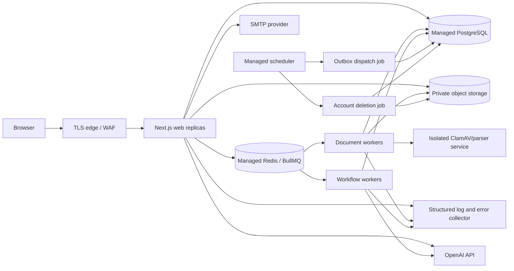

# NEXUS AI deployment, rollback, and recovery guide

**Last reviewed:** 2026-11-08  
**Deployment status:** prepared but not deployed  
**Production approval:** blocked by the outstanding Phase 13 release gates

This guide describes the supported production topology, configuration contract, release sequence, monitoring, backups, rollback, and recovery. It deliberately contains no credential values. `deploy/env.production.template` contains names and obvious secret-manager placeholders only.

No production account or deployed URL was supplied during Phase 14. The local build, configuration parser, migration history, client-bundle secret scanner, test stack, and smoke-test tool were verified; managed services and a remote deployment still require operator credentials and approval.

## 1. Supported topology

Use Vercel or the `web` container target for the Next.js application. Long-lived document and workflow workers must run on a container/service platform that supports durable processes and graceful shutdown. Do not run them inside request-scoped serverless functions.



Every process in one release must use the same immutable source revision and image. The process inventory and commands are in `deploy/processes.json`.

## 2. Release blockers

Do not accept production users or documents until all of these are closed and recorded:

1. Enforced Content Security Policy without broad production `unsafe-inline` or `unsafe-eval` exceptions.
2. Untrusted PDF/DOCX extraction in a hardened, unprivileged, resource-limited, no-egress sandbox.
3. A complete independent security scan or penetration test; the Phase 13 deep scan failed before reviewing a file.
4. Staging evidence for PostgreSQL, private storage, Redis, ClamAV, SMTP, OpenAI, error reporting, and proxy behavior.
5. Successful backup/restore, rollback, failover, worker-crash, queue-outage, and incident-response drills.
6. Security, privacy/legal, accessibility, SRE/on-call, and launch-owner approval.

The remote smoke tool intentionally fails an HTTPS deployment without an enforced CSP.

## 3. Artifact and process configuration

The root `Dockerfile` provides three targets:

| Target | Purpose | Default command |
| --- | --- | --- |
| `web` | Minimal Next.js standalone runtime, non-root user | `node server.js` |
| `worker` | Shared non-root worker/job image with production dependencies | `npm run worker:documents` |
| `migrate` | One-shot release image containing Prisma CLI and migrations | `npm run db:deploy` |

Build once with a non-secret release identifier:

```bash
docker build --target web \
  --build-arg RELEASE_VERSION="$RELEASE_VERSION" \
  --tag registry.example/nexus-web:"$RELEASE_VERSION" .

docker build --target worker \
  --build-arg RELEASE_VERSION="$RELEASE_VERSION" \
  --tag registry.example/nexus-worker:"$RELEASE_VERSION" .

docker build --target migrate \
  --build-arg RELEASE_VERSION="$RELEASE_VERSION" \
  --tag registry.example/nexus-migrate:"$RELEASE_VERSION" .
```

`RELEASE_VERSION` is public build metadata, not a secret. Do not pass database URLs, API keys, auth secrets, tokens, or SMTP passwords as Docker build arguments. Inject secrets only when the container starts. The build runs the public client-bundle secret scanner before producing the web image.

The application emits base-domain HSTS with a two-year maximum age. Add `includeSubDomains` only at the TLS edge after every current and future subdomain is confirmed HTTPS-only. HSTS preload is a separate, effectively irreversible operational decision and is not enabled by this repository.

The Next.js standalone artifact is promotable: build it once, scan and sign it, then promote the same digest through staging and production. Rebuilding the same revision independently can create different Next.js Server Function encryption keys and build IDs; immutable image promotion avoids that version-skew problem. If an encryption-key override is ever required, supply `NEXT_SERVER_ACTIONS_ENCRYPTION_KEY` through a reviewed build-secret mechanism, never a Docker `ARG` or committed file.

### Vercel web option

Vercel may build the Next.js web surface directly. Configure the same build metadata and runtime variables in project settings, keep preview/staging/production resources separate, and run migrations as a protected release job before traffic moves. Deploy the worker image on a long-lived runtime. Do not configure production secrets for untrusted fork previews.

## 4. Environment and secret management

Copy variable names from `deploy/env.production.template` into the platform secret/config manager. Do not copy resolved values into `.env`, Dockerfiles, CI YAML, tickets, chat, or build logs.

Run startup validation inside the release environment:

```bash
npm run deploy:validate
```

Validation fails closed for missing production credentials, insecure origins or transports, mock AI, local storage/queue adapters, a structural-only scanner, absent release identity, absent monitoring/error reporting, public secret-like variable names, and inconsistent deployment identifiers. Output contains only safe configuration metadata.

### Secret classification

| Variable | Storage and access |
| --- | --- |
| `DATABASE_URL` | Secret manager; web and workers only; pooled TLS endpoint |
| `DIRECT_URL` | Secret manager; migration job only; direct TLS endpoint |
| `BETTER_AUTH_SECRET` | Secret manager; web only; high entropy; rotation is a controlled session event |
| `GOOGLE_CLIENT_SECRET` | Secret manager; web only; configure with the matching Google client ID |
| `APPLE_PRIVATE_KEY` | Secret manager; web only; multiline `.p8` signing key used to generate Apple client-secret JWTs |
| `OPENAI_API_KEY` | Secret manager; web/workflow workers only; restricted project and budget |
| `REDIS_URL` | Secret manager; web and workers; `rediss:` only |
| `SMTP_PASSWORD` | Secret manager; outbox/web process only |
| `S3_ACCESS_KEY_ID`, `S3_SECRET_ACCESS_KEY` | Prefer workload identity; otherwise secret manager and web/document/deletion processes only |
| `MONITORING_TOKEN` | Secret manager; monitoring probe only |
| `ERROR_REPORTING_TOKEN` | Secret manager; server processes only |

There are intentionally no `NEXT_PUBLIC_*` variables. Next.js inlines such values into browser JavaScript at build time; never add a secret or credential under that prefix.

Rotation procedure:

1. Create a replacement credential with the same or narrower permissions.
2. Add it to staging and validate the affected adapter.
3. Deploy the replacement to production without deleting the old credential.
4. Verify health, logs, and a bounded functional journey.
5. Revoke the old credential and verify again.
6. Record the rotation, owner, time, and affected release without recording the value.

Rotating `BETTER_AUTH_SECRET` may invalidate existing sessions and must be communicated and tested. NEXUS currently discards provider bearer and ID tokens before persistence. Rotate Google credentials through both provider and runtime configuration. Rotate an Apple key by overlapping a new Key ID/private key, validating sign-in, and then revoking the old key. Storage or database rotation must not interrupt active workers midway through a job.

Register exact OAuth return URLs before enabling a provider:

- Google: `https://your-domain.example/api/auth/callback/google` (localhost HTTP is allowed only for Google's local testing).
- Apple: `https://your-domain.example/api/auth/callback/apple`; Apple requires a registered HTTPS domain and does not accept localhost.

Run a real provider sign-in and sign-out journey in staging after each credential, callback, domain, or `APP_BASE_URL` change.

## 5. Managed PostgreSQL

Provision a dedicated production PostgreSQL database in the approved region with:

- TLS certificate validation, encryption at rest, private networking or strict source allowlists;
- automated backups and point-in-time recovery;
- multi-zone availability where the approved RTO requires it;
- provider metrics for connections, CPU, memory, storage, locks, replication lag, and slow queries;
- a pooled application endpoint and, when required by the provider, a direct migration endpoint;
- separate database roles for runtime and migration where practical;
- connection limits sized for the sum of web and worker replicas;
- no shared database with preview, staging, analytics, or developer machines.

Use `DATABASE_URL` for application traffic and `DIRECT_URL` for Prisma commands. Both require `sslmode=require`, `verify-ca`, or preferably `verify-full`. The migration job receives both; normal web and worker processes should not receive `DIRECT_URL`.

### Migration release sequence

1. Confirm the new migration is additive/backward-compatible with the currently running application.
2. Verify CI applied the entire history to an empty PostgreSQL database.
3. Create or confirm a restorable managed snapshot/PITR point and record its identifier.
4. Stop if replication, storage, connection, or backup health is degraded.
5. Run exactly one protected migration job using the immutable release image:

   ```bash
   npm run deploy:validate
   npm run db:status
   npm run db:deploy
   npm run db:status
   ```

6. Deploy canary web and worker replicas.
7. Run smoke tests and approved critical journeys before shifting all traffic.

Never run `prisma migrate dev` or `prisma migrate reset` against retained data. Never edit an applied migration. A faulty schema change is repaired with a reviewed forward migration.

## 6. Private document storage

Use one production-only bucket with:

- all public access blocked and no public bucket/object ACLs;
- TLS-only access, encryption at rest with an approved managed or customer key;
- versioning or the provider's equivalent recovery feature;
- lifecycle cleanup aligned with quarantine, recovery, and deletion requirements;
- access logs that omit signed URLs and are restricted to security operators;
- CORS limited to the exact production origin, `PUT`/required headers, and no credential wildcard;
- object-store audit events for policy and deletion changes;
- workload identity with only bucket metadata plus required object read/write/delete permissions.

`S3_ENDPOINT` and static credentials may be omitted for AWS-compatible workload identity. A custom endpoint must be HTTPS. The runtime dependency monitor performs a bucket metadata check; grant creation and all object access remain server-authorized.

Before launch, prove that anonymous GET/list, changed object keys, altered methods/content headers, expired grants, cross-origin requests, and cross-environment identities fail.

## 7. Redis, workers, scanner, and schedulers

Use a managed Redis endpoint with TLS/authentication, private networking, durable persistence appropriate for BullMQ, `noeviction`, memory/connection alarms, and a production-specific `QUEUE_NAMESPACE`.

Deploy at least one document worker and one workflow worker. Configure graceful termination long enough to stop fetching jobs and close active work. Scale only after queue and database connection limits are measured. Alert on waiting age, failed jobs, stalled jobs, retry exhaustion, and zero healthy worker replicas.

ClamAV/parser infrastructure must be private, updated, monitored, and fail closed. Reachability alone is not proof of safe scanning. Document extraction must be moved into the required sandbox before production files are accepted.

Run outbox dispatch at least once per minute and account-deletion processing at least daily using provider-managed schedules or identity. Do not expose unauthenticated cron HTTP endpoints.

## 8. OpenAI, mail, and external providers

Create a dedicated production OpenAI project/key with approved models, budget/rate alerts, operator-only access, and accepted retention/residency terms. Configure `AI_PROVIDER=openai`; the environment validator rejects the mock provider in deployment. A provider outage must remain an explicit failed request and must never fall back to a simulated success.

Use a verified transactional-mail sender and production-only SMTP credential. Validate SPF, DKIM, DMARC, bounces, suppression handling, and password-reset/verification links at the canonical HTTPS origin.

## 9. Logging, monitoring, and error reporting

Server logs are structured JSON written to stdout/stderr for platform collection. Each record contains timestamp, level, event, service, release, environment, and sanitized fields. Fields matching password, secret, token, authorization, cookie, credential, connection URL, or API/access-key names are replaced with `[REDACTED]`. Error objects emit name/digest only—never message or stack—to avoid leaking provider diagnostics, prompts, signed URLs, or credentials.

Next.js `onRequestError` sends a sanitized envelope to `ERROR_REPORTING_ENDPOINT` using the server-only bearer token. The payload includes service, release, environment, error name/digest, route template/type, router kind, and method. It excludes URL query strings, request headers, request/response bodies, user content, and stack traces. Delivery has a bounded timeout and cannot fail the user request.

Health endpoints:

| Endpoint | Exposure | Meaning |
| --- | --- | --- |
| `/api/v1/health/live` | Load balancer | Process can answer HTTP; never checks dependencies |
| `/api/v1/health/ready` | Load balancer | PostgreSQL accepts a bounded query |
| `/api/v1/health/dependencies` | Monitoring only, bearer protected | Database, Redis, private storage, and scanner reachability |

Unauthorized dependency probes return `404`. Health responses are never cached and reveal no hostnames, credentials, bucket names, or exception details.

Create alerts for:

- external HTTPS availability and latency;
- readiness failures and dependency-monitor `503` responses;
- HTTP 5xx rate, auth abuse/lockouts, and error-report delivery failure;
- PostgreSQL saturation, locks, storage, lag, and backup failure;
- Redis memory/connections and queue wait/failure/stall rates;
- zero worker replicas or repeated worker restarts;
- object-storage denial/error rate and lifecycle/policy changes;
- ClamAV availability/signature age and quarantine spikes;
- OpenAI timeouts/errors, quota exhaustion, and unusual token/cost changes;
- SMTP/outbox retry age and undelivered verification/recovery messages.

Every production alert needs a severity, owner, paging destination, runbook URL, and tested acknowledgement path. Do not put prompts, messages, document names/content, email addresses, signed URLs, session IDs, or credentials into metric labels.

## 10. Backups and restore

### PostgreSQL

Enable managed continuous/PITR backups and daily retained snapshots before deployment. Define approved RPO/RTO values with the service owner; do not infer them from the provider default. Restrict restore permissions, enable deletion protection and MFA, and alert on backup failure or retention changes.

At least quarterly and before the first production launch:

1. Restore the selected backup into a new isolated database—not over production.
2. Apply a network policy that permits only the restore-drill runner.
3. Run migration status, integrity queries, tenant-isolation checks, and bounded user journeys.
4. Measure achieved RPO/RTO and compare with the approved target.
5. Destroy the isolated restore after evidence is retained without customer content.

### Object storage

Enable versioning/recovery and lifecycle rules, and protect bucket-policy/encryption changes. Database snapshots and object versions must have compatible recovery points; otherwise restored metadata may reference missing or newer objects. Test recovery using an isolated bucket and never make restored quarantine objects public.

### Redis and queues

Redis is coordination/queue state, not the system of record. Enable the persistence supported by the selected service, but recovery also relies on idempotent jobs and the PostgreSQL outbox. Test Redis loss/recreation, outbox replay, duplicate delivery, and stalled-job reconciliation.

### Secret/configuration recovery

Back up secret-manager configuration, IAM/policy definitions, DNS, deployment manifests, alert rules, and runbooks through approved encrypted provider facilities or infrastructure-as-code. Never export plaintext secrets into repository backups.

## 11. Deployment and verification

Recommended staged release:

1. CI runs frozen install, repository-secret scan, format, lint, typecheck, unit tests, production build, client-bundle scan, fresh-database migrations, Playwright journeys, and dependency audit.
2. Build, scan, sign, and publish immutable web/worker/migration images.
3. Validate staging environment and run the migration job.
4. Deploy staging web, workers, schedules, logging, and monitors.
5. Run the remote smoke tool:

   ```bash
   DEPLOYMENT_SMOKE_BASE_URL=https://staging.nexus.example \
   MONITORING_TOKEN="$(read-from-secret-manager)" \
   npm run deploy:smoke
   ```

6. Exercise registration, verification, login/logout, password recovery, workspace isolation, chat/provider failure, private upload/scan/search/download, quotas, workflow cancellation, notifications, settings, and administration denial/allow paths.
7. Promote the same image digests to a production canary, migrate once, and repeat smoke/critical journeys.
8. Shift traffic gradually while watching errors, latency, database, queues, storage, provider, and cost.
9. Record release, migration, image digests, backup point, evidence links, approvers, and rollback owner.

The smoke tool prints status metadata only. It never prints a monitoring token, response body, signed URL, or environment secret.

## 12. Rollback

Define a rollback owner before starting a release. Trigger rollback for sustained SLO breach, authentication/session regression, tenant isolation concern, corrupt writes, migration failure, queue runaway, document privacy failure, or inability to observe the system.

### Application-only rollback

1. Stop traffic increase and disable the affected feature if a safe server-side flag exists.
2. Keep the current database snapshot/PITR point and logs.
3. Restore the previous signed web and worker image digests; do not rebuild them.
4. Ensure the previous application is compatible with every migration already applied.
5. Run smoke and critical authorization journeys.
6. Drain/inspect incompatible queued work before resuming workers.

### Migration failure

- If `prisma migrate deploy` fails, do not send new traffic. Preserve output without credentials, inspect migration state, and use `prisma migrate resolve` only after a reviewed database-specific recovery decision.
- If an additive migration succeeded but application deployment failed, roll application code back and leave the migration in place.
- If a migration produced incorrect data/schema, create a reviewed corrective forward migration. Do not edit the applied migration or run `migrate reset`.
- Restore production from backup only when forward correction cannot meet integrity/RTO requirements and the incident commander explicitly approves the data-loss window.

### Provider/config rollback

Restore the last known-good configuration version from the secret/config manager, then redeploy/restart only affected processes. Keep both old and new credentials active during controlled rotation when the provider supports it. Never paste a previous secret into CI or source.

## 13. Incident recovery runbooks

### Database unavailable or corrupted

Freeze writes/traffic, capture provider state, declare an incident, identify the last verified recovery point, restore into isolation, run integrity/tenant checks, calculate the actual data-loss window, and obtain incident-commander approval before DNS/connection cutover.

### Object storage exposure

Block public access at the account/bucket boundary, revoke affected identities and signed grants, preserve audit logs, determine object scope, rotate credentials, verify every policy/CORS/encryption setting, and follow the breach/notification process before resuming uploads.

### Compromised OpenAI/storage/mail credential

Revoke the credential at the provider, create a scoped replacement, deploy it through the secret manager, search sanitized audit/provider logs for misuse, and review downstream data exposure. Do not include the credential in incident tickets or chat.

### Queue or worker outage

Pause producers if backlog threatens retention/SLOs, restore Redis/workers, inspect failed/stalled jobs, replay only through idempotent outbox/job paths, and watch database/provider load during recovery.

### Bad release

Stop rollout, preserve evidence, restore previous image digests, verify migration compatibility, smoke test, and reopen traffic gradually. A post-incident review must assign the missing test/control rather than treating rollback as completion.

## 14. Final production sign-off

Production is approved only when the release checklist contains:

- immutable source revision and image digests;
- successful CI, migration, staging, smoke, and critical-journey evidence;
- closed or explicitly accepted security findings and Phase 13 blockers;
- managed backup policy plus completed restore drill with measured RPO/RTO;
- live logs, error collector, dashboards, paging, and tested contacts;
- privacy/provider, accessibility, security, support, and operations approval;
- rollback owner, prior image digests, recovery point, and incident channel.

Until a real staging/production URL and approved service credentials are supplied, Phase 14 can validate deployment tooling but cannot truthfully claim that NEXUS AI has been deployed or remotely verified.
