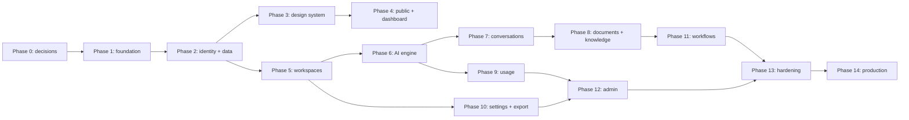

# NEXUS AI Development Roadmap

**Status:** Phase 8 document-intelligence scope implemented; knowledge curation, credentialed OpenAI staging acceptance, and broader deletion/production gates remain open · **Last reviewed:** 2026-11-08

**Current phase:** Phases 1–7 and the requested Phase 8 document-intelligence scope are implemented. Private PDF/DOCX/TXT upload, asynchronous extraction, PostgreSQL FTS retrieval, summaries, and cited document Q&A are delivered; the broader Phase 8 knowledge collection/tag/item scope remains deferred. Governed account deletion, credentialed OpenAI staging acceptance, provider commercial/privacy approval, and production hardening remain explicit gates.

## 1. Roadmap intent

This roadmap converts the product brief into small, verifiable milestones. Each phase must leave the repository in a working state, include relevant automated checks, and disclose limitations. A phase is not complete because files exist; its exit criteria must be demonstrated.

The sequence favors identity, ownership, authorization, usage accounting, and operational foundations before high-risk AI and document features. Work may be prototyped behind non-production flags, but a later phase must not silently bypass an earlier security boundary.

## 2. Phase 0 repository assessment (historical baseline)

Assessment performed on 2026-11-07:

| Area | Finding | Consequence |
|---|---|---|
| Git | Repository exists; no commits or remote; initial branch is `master` | Establish branch/remote conventions and create an auditable baseline in Phase 1 |
| Application | No source files or generated project | Safe greenfield initialization; no legacy behavior to preserve |
| Package management | No `package.json`, lockfile, Node policy, or dependency inventory | Select Node/package-manager policy before scaffolding and commit one lockfile |
| Framework | No Next.js/React/TypeScript configuration | Initialize from current official stable tooling only after approval |
| Database | No Prisma schema, migration history, or PostgreSQL connection | Provision isolated development/test databases before Phase 2 |
| Authentication | No Better Auth integration or email provider | Decide cookie/domain topology and transactional email provider before auth implementation |
| UI | No CSS, assets, tokens, or components | Design system begins in Phase 3 after the authenticated skeleton is defined |
| Quality | No lint, format, unit, integration, E2E, or CI configuration | Establish the smallest reliable quality gate during Phase 1 |
| Operations | No environments, hosting, monitoring, backups, or runbooks | Treat deployment topology, preview isolation, and observability as architectural work |
| Documentation | No project documentation before Phase 0 | The six Phase 0 documents become the planning baseline |

There are no current configuration defects because there is no configuration. The material risks are missing decisions, unbounded scope, and choosing incompatible service/runtime assumptions during initialization.

## 3. Recommended delivery architecture

Use a TypeScript modular monolith in one Next.js App Router repository:

- React Server Components by default; Client Components only for interactive islands.
- Route Handlers as the HTTP boundary, with request validation and thin orchestration.
- Feature/application services own use cases and authorization-aware operations.
- Prisma repositories/data access remain server-only and use PostgreSQL as the system of record.
- Better Auth owns identity/session protocols; NEXUS owns workspace membership and platform authorization.
- A provider-neutral AI interface wraps the Vercel AI SDK; OpenAI is the first adapter.
- Private S3-compatible storage contains original documents; PostgreSQL stores metadata, extracted/chunked text, and search indexes.
- A distributed coordination store is available before multi-instance AI/chat for shared rate limits and cancellation; a separate worker deployment and Redis-backed queue handle resource-intensive document/workflow jobs when those phases begin.
- A transactional outbox plus a lightweight durable dispatcher/scheduler is the boundary for database state changes that must reliably trigger mail or lifecycle work from Phase 2 onward.

See `SYSTEM_ARCHITECTURE.md`, `DATABASE_DESIGN.md`, `API_SPECIFICATION.md`, and `SECURITY_REQUIREMENTS.md` for the authoritative details and unresolved choices.

## 4. Delivery rules for every phase

Before marking any phase complete:

1. confirm scope and acceptance criteria;
2. update or add an architecture decision for material choices;
3. implement through domain/service boundaries, not page-local shortcuts;
4. validate untrusted inputs and enforce authorization on the server;
5. include loading, success, empty, and error states for user-facing work;
6. run format, lint, strict type checking, relevant unit/integration/E2E tests, and a production build;
7. review generated dependency and migration changes;
8. test at least one failure path and one unauthorized path;
9. update documentation and environment examples;
10. report what works, what does not, remaining risks, and the proposed next phase;
11. obtain approval before starting the next phase when the agreed workflow requires it.

Security-critical authorization behavior must have integration tests; visual confirmation alone is insufficient.

## 5. Milestones

### Phase 0 — Repository inspection and technical planning

**Objective:** establish an evidence-based architecture without application implementation.

Deliverables:

- repository and dependency assessment;
- `PRODUCT_SPECIFICATION.md`;
- `SYSTEM_ARCHITECTURE.md`;
- `DATABASE_DESIGN.md`;
- `API_SPECIFICATION.md`;
- `SECURITY_REQUIREMENTS.md`;
- `DEVELOPMENT_ROADMAP.md`;
- explicit technical risks, service dependencies, environment contract, and first Phase 1 tasks.

Exit criteria:

- all six documents exist and agree on resource ownership, roles, service boundaries, and phases;
- unresolved decisions have owners and deadlines;
- no application code, dependency installation, or service provisioning has been performed;
- the product owner approves or revises the Phase 1 proposal.

### Phase 1 — Project initialization and configuration

**Objective:** create a minimal, reproducible Next.js foundation without pretending product features exist.

Planned work:

- resolve the decisions listed in Section 10 that block initialization;
- confirm current stable and mutually compatible Node.js, Next.js, React, TypeScript, Prisma, testing, and linting versions from official sources at implementation time;
- initialize Next.js App Router with `src/`, strict TypeScript, CSS Modules, and import aliases; do not add Tailwind;
- choose and pin one package manager through its lockfile and `packageManager` metadata;
- establish `dev`, `build`, `start`, `lint`, `typecheck`, `test`, and E2E command conventions;
- add environment validation with server/client separation and a secret-free `.env.example`;
- add baseline secure headers, error boundaries, not-found behavior, and structured server logging;
- create the agreed folder skeleton, README, contribution notes, and architecture decision log;
- configure Vitest and Playwright with one honest smoke test each;
- configure CI for install, lint, typecheck, unit tests, and production build;
- decide whether to rename `master` to `main` and configure the remote only with owner approval/details.

Exit criteria:

- a clean checkout installs reproducibly using the documented supported Node version;
- lint, strict typecheck, unit smoke test, production build, and Playwright smoke test pass;
- no secret appears in Git or a client bundle;
- the initial route renders a truthful foundation page with accessible error/loading handling;
- CI performs the same baseline checks;
- the repository contains no unapproved product-feature placeholders.

### Phase 2 — Database and authentication

**Objective:** establish durable identity, personal workspace ownership, sessions, and authorization primitives.

Planned work:

- provision separate local/development/test PostgreSQL databases and define migration workflow;
- implement the reviewed Prisma schema subset for Better Auth compatibility, users, workspaces, memberships, invitations, audit events, and outbox records;
- integrate Better Auth using its official Next.js/Prisma guidance current at implementation time;
- implement registration, verification, sign-in/out, password recovery, session listing/revocation, profile basics, and account-deletion workflow;
- provision the default personal workspace and sole Owner membership idempotently after successful email verification and before first product access; use one transaction where the auth hook supports it, otherwise a durable state machine that blocks access until completion;
- add server-only authentication and workspace authorization helpers;
- integrate transactional email with non-delivery-safe UX and development capture tooling;
- operate a lightweight durable database-outbox dispatcher/scheduler for email, account lifecycle, and retryable Phase 2 work; heavy Redis job transport is not required yet;
- create audit events for security-relevant actions;
- test authentication, CSRF/origin behavior, session lifecycle, role enforcement, and cross-workspace denial.

Exit criteria:

- migrations apply to an empty database and the documented rollback/forward-recovery procedure is tested;
- all protected pages/APIs deny unauthenticated access server-side;
- integration tests prove a user cannot access another user's workspace;
- secrets and session tokens do not appear in logs or client output;
- deletion and sole-Owner behavior match an approved retention policy.

### Phase 3 — Design system and reusable UI

**Objective:** establish the visual/accessibility vocabulary before building feature pages.

Planned work:

- CSS custom-property tokens for color, type, spacing, radius, borders, elevation, motion, and responsive behavior;
- server-friendly primitives for buttons, links, forms, dialogs, menus, tabs, toasts/status, cards, tables, pagination, skeletons, and empty/error states;
- application shell, collapsible navigation, workspace switcher, account menu, and mobile patterns;
- Lucide icon wrapper with accessible defaults;
- component examples and automated accessibility/unit coverage for high-risk primitives;
- light/dark strategy decision (dark-only is acceptable initially if contrast is verified).

Exit criteria:

- key primitives meet the agreed WCAG 2.2 AA checks, keyboard behavior, focus management, and reduced-motion behavior;
- layout is usable at defined small, medium, and large viewport checks;
- design review confirms NEXUS identity and avoids generic placeholder-dashboard styling.

### Phase 4 — Landing page and dashboard

**Objective:** ship a polished public explanation and an authenticated home that uses real persisted data.

Planned work:

- public routes, metadata, navigation, responsive content, and truthful pricing/availability;
- authenticated dashboard queries for recent resources, usage summary, and activity;
- quick actions connected to real enabled routes only;
- SEO/social assets and accessibility/performance review.

Exit criteria:

- public and dashboard E2E journeys pass;
- dashboard never crosses active-workspace scope;
- empty/loading/error states are validated with real query behavior.

### Phase 5 — Workspace management

**Objective:** complete workspace lifecycle and membership administration.

Planned work:

- create, view, rename, switch, recoverable delete/authorized restore, and non-Owner self-leave flows;
- invitation creation, acceptance, expiry, cancellation, and abuse-safe resend;
- Owner/Admin/Member permission matrix and ownership transfer, enforcing that `Workspace.ownerUserId` always equals the sole `OWNER` membership;
- workspace membership and security audit records;
- transaction and concurrency tests for membership changes and team-workspace restore-versus-purge races.

Exit criteria:

- API and UI tests cover every role transition and cross-workspace denial;
- concurrent membership changes can produce neither zero nor multiple Owners, and the owner pointer always matches the sole `OWNER` membership;
- invitation enumeration, replay, and privilege-escalation cases are covered.

### Phase 6 — AI provider integration and chat engine

**Objective:** introduce one real, observable OpenAI-backed streaming path behind an application provider contract.

**Implementation note (2026-11-08):** Complete in application code. The OpenAI adapter uses Vercel AI SDK behind a stable provider port; the local/test mock is explicit and cannot run in deployed environments. PostgreSQL atomic buckets and durable cancellation polling provide distributed correctness without an in-memory dependency. A managed Redis cutover remains an approved scale/operations option, not a prerequisite for local/test correctness. Credentialed OpenAI contract testing still requires a protected staging secret and is not performed in normal CI.

Planned work:

- approved model catalog and provider capability interface;
- Vercel AI SDK/OpenAI adapter kept server-only;
- streaming route, cancellation propagation, timeouts, safe error mapping, correlation IDs, and rate/quota checks;
- distributed Redis-backed rate-limit and cancellation coordination before any multi-instance or public deployment, with no in-memory-only correctness dependency;
- atomic conversation/message attempt state transitions and usage recording;
- prompt policy boundaries and provider outage handling;
- tests with a deterministic fake adapter plus limited provider-contract tests outside normal CI.

Exit criteria:

- real configured requests stream and persist without exposing credentials;
- aborted, timed-out, rate-limited, and provider-failed attempts reach honest terminal states;
- token/cost accounting reconciles provider metadata according to the approved policy.

### Phase 7 — Conversation management

**Objective:** make chat history durable, navigable, and safely rendered.

**Implementation note (2026-11-08):** Complete. Conversation and latest-message history are cursor-paged and workspace scoped; title/message full-text search uses PostgreSQL GIN indexes; creator/Admin ETag-protected rename, archive/reactivate, recoverable delete, and restore are enforced server-side. The responsive history/studio surfaces render canonical timestamps and database records across refreshes, with loading, empty, archived, and recoverable error states. Integration coverage proves ownership, tenant isolation, search, ordering, lifecycle, and refresh persistence.

Planned work:

- history pagination, rename, archive/recoverable delete/authorized restore, full-text search, and workspace filtering;
- regeneration attempt/branch behavior and message status UI;
- sanitized Markdown, code highlighting, copy interactions, and long-content performance;
- model selection limited to the server-published catalog.

Exit criteria:

- persistence, ordering, search, delete/restore race, regenerate, and cross-user authorization tests pass;
- malicious Markdown/HTML and oversized content test cases do not execute active content or break the shell.

### Phase 8 — Document and knowledge intelligence

**Objective:** ingest supported private documents safely, organize durable workspace knowledge, and provide traceable, grounded assistance.

**Implementation note (2026-11-08):** The requested document-intelligence subset is complete. The application now uses quota-reserved direct private uploads, SHA-256 and object metadata verification, Redis/BullMQ processing with a transactional outbox, ClamAV production scanning, bounded PDF/DOCX/TXT extraction, immutable chunks, PostgreSQL FTS behind a pgvector-ready retriever, extractive summaries, and persisted citation-backed Q&A. Responsive upload/progress/status/detail surfaces and malformed-file/cross-workspace integration tests are included. Knowledge collection, tag, and item CRUD; restoration/reprocessing UI; permanent object purge; and OCR remain deferred rather than simulated.

Planned work:

- direct/private object upload flow, validation/quarantine, checksums, recoverable deletion/restoration, and object lifecycle;
- Redis-backed queue and isolated worker with idempotent processing stages;
- bounded PDF/DOCX/TXT extraction, normalized text, chunking, search indexing, and failure states;
- summaries and grounded Q&A using authorized retrieval and source locators;
- knowledge collection, tag, and item CRUD with provenance, tenant-scoped PostgreSQL full-text search, deterministic pagination, and authorized retrieval;
- prompt-injection separation between system instructions and untrusted retrieved data;
- storage, parsing, knowledge CRUD/search/provenance, retrieval, document/knowledge-item deletion-restoration and purge-race, irreversible collection/tag deletion, and access-control tests using adversarial fixtures.

Exit criteria:

- supported fixture corpus processes within agreed limits and unsupported/malicious files fail safely;
- private objects are not publicly listable or fetchable;
- Q&A evidence references only authorized chunks from selected scope;
- knowledge search and AI retrieval return only authorized workspace content and preserve provenance;
- reprocessing and deletion are idempotent and observable.

### Phase 9 — Usage management

**Objective:** make consumption, quotas, and estimated costs accurate and explainable.

**Implementation note (2026-11-08):** The requested usage-management subset is complete. Provider-returned usage now writes an immutable provenance-aware ledger, effective-dated model prices are imported explicitly with no seeded values, and generation performs atomic workspace quota reservation followed by idempotent settlement. The responsive usage surface, daily breakdown, pricing coverage, privacy-scoped record API, ETag-protected Owner/Admin quota configuration, dashboard integration, calculation tests, and concurrent quota/isolation integration coverage are included. Automatic vendor-price synchronization, invoices/payments, platform-admin reconciliation UI, and a scheduled drift-report worker remain deferred rather than simulated.

Planned work:

- versioned model pricing catalog and immutable usage ledger semantics;
- reservation/reconciliation policy for concurrent requests;
- daily/monthly aggregates and user-facing breakdowns using Recharts where a chart adds value;
- admin reconciliation report and quota override audit trail.

Exit criteria:

- calculation tests cover retries, failures, cancellations, missing provider usage, model price changes, and concurrency;
- displayed costs are labeled estimates and reconcile to immutable records within the approved tolerance.

### Phase 10 — Notifications, settings, and export

**Objective:** complete user-visible account controls, portable export, and reliable in-app status communication.

**Implementation status:** notification history, durable activity/document/workflow/security producers, profile/security/password/session/AI/notification settings, and governed account deletion are implemented. Portable data export remains pending.

Planned work:

- notification list/count/read state and links with authorization recheck;
- profile, session/security, and AI preference pages;
- notification creation from durable events rather than fragile request-side effects;
- asynchronous per-workspace `MY_DATA`/Owner workspace-export request, status, private artifact download, expiry, and cleanup flows using the approved portability contract;
- retention and pagination behavior.

Exit criteria:

- read/unread behavior is concurrency-safe;
- stale or unauthorized notification links disclose no protected resource;
- security-setting changes require the agreed re-authentication level and are audited;
- export authorization, tenant scope, expiry, and deletion tests pass without exposing content in logs or public storage.

### Phase 11 — AI workflow engine

**Objective:** execute versioned, constrained AI workflows with complete history.

**Implementation status (2026-11-08):** The controlled first release is implemented with visual graph authoring, four strict node kinds (`INPUT`, `TEMPLATE`, `AI_PROMPT`, `OUTPUT`), immutable versions/digests, explicit publication, recoverable lifecycle, Redis/BullMQ orchestration, durable outbox retry, membership reauthorization, rate/concurrency/step/time/size ceilings, cancellation, redacted logs, audit/notification events, and provider usage links. Unknown/code/network nodes, cycles, expression templates, cross-tenant IDs, and replay conflicts are rejected. Future loop, approval, document-retrieval, side-effecting tool, and egress-broker nodes remain intentionally absent. Production worker crash-reclaim/lease automation and a dedicated restore-versus-purge stress test remain hardening work before broad launch.

Planned work:

- visual editor and typed, allow-listed node definitions;
- draft/published version lifecycle, recoverable workflow deletion/authorized restoration, and graph validation;
- Redis-backed execution orchestration with step, time, size, token, and concurrency budgets;
- idempotent step transitions, cancellation, redacted logs, and usage links;
- SSRF, arbitrary-code, prompt-injection, replay resistance, and workflow restore-versus-purge race tests.

Exit criteria:

- only approved nodes execute; arbitrary code/network destinations are impossible through configuration;
- retries do not duplicate irreversible side effects;
- execution history explains each step without leaking secrets or unrelated content.

### Phase 12 — Administration

**Status:** implemented in Phase 12.

**Objective:** provide least-privilege platform operations without granting implicit access to customer content.

Delivered work:

- separate platform-role authorization;
- mandatory production platform-admin MFA enrollment/recovery, secure bootstrap, audited break-glass access, and prompt revocation;
- user status controls, aggregate usage, audit viewer, and safe platform settings;
- high-risk action confirmation/re-authentication and immutable audit events;
- operational privacy filters and export limits.

Exit criteria:

- ordinary workspace Owners cannot access admin endpoints;
- each privileged mutation is integration-tested and audited;
- every production platform-admin path rejects a session without the required MFA assurance, including bootstrap and recovery edge cases;
- admin views expose only the minimum approved customer data.

### Phase 13 — Testing and security hardening

**Objective:** close cross-cutting release risks and establish measurable release evidence.

**Review status (2026-11-08):** Core local quality gates pass, including 45 unit tests, 17 PostgreSQL-backed browser tests, schema validation, lint, types, and the optimized production build. Phase 13 fixed generic internal error handling, deferred database ownership integrity, per-node workflow reauthorization, shorter document grants, bounded AI context, strict query parsing, deployed transport validation, admin query bounds, and authenticated accessibility coverage. Production approval remains blocked by the absent enforced CSP, unsandboxed document parsers, failed independent deep-scan infrastructure, unverified production services/provider controls, and missing recovery/load/operational drills. The complete evidence and risk register are in `docs/PHASE_13_PRODUCTION_READINESS.md`.

Planned work:

- full authorization matrix and IDOR test suite;
- dependency, secret, static, migration, accessibility, and security-header checks in CI;
- load and failure testing for chat streams, uploads, workers, search, and quota concurrency;
- threat-model review, penetration test or equivalent independent review, and remediation;
- backup restore drill, deletion verification, incident runbooks, and alert tests;
- export completeness, authorization, expiry, and cleanup verification;
- critical E2E journeys across supported browsers.

Exit criteria:

- no open critical/high security finding without explicitly approved risk treatment;
- agreed SLO/load targets and recovery procedures have evidence;
- release checklist, on-call ownership, and rollback plan are approved.

### Phase 14 — Deployment and production monitoring

**Objective:** launch through controlled environments and validate production operation.

**Preparation status (2026-11-08):** Provider-neutral deployment artifacts are implemented: non-root standalone web/worker/migration container targets, strict secret-safe environment validation, pooled/direct PostgreSQL separation, workload-identity object storage, structured redacted logs, sanitized server error reporting, protected dependency monitoring, client-bundle secret scanning, remote smoke tooling, pinned CI, and detailed backup/restore/rollback/recovery procedures. No managed account, credential, DNS name, staging stack, or deployed URL was supplied, so production services and remote journeys are not verified. Phase 14 remains incomplete until the Phase 13 CSP/parser/security-review gates and the staging, restore, failover, monitoring, paging, and sign-off exit criteria have evidence. See `docs/DEPLOYMENT_GUIDE.md`.

Planned work:

- isolated preview/staging/production configuration and data stores;
- Vercel web deployment plus compatible worker runtime;
- migration/release orchestration, canary or staged rollout, rollback, and feature flags;
- dashboards and alerts for availability, latency, provider errors, queues, usage anomalies, storage, and auth abuse;
- post-launch observation and incident review cadence.

Exit criteria:

- smoke tests pass against production configuration without test data leakage;
- monitoring, paging, backup, restore, rollback, and incident contacts are live;
- launch owner signs off on security, legal, support, and operational readiness;
- approved export and deletion journeys pass against production configuration before customer content is accepted.

## 6. External services required

No external service should be provisioned in Phase 0. Candidates are selected and approved before the phase that needs them.

| Capability | Required service/category | Earliest phase | Selection criteria |
|---|---|---:|---|
| Source hosting/CI | Git provider and CI platform (or provider-integrated CI) | 1 | branch protection, secret handling, required checks |
| Web hosting | Vercel | 1/4 | App Router support, preview isolation, regions, limits, logs |
| Relational data | Managed PostgreSQL | 2 | region, Prisma/serverless pooling, backups/PITR, extensions, connection limits |
| Transactional email | Email API + verified sending domain | 2 | deliverability, webhooks, region/privacy, suppression handling |
| AI | OpenAI through a server-side provider adapter | 6 | approved models, rate limits, retention terms, regional/privacy controls |
| Private documents | S3-compatible object storage | 8 | private ACL posture, signed operations, lifecycle, CORS, encryption, malware workflow |
| Distributed coordination | Managed Redis | 6 | TLS, region, eviction policy, atomic limits, cancellation/pub-sub semantics, observability |
| Heavy jobs | Redis-compatible queue and long-lived worker runtime | 8 | durability, leases/reclaim, retries, failed-job operations, worker isolation and scaling |
| Error monitoring | Exception/performance monitoring service | 1 before production | source-map privacy, scrubbing, alerting, retention |
| Product/ops metrics | Privacy-reviewed analytics/metrics platform | 4 before production | data minimization, retention, region, export |
| Malware scanning | Managed scanner or isolated scanning service | 8 | supported formats/size, update cadence, quarantine, false-positive handling |
| DNS/domain | DNS and domain provider | 2/14 | email records, TLS, operational access controls |

Avoid adding Recharts, Redis, upload parsers, or cloud SDKs before the phase that uses them. The Phase 2 database-outbox dispatcher does not require Redis. Phase 6 uses PostgreSQL-backed distributed coordination first; Redis is introduced only when the reviewed load/latency envelope or Phase 8 queue requires it.

## 7. Environment variable contract

Names below are proposed application configuration names. Phase 1 must validate them with the selected libraries and providers; `.env.example` contains names and safe descriptions only, never real values. Every variable is scoped separately for local, test, preview, staging, and production.

| Variable | Exposure | Earliest phase | Purpose/notes |
|---|---|---:|---|
| `APP_ENV` | Server | 1 | Explicit application environment enum; do not rely solely on `NODE_ENV` |
| `APP_BASE_URL` | Server | 1 | Canonical public origin used for absolute links and metadata; clients should prefer relative URLs. In the initial single-domain deployment it must match `BETTER_AUTH_URL` |
| `LOG_LEVEL` | Server | 1 | Allow-listed structured log level |
| `DATABASE_URL` | Secret/server | 2 | Pooled PostgreSQL application connection |
| `DIRECT_URL` | Secret/server | 2 | Optional direct migration connection if the selected provider requires it; matches current Prisma 7 guidance |
| `BETTER_AUTH_SECRET` | Secret/server | 2 | High-entropy current authentication secret; rotation policy required |
| `BETTER_AUTH_SECRETS` | Secret/server | 2 | Optional ordered versioned secrets during a bounded rotation migration; remove retired values after the documented session transition window |
| `BETTER_AUTH_URL` | Server | 2 | Canonical authentication origin; initially the same origin as `APP_BASE_URL`. Any exception requires exact trusted origins and a reviewed cookie/CSRF topology |
| `EMAIL_FROM` | Server | 2 | Verified sender identity; not a credential |
| `EMAIL_PROVIDER_API_KEY` | Secret/server | 2 | Transactional email provider credential; rename to provider-specific name after selection |
| `OPENAI_API_KEY` | Secret/server | 6 | OpenAI server credential; never exposed with `NEXT_PUBLIC_` |
| `AI_DEFAULT_MODEL` | Server | 6 | Must match the server allow-list, not arbitrary client input |
| `AI_ALLOWED_MODELS` | Server | 6 | Validated configuration or move to governed database settings |
| `AI_REQUEST_TIMEOUT_MS` | Server | 6 | Bounded integer configuration |
| `S3_ENDPOINT` | Server | 8 | Omit for AWS default if the chosen SDK permits; validate HTTPS |
| `S3_REGION` | Server | 8 | Storage signing/placement region |
| `S3_BUCKET` | Server | 8 | Environment-specific private bucket |
| `S3_ACCESS_KEY_ID` | Secret/server | 8 | Prefer workload identity where available |
| `S3_SECRET_ACCESS_KEY` | Secret/server | 8 | Prefer workload identity where available |
| `S3_FORCE_PATH_STYLE` | Server | 8 | Optional validated boolean for compatible providers |
| `DOCUMENT_MAX_BYTES` | Server | 8 | Server-enforced upload limit |
| `REDIS_URL` | Secret/server | 6 | TLS Redis connection for distributed rate limits/cancellation, later reused by approved queue transport |
| `REDIS_PREFIX` | Server | 6 | Environment isolation for limiter and cancellation keys; never derived from user input |
| `QUEUE_PREFIX` | Server | 8 | Environment isolation; not user-controlled |
| `WORKER_CONCURRENCY` | Server | 8 | Bounded worker setting based on resource tests |
| `ERROR_MONITOR_DSN` | Server | 1/14 | Server ingestion endpoint if the selected vendor uses one |
| `NEXT_PUBLIC_ERROR_MONITOR_DSN` | Client-safe | 1/14 | Only if explicitly safe and needed; scrub payloads |
| `OTEL_EXPORTER_OTLP_ENDPOINT` | Server | 14 | Optional telemetry endpoint; authentication kept in server-only headers/secret variables |
| `CRON_SECRET` | Secret/server | 2 | Only if authenticated scheduled HTTP triggers are used for outbox/lifecycle dispatch or later operations; prefer platform identity where possible |

Do not create a generic `SECRETS` blob or expose server configuration through client serialization. Startup must fail clearly for missing required variables in the relevant process, while build-time behavior must account for variables intentionally absent during static analysis.

## 8. Quality strategy and phase gates

### 8.1 Test layers

- **Unit:** pure authorization rules, validators, pricing calculations, chunking rules, graph validation, and provider error mapping.
- **Integration:** route/service/database behavior against isolated PostgreSQL; session/CSRF behavior; transactions; ownership and role matrices; queue idempotency.
- **Contract:** AI, storage, email, and queue adapters against fakes in normal CI with controlled live checks separately.
- **End-to-end:** registration/recovery, protected navigation, workspace membership, streaming chat, document processing, settings, and admin denial/allow journeys.
- **Security/adversarial:** IDOR, malformed inputs, malicious Markdown/files, prompt injection, SSRF attempts, quota races, replay, and secret/log leakage.
- **Non-functional:** accessibility, responsive visual review, performance/load, backup restore, and failure injection.

### 8.2 Required checks by default

The target CI sequence is reproducible install, formatting check, lint, strict typecheck, unit tests, integration tests, production build, dependency/security checks, and selected Playwright smoke tests. Full E2E and live integration suites may run in a protected staging pipeline when they require services or secrets.

Coverage percentage is a diagnostic, not the acceptance criterion. Critical authorization branches and financial/usage calculations require explicit cases regardless of aggregate coverage.

## 9. Dependency ordering

This is a risk-oriented sequence, not permission to start dependent work early. Product discovery and interface sketches can run ahead, but production implementation must honor the dependency gates.

## 10. Decisions required before or during Phase 1

| Decision | Recommendation | Deadline |
|---|---|---|
| Node.js policy | Use an active LTS supported by the selected current Next.js release; pin via project metadata/tool file | Before scaffold |
| Package manager | Use `npm` unless the owner prefers pnpm; commit exactly one lockfile | Before scaffold |
| Git default branch/remote | Rename to `main` and add the owner-provided remote; do neither without confirmation | Before CI/branch rules |
| Deployment region | Co-locate web, PostgreSQL, storage, and queues as closely as provider constraints allow | Before service provisioning |
| Environment tiers | Local, test, preview, staging, production with no production data in lower tiers | Phase 1 architecture |
| Monorepo need | Start as one application repository; add worker package/workspace only when async processing begins | Phase 1 |
| Styling | CSS Modules + global CSS variables, as mandated; no Tailwind | Fixed |
| Prisma/Better Auth compatibility | As of this review, Better Auth documents Prisma 7 support and says its Prisma adapter does not yet support Prisma 8. Prefer the latest stable Prisma 7 release supported by Better Auth, record the temporary major-version exception in an ADR, and reassess before Phase 2; alternatives require explicit approval | Before dependency installation |
| API stability | Internal `/api/v1` contract with documented exceptions for framework/library-managed auth endpoints | Phase 1 |
| Observability vendor | Select based on scrubbing, region, cost, and Vercel/worker coverage | Before production data |
| Privacy/retention | Name policy owner and define initial retention/deletion/backup rules | Before Phase 2 exits |
| Service vendors | Use evaluation matrix; do not lock architecture to undocumented vendor behavior | Before each integration phase |

## 11. First implementation tasks after approval

These are the first proposed Phase 1 tasks, in order:

1. record approval and close/assign blocking decisions from Section 10;
2. confirm stable compatible versions and runtime requirements from official Next.js, React, TypeScript, Prisma, Vitest, and Playwright sources;
3. initialize the App Router project in the existing repository with strict TypeScript, `src/`, CSS Modules, and no Tailwind;
4. pin the Node/package-manager policy and commit the generated lockfile;
5. add the architecture-aligned directories without empty ornamental layers;
6. implement typed environment parsing and a secret-free `.env.example`;
7. configure secure baseline headers, error/not-found boundaries, structured logging, and a minimal health signal whose readiness checks only dependencies enabled and required in that deployment;
8. configure lint, format, typecheck, Vitest, Playwright, and production-build scripts;
9. add one unit smoke test, one page E2E smoke test, and CI executing the baseline gate;
10. write setup instructions and an ADR for the initialization choices;
11. run the full Phase 1 gate and report exact results before proposing Phase 2.

Phase 1 must not include database models, Better Auth, fake dashboard metrics, simulated chat, or placeholder document processing. Those belong to approved later phases.

## 12. Principal technical risks

| Risk | Likelihood/impact | Early mitigation |
|---|---|---|
| Scope expands across all modules before foundations stabilize | High / High | Phase gates, explicit exit criteria, no feature placeholders |
| Serverless connection or runtime mismatch with Prisma/jobs/parsers | Medium / High | Choose runtime per route; test pooling; use dedicated workers for heavy jobs |
| Cross-workspace data exposure | Medium / Critical | Workspace-scoped queries, central authorization, adversarial integration tests |
| Better Auth/schema/version incompatibility | Medium / High | Use official integration guidance at implementation time; migration review; avoid copied stale config |
| Streaming lifecycle produces partial/duplicate messages or usage | Medium / High | Explicit attempt states, idempotency, transactional persistence/reconciliation |
| Uploaded documents exhaust resources or carry malicious content | High / High | Direct private upload, signature/size limits, isolation, scanning, bounded extraction |
| Retrieved content manipulates AI behavior | High / High | Treat retrieval as quoted untrusted data, tool allow-lists, output validation, no privileged actions from model text |
| Cost/quotas race under concurrency | Medium / High | Reservation and immutable ledger design, transaction tests, hard provider caps |
| Queue/database dual-write loses or duplicates work | Medium / High | Transactional outbox and idempotent consumers |
| Vercel web runtime cannot host durable workers | High / Medium | Separate worker deployment while retaining one codebase/contracts |
| Provider lock-in | Medium / Medium | Narrow adapters and application-owned model/usage types; avoid lowest-common-denominator UI |
| Logs/telemetry leak content or tokens | Medium / Critical | Structured allow-list logging, scrubbing tests, minimal retention and access |
| Account/workspace deletion conflicts with backups/audit obligations | Medium / High | Approved retention model, tombstones where justified, documented backup expiry |

## 13. Change control

Each phase should result in a short completion report containing:

- delivered requirements and links to relevant files/migrations;
- commands run and their actual results;
- security and authorization cases verified;
- known limitations and deferred work;
- schema/API/architecture decisions added or changed;
- operational or environment changes;
- recommended next milestone and explicit approval request.

Material changes to tenancy, authentication, public API behavior, storage, AI data handling, workflow capabilities, or deletion policy require an architecture/security review and updates to the Phase 0 documents before implementation.

## 14. Version-sensitive references checked in Phase 0

These are planning references, not permission to install their example versions unchanged. Compatibility must be rechecked when the relevant phase begins.

- [Next.js App Router](https://nextjs.org/docs/app) and [Route Handlers](https://nextjs.org/docs/app/getting-started/route-handlers)
- [Better Auth Next.js integration](https://better-auth.com/docs/integrations/next) and [security reference](https://better-auth.com/docs/reference/security)
- [Better Auth Prisma adapter](https://better-auth.com/docs/adapters/prisma) and [native PostgreSQL adapter](https://better-auth.com/docs/adapters/postgresql)
- [Prisma Next.js guide](https://www.prisma.io/docs/guides/v7/frameworks/nextjs) and [connection pooling guidance](https://www.prisma.io/docs/orm/v7/prisma-client/setup-and-configuration/databases-connections/connection-pool)
- [Vercel AI SDK provider abstraction](https://ai-sdk.dev/docs/foundations/providers-and-models) and [`streamText`](https://ai-sdk.dev/docs/reference/ai-sdk-core/stream-text)
- [Vercel Function duration limits](https://vercel.com/docs/functions/configuring-functions/duration)
