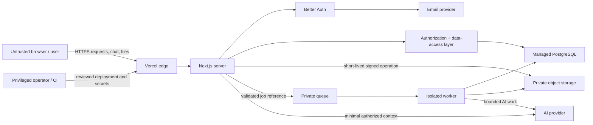

# NEXUS AI Security Requirements

- **Status:** Phase 0 planning baseline — proposed, not implemented
- **Last reviewed:** 2026-11-07
- **Applies to:** NEXUS AI web application, APIs, workers, data stores, object storage, AI integrations, administration, CI/CD, and Vercel deployments
- **Primary stack:** Next.js App Router, React, TypeScript, Better Auth, Prisma, PostgreSQL, Vercel AI SDK, OpenAI, S3-compatible private storage, and managed Redis for distributed coordination and later queueing

## 1. Purpose and security posture

This document is the normative security baseline and repository threat model for NEXUS AI. It translates the product brief and [product specification](./PRODUCT_SPECIFICATION.md) into controls that can be designed, implemented, and tested one milestone at a time.

The repository contained no application source, dependencies, migrations, deployment configuration, or tests when this baseline was written. Every control below is therefore a **requirement**, not evidence of an existing safeguard. Architecture descriptions are based on the approved project brief and current Phase 0 documents, not on running code. A fresh threat-model pass is required when Phase 2 authentication, Phase 5 workspaces, Phase 8 document processing, and Phase 11 workflows are implemented.

The intended verification target is broadly **OWASP ASVS 5.0.0 Level 2**, with additional tenant-isolation, untrusted-document, AI-tool, and workflow controls. ASVS is a verification framework rather than a compliance certificate; NEXUS must maintain a traceable control/test matrix before production launch ([OWASP ASVS 5.0.0](https://asvs.owasp.org/)).

Normative terms have their usual meanings:

- **MUST / MUST NOT** — required for the applicable release gate.
- **SHOULD / SHOULD NOT** — expected unless a documented threat-based exception is approved.
- **MAY** — optional.
- **Launch blocker** — production customer data or public access is prohibited until the item is resolved and verified.

Security controls must fail closed. UI route hiding, opaque identifiers, client-side validation, prompt wording, and provider defaults are never authorization boundaries.

## 2. Intended architecture and trust boundaries

### 2.1 Components and security ownership

| Component | Intended responsibility | Security boundary it owns |
|---|---|---|
| Browser / React UI | User interaction, streamed display, upload transfer | Treat all browser state and submitted values as attacker-controlled; never hold provider or infrastructure secrets |
| Vercel edge and deployment | TLS termination, deployment, firewall and optional WAF controls | HTTPS, deployment separation/protection, coarse abuse controls; not application authorization |
| Next.js application | Route Handlers, Server Actions, server rendering, service layer | Request validation, CSRF/origin checks, session verification, authorization, safe response construction |
| Better Auth | Registration, credential verification, sessions, verification/recovery tokens | Password hashing, session lifecycle, token lifecycle, auth-specific CSRF/origin defenses |
| Authorization/data-access layer | Workspace membership and capability decisions | Tenant isolation and object-level authorization for every data path |
| Prisma + PostgreSQL | Durable relational state and transactions | Constraints, referential integrity, atomic mutations, least-privilege database access; optional RLS defense in depth |
| Private object storage | Original uploads and generated file artifacts | Private-at-rest objects, least-privilege service access, time-limited signed operations, lifecycle deletion |
| Queue and workers | Document extraction/indexing and workflow execution | Job authenticity, idempotency, resource isolation, bounded retries/execution, current authorization/resource checks |
| AI provider abstraction | Model calls, streaming, usage accounting | Provider/model allow-list, data minimization, time/token/cost ceilings, no client credentials |
| Email provider | Verification, recovery, deletion, and security notifications | Correct recipient and link construction, anti-enumeration behavior, delivery security and auditability |
| Platform administration | User, usage, audit, and configuration operations | Separately assigned platform role, strong authentication, least privilege, complete audit trail |
| CI/CD and package ecosystem | Build, test, migration, deployment | Trusted dependencies/actions, protected secrets, reviewed changes, reproducible installs and provenance evidence |

### 2.2 Data flow and trust zones

Each arrow is a trust-boundary crossing. The receiver must authenticate the caller where applicable, validate the complete message, enforce current authorization, impose resource limits, and avoid trusting labels or state supplied by the sender.

### 2.3 Protected assets

1. User identities, password verifiers, verification/recovery tokens, session tokens, and linked-provider credentials.
2. Workspace membership and roles, including the last-owner invariant and the separate platform-admin role.
3. Private conversations, messages, documents, extracted text, chunks, knowledge, workflow definitions, executions, logs, notifications, and usage records.
4. Object-store keys and signed URLs, database/queue/storage credentials, Better Auth secrets, email credentials, and AI provider keys.
5. AI instructions, provider/model configuration, usage quotas, and the integrity of tool/workflow decisions.
6. Audit evidence, deletion/export state, retention guarantees, backups, and the ability to investigate incidents.
7. Service availability and bounded spend across AI, storage, email, database, and worker resources.
8. Source, dependencies, build workflows, migrations, and deployed artifacts.

### 2.4 Actors and realistic attacker capabilities

| Actor | Starting capability | Capability they must not gain |
|---|---|---|
| Anonymous internet user | Public pages and auth endpoints; arbitrary requests and headers | Account enumeration, credential guessing at scale, session creation for another identity, private data access, unbounded resource spend |
| Authenticated Member | Their sessions and authorized workspace resources; arbitrary IDs, prompts, files, and workflow inputs | Access to another workspace, role escalation, owner/admin actions, platform administration, arbitrary execution |
| Workspace Admin | Broad content and ordinary Member management | Admin/Owner role management, ownership transfer/deletion, platform admin, cross-workspace access |
| Workspace Owner | Full authority inside owned workspace | Other workspaces, platform administration unless separately assigned |
| Malicious document/content author | Bytes and instructions embedded in PDF/DOCX/TXT or retrieved content | Parser escape, code execution, cross-tenant retrieval, tool invocation, secret exfiltration, authority over system instructions |
| Compromised browser/session | Whatever the stolen session currently authorizes | Long-lived persistence after revocation, hidden privilege expansion, secrets not otherwise exposed to that session |
| Platform administrator | Explicitly granted operational capabilities | Undocumented or unaudited customer-content access, credentials beyond operational need, silent impersonation |
| Compromised dependency/build action | Code execution in the affected build context | Production secrets, unsigned/unreviewed deployment, durable repository compromise |
| External provider | Data deliberately sent under contract and configuration | Unnecessary customer content, unrelated tenant data, infrastructure credentials |

Compromise of the production application or database superuser is not treated as harmless, but controls such as encryption at rest do not claim to isolate data from an already-authorized application process. Backups, provider consoles, and operator access require independent least-privilege and audit controls.

## 3. Security invariants

The following properties must remain true across UI pages, Route Handlers, Server Actions, streaming endpoints, search, exports, signed URLs, background jobs, AI tools, and administrative paths:

1. A principal can access a workspace resource only while a current database membership and action-specific policy allow it.
2. The active workspace stored in the browser is a navigation preference, never proof of membership.
3. Every workspace-owned row and object has an unambiguous, immutable tenant association. Child resources cannot be attached across workspaces.
4. Platform administration is not implied by workspace ownership or by a client-provided role.
5. Authentication and authorization are checked at the sensitive operation and data source, not only in layouts, middleware/proxy, or client components. This follows the Next.js recommendation to centralize secure checks near data access ([Next.js authentication guide](https://nextjs.org/docs/app/guides/authentication)).
6. All state-changing requests are authenticated, authorized, validated, CSRF-protected where cookies are used, and auditable when security-relevant.
7. User uploads, extracted text, knowledge, chat content, Markdown, model output, queue messages, and provider responses are untrusted data.
8. Untrusted content can inform an AI response but cannot grant tools, select a tenant, reveal secrets, or authorize an action.
9. AI and workflow execution can perform only allow-listed operations with server-injected identity and scope; arbitrary code, shell, dynamic imports, `eval`, and unrestricted network fetches are forbidden.
10. Documents remain private in object storage. Possession of an object key is not authorization, and signed URLs are short-lived bearer capabilities issued only after authorization.
11. Secrets never enter client bundles, prompts, model-visible context, URLs, analytics, normal logs, or repository history.
12. Destructive and multi-resource lifecycle operations are atomic where possible and otherwise use a recoverable, idempotent saga with visible terminal state.
13. Revocation, deletion, role changes, quota changes, and incident containment take effect within a defined and tested window.
14. No production launch depends on an unverified provider default, undocumented preview exposure, or in-memory-only rate limiting in a serverless deployment.
15. A `PERSONAL` workspace has exactly its owner membership and accepts no invitation, added member, role transfer, or direct deletion; collaboration uses `TEAM`, and governed account deletion owns personal-workspace removal.

## 4. Prioritized threat model

These are design hypotheses, not findings in the empty repository.

| Priority | Scenario and attacker capability gain | Preconditions | Impact | Required controls / evidence |
|---|---|---|---|---|
| Critical | Cross-workspace query, cache, search, signed URL, or job returns another tenant's data | Missing or inconsistent tenant scope | Bulk confidentiality breach; possible mutation/deletion | Central authorization layer, workspace-scoped queries, object reauthorization, negative tenant tests, cache-key review |
| Critical | Prompt-injected document causes a tool or workflow to expose data or perform a side effect | Model can call over-privileged tools or treat retrieved text as authority | Cross-tenant disclosure, external side effects, data destruction | Untrusted-data separation, server-side tool authorization, least-privilege tool set, exact user approval, egress controls, adversarial evals |
| Critical | Workflow node or parser permits arbitrary code/command execution | Dynamic code, unsafe native parser, macro/script execution, or sandbox escape | Application/worker and credential compromise | Allow-listed node catalog, isolated bounded parsing, no code nodes, patched parsers, restricted service identity and network |
| High | Member/Admin changes role, removes last Owner, or invokes an Owner-only operation | Client-trusted role or race between check and mutation | Workspace takeover or deletion | Action matrix, transactional current-state check, owner invariant, concurrency tests, immutable audit event |
| High | Recovery, email change, account linking, or deletion token is replayed or redirected | Weak token storage/lifetime, account enumeration, open redirect | Account takeover or irreversible loss | Hashed single-use tokens, strict host/origin allow-list, generic responses, recent reauthentication, notifications, transaction-backed consume |
| High | Malicious PDF/DOCX/TXT exploits parser or decompression resources | In-process parsing without limits/isolation | Code execution or denial of service | Quarantine, type/content validation, malware scan, worker isolation, decompression/page/time/memory limits |
| High | Public bucket, overbroad service credential, or long signed URL exposes documents | Storage misconfiguration or URL leakage | Private-document disclosure | Block public access/equivalent, least-privilege prefix policy, TLS, encryption, 60-second download URLs, configuration tests |
| High | Stolen session remains valid after reset, role change, account deletion, or revocation | Long cookie cache or missing database check | Continued account access | Database sessions, bounded cache, revoke-all flows, sensitive-operation cache bypass, revocation tests |
| High | Platform admin route is reachable by workspace Owner or weakly protected operator | Role namespace collision or no MFA | Broad user/data compromise | Separate role table/claim, phishing-resistant MFA target, just-in-time access where possible, full audit and alerts |
| High | Dependency, package lifecycle script, or CI action exfiltrates build/deploy secrets | Unreviewed dependency or mutable action tag | Supply-chain compromise | Lockfile, dependency review, provenance/signature checks, SHA-pinned actions, minimal CI permissions, protected environments |
| Medium | CSRF, stored Markdown/model-output XSS, or unsafe redirect acts with a user's session | Cookie auth plus missing origin/output controls | User-level mutation/session abuse | CSRF/origin checks, safe Markdown renderer, CSP, URL scheme allow-list, redirect allow-list |
| Medium | AI/upload/workflow abuse exhausts quota or creates provider cost | Public or compromised account; weak distributed limits | Availability and financial loss | Edge + application limits, concurrency/token/file ceilings, budgets, cancellation, anomaly alerting |
| Medium | Queue replay, stale authorization, or retry duplicates side effects | At-least-once delivery and non-idempotent handler | Duplicate actions, processing after deletion/revocation | Idempotency keys, immutable workflow version, execution-time checks, bounded retries and dead-letter state |
| Medium | Deletion misses derived chunks, objects, provider files, queue jobs, logs, or backups | Cross-system deletion with no inventory | Privacy breach and false user promise | Deletion manifest/saga, tombstone, reconciliation, retention schedule, provider deletion evidence |

### 4.1 Severity calibration

- **Critical:** unauthenticated or low-privilege cross-tenant bulk access; production secret compromise enabling broad access; arbitrary server/worker code execution; or an AI/tool path that can autonomously perform comparably broad unauthorized actions.
- **High:** takeover of an account/workspace, access to a meaningful set of another tenant's private data, Owner/platform-admin escalation, malicious parser compromise, or destructive actions with realistic prerequisites.
- **Medium:** single-user CSRF/XSS, limited private-data exposure, repeatable cost/availability abuse, or control weakness requiring another compromise or constrained configuration.
- **Low:** hardening gap with limited standalone impact, low-sensitivity metadata leak, or a narrowly scoped issue with strong effective controls.

Severity is reduced only by an independently enforced control or an absent impact prerequisite, not by undocumented intent, hard-to-guess IDs, prompt instructions, or UI restrictions.

## 5. Authentication, sessions, and account lifecycle

### 5.1 Better Auth configuration baseline

1. Use Better Auth's supported Prisma adapter and database-backed sessions. At this Phase 0 review, the official adapter supports Prisma 7 and does not yet support Prisma 8; Prisma 7 is therefore the provisional baseline, and Phase 1 must re-verify and pin a mutually compatible stable set. Review security notes before every upgrade ([Better Auth Prisma adapter](https://better-auth.com/docs/adapters/prisma)).
2. Set the canonical production `baseURL` explicitly. Keep `trustedOrigins` and allowed callback/redirect hosts to exact application origins; do not use broad `*.vercel.app` or arbitrary wildcards in production. When Apple is enabled, the exact `https://appleid.apple.com` provider origin is the only non-application exception.
3. Keep Better Auth's CSRF and origin checks enabled. `disableCSRFCheck`, `disableOriginCheck`, permissive proxy-header trust, and a production fallback secret are prohibited. Better Auth documents its origin, Fetch Metadata, JSON-request, cookie, state, and PKCE protections; local configuration must preserve them ([Better Auth security](https://better-auth.com/docs/reference/security), [Better Auth options](https://better-auth.com/docs/reference/options)).
4. Set `BETTER_AUTH_SECRET` through the production secret store with at least 256 bits of random entropy. Use Better Auth's versioned secret mechanism for planned rotation and retain an old version only for the documented transition window.
5. Enable transactions for the Prisma adapter. Password reset must spend the token, update the password, and revoke sessions atomically. Better Auth requires an explicit transaction option for this behavior ([Better Auth email/password](https://better-auth.com/docs/authentication/email-password)).
6. Store verification identifiers using Better Auth's `hashed` strategy. Token consumption must be atomic and single-use; a Redis-backed implementation must support an atomic get-and-delete operation.
7. Do not store OAuth access/refresh/ID tokens in plaintext. NEXUS enables the pinned Better Auth token-encryption option but additionally discards provider access, refresh, and ID tokens before persistence because login does not require provider API access. Provider credentials remain server-only; any future feature that retains provider tokens requires a separate threat review and key-rotation rehearsal ([Better Auth users and accounts](https://better-auth.com/docs/concepts/users-accounts)).

### 5.2 Passwords and registration

1. The configured product minimum is **6 Unicode characters** and the maximum is **128 characters**. Permit paste and password managers, reject known common values, and recommend longer unique passphrases. This product decision is below current NIST single-factor guidance and remains an explicitly accepted security risk.
2. Reject commonly used or compromised passwords with a privacy-preserving blocklist service or locally obtained corpus. A blocklist outage must have a documented fail policy and must not disclose the candidate password.
3. Use Better Auth's memory-hard password hashing (currently `scrypt`) unless an approved Argon2id implementation with reviewed parameters and migration logic replaces it. Never implement password hashing directly in route code. Better Auth's current default is documented in its [security reference](https://better-auth.com/docs/reference/security).
4. Configure Better Auth with `requireEmailVerification: true` and disable registration `autoSignIn` so an unverified registration does not receive a normal application session. Responses and timing must not reveal whether an email already exists.
5. Normalize email only according to the email provider/product policy; do not invent provider-specific dot or plus-address equivalence. Enforce a database uniqueness rule on the chosen normalized representation.
6. Do not auto-link an OAuth identity solely because an email string matches. If OAuth is added, require a provider-verified email, a trusted provider, state + PKCE, and explicit linking from a recently authenticated session.
7. Registration, sign-in, verification resend, recovery, and account-linking events must be rate limited and audited without storing submitted passwords or tokens.
8. Track the six-character deviation from [NIST SP 800-63B-4](https://csrc.nist.gov/pubs/sp/800/63/b/4/final), which calls for a 15-character minimum for passwords used as a single factor. Revisit the minimum before production launch; MFA and a small local common-password list do not fully compensate for reduced entropy.

### 5.3 Sessions

1. Session cookies must be `Secure`, `HttpOnly`, `SameSite=Lax` or stricter, `Path=/`, and have no `Domain` attribute. Prefer the `__Host-` prefix when compatible. Session and bearer authentication tokens must never be stored in `localStorage`, `sessionStorage`, URLs, or readable client state.
2. Regenerate the session identifier after login and any privilege or credential change. Logout must invalidate the server-side session, not merely remove the cookie.
3. Proposed initial limits are **12 hours idle**, **7 days absolute**, and **10 minutes freshness** for high-risk operations. "Remember me" and longer lifetimes are an explicit product/security decision; no sliding configuration may create an unbounded session.
4. Sensitive operations — password/email change, provider linking, session revocation, ownership transfer, account/workspace deletion, platform-admin access, and secret/config changes — require a database-validated session and reauthentication no older than 10 minutes.
5. Users must be able to list and revoke other sessions. Password reset, suspected compromise, email change, and account deletion revoke all sessions. Password change revokes other sessions by default.
6. If Better Auth cookie caching is enabled, use at most a 60-second cache and bypass it for all sensitive operations. Revocation latency must be tested and documented. Disabling the cache is preferred until load evidence justifies it.
7. Session data exposed to the browser must be minimal and must not be treated as authoritative for workspace or platform roles.
8. The overall and inactivity limits must be enforced server-side, consistent with [NIST session management guidance](https://pages.nist.gov/800-63-4/sp800-63b/session/) and the [OWASP Session Management Cheat Sheet](https://cheatsheetseries.owasp.org/cheatsheets/Session_Management_Cheat_Sheet).

### 5.4 Email verification and recovery

1. Request endpoints return the same status, body shape, and materially equivalent timing for existing, nonexistent, verified, and unverified accounts.
2. Verification and reset links use only the configured HTTPS production origin, never an incoming `Host`, `Origin`, `Referer`, or callback URL without exact allow-list validation.
3. Password-reset tokens must be random, hashed at rest, single-use, and expire after **30 minutes**. Email-verification tokens expire after **24 hours**. Issuing a new token invalidates prior tokens of the same purpose.
4. A recovery request does not lock or modify the account. Successful reset does not automatically sign the user in; it revokes all sessions and sends an independent security notification.
5. Email change requires recent reauthentication and confirmation of the new address; notify the old address. Recovery-address changes, if later supported, require equivalent safeguards.
6. Email bodies must not contain passwords, session tokens, sensitive workspace content, or links to non-production/unknown hosts. Tokens and full URLs must be redacted from logs and email-provider event payloads where possible.
7. Apply the non-enumeration, single-use, side-channel, and post-reset principles in the [OWASP Forgot Password Cheat Sheet](https://cheatsheetseries.owasp.org/cheatsheets/Forgot_Password_Cheat_Sheet.html).

### 5.5 Account deletion

1. Expose account deletion only through an application service, not a raw Better Auth delete endpoint. Better Auth deletion must remain disabled until the full data-deletion workflow is implemented.
2. Require a recent session plus password re-entry for credential accounts, or a single-use deletion verification link for accounts without a password. Display the exact affected workspaces and retention consequences before confirmation. Better Auth supports recent-session, password, and email-verification gates, but NEXUS owns cross-system cleanup ([Better Auth account deletion](https://better-auth.com/docs/concepts/users-accounts)).
3. Before any account/session mutation, lock and inspect every workspace the user owns. Each `TEAM` workspace must already be transferred or explicitly `PENDING_DELETION`; otherwise reject confirmation with a safe ownership-resolution response. The default personal workspace is deleted with the account. This preflight prevents the user from entering a restricted account state while still needing ordinary workspace administration.
4. After that precondition passes, transactionally mark the account `PENDING_DELETION`, revoke all other sessions/tokens, prevent ordinary login/new work, create a deletion manifest, and start the approved grace period. The proposed account-only default is **7 days**, pending the legal/retention decision, but the effective purge time must be no earlier than the latest explicitly deleted owned team workspace's recovery deadline (provisionally 30 days). Replace the confirming session with a narrowly scoped deletion-status/cancellation capability, or send a single-use cancellation link to the verified email; it must not authorize normal product access.
5. Cancellation during the grace period requires fresh proof of account control, is idempotent, invalidates the restricted capability, and restores the account only if purge has not begun. After the grace period, an idempotent deletion job must remove or de-identify, according to the approved retention policy: memberships, conversations/messages, documents/chunks/summaries, knowledge, workflows/executions, notifications, usage detail, object-store objects/versions, queue jobs, provider-hosted artifacts, and search/vector records. Shared workspace content owned by a transferred workspace must not be silently deleted as personal data.
6. Security/audit records retained for fraud, legal, or incident purposes must use a pseudonymous tombstone, contain no content, and document lawful purpose and expiry. Backups age out according to the published backup window and are not restored into active service without replaying deletion tombstones.
7. Reconcile every deletion manifest until all systems reach a terminal result; alert on partial failure. The user receives completion or failure status without revealing internal details.

## 6. Workspace RBAC, tenant isolation, and IDOR prevention

### 6.1 Role baseline

| Capability | Owner | Admin | Member | Platform admin |
|---|:---:|:---:|:---:|:---:|
| View workspace resources | Yes | Yes | Yes | No implicit access |
| Create chat/document/knowledge resources | Yes | Yes | Yes | No implicit access |
| Update/delete own ordinary content | Yes | Yes | Yes | No implicit access |
| Manage all ordinary workspace content | Yes | Yes | No | No implicit access |
| Manage workspace settings | Yes | Yes | No | No implicit access |
| Invite/remove Member | Yes | Yes | No | No implicit access |
| Invite Admin; promote/demote/remove Admin | Yes | No | No | No implicit access |
| Transfer ownership or delete workspace | Yes | No | No | No implicit access |
| Configure workflows | Yes | Yes | No | No implicit access |
| Run published workflows | Yes | Yes | Yes, policy/quota controlled | No implicit access |
| Platform administration | Only with separate platform role | Only with separate platform role | Only with separate platform role | Yes |

No resource-level sharing ACLs are in the first-release baseline. If introduced later, they require a new deny-by-default policy model and threat-model update.

This matrix governs team workspaces. A personal workspace is the stricter special case: its sole Owner receives the ordinary content capabilities above, but membership, invitation, transfer, leave, and direct workspace-deletion operations are denied.

### 6.2 Authorization algorithm

Every protected operation must:

1. Validate the session against the server-side session store.
2. Resolve the authenticated `userId`; never accept it from request data.
3. Validate the `workspaceId` syntax, then load current membership by the `(workspaceId, userId)` pair.
4. Authorize an explicit action such as `document:read`, `member:remove`, or `workflow:execute`; do not scatter role-name comparisons through routes and components.
5. Query/mutate the target using both its identifier and authorized workspace scope in one data-access operation where practical. Nested resources must join through an authorized parent.
6. For role, ownership, membership, quota, or destructive mutations, re-check current state inside the same database transaction and lock/serialize the relevant rows where races matter.
7. Return a consistent `404` for nonexistent and unauthorized tenant objects unless an authenticated administrative workflow explicitly needs to distinguish them.
8. Emit an audit event for privileged, denied high-risk, or destructive operations.

Next.js Proxy/middleware and layouts may provide optimistic redirects only. They are not sufficient because partial rendering, direct Route Handler access, Server Actions, workers, and internal calls can bypass UI assumptions.

### 6.3 Data-model and query requirements

1. Every domain row is either user-global by design or has a non-null `workspaceId`. `DocumentChunk`, `Message`, and execution/log children must be constrained to the same workspace as their parent through service logic and, where feasible, composite foreign keys.
2. Add composite indexes supporting the real authorization predicates, such as `(workspaceId, id)`, `(workspaceId, createdAt)`, and unique `(workspaceId, userId)` membership. Globally unique IDs do not replace tenant predicates.
3. Prisma calls that load workspace data by an unscoped `id`, followed only by a client or presentation check, are prohibited. Raw SQL must use parameter binding and the same authorization wrapper.
4. All list, count, aggregate, search, recent-item, usage, notification, audit, streaming, export, document-download, and AI-retrieval queries require workspace scope. Pagination cursors must be bound to that scope.
5. Cache keys must include the authorization scope and relevant membership/policy version. Private responses must not enter a public/shared cache. Role/membership changes must invalidate or outlive any authorization cache within the defined revocation window.
6. Platform admins do not automatically receive workspace content access. Support access requires an approved purpose, time-bounded elevation, customer-visible policy where appropriate, and audit.
7. Enforce exactly one effective Owner per workspace, matching `Workspace.ownerUserId` and one `WorkspaceMember` row with role `OWNER`. Transfer atomically promotes the new Owner, demotes the prior Owner, and changes the owner pointer. Removal, leaving, concurrent transfer, and account deletion must never produce zero or multiple Owners.
8. Use a short Prisma transaction for multi-row security mutations; do not make network calls inside it. Select an isolation level and retry policy appropriate to the invariant. Prisma documents transaction boundaries, timeout options, and serialization conflicts in its [transaction guide](https://www.prisma.io/docs/orm/fundamentals/transactions).

### 6.4 PostgreSQL row-level security decision

Application-layer authorization is mandatory. PostgreSQL Row-Level Security (RLS) is recommended defense in depth for workspace-owned tables only after a proof of concept confirms correct behavior with Prisma connection pooling and transaction-local tenant context.

If RLS is adopted:

- the runtime role must not be a superuser, table owner, or have `BYPASSRLS`;
- workspace tables must use `ENABLE ROW LEVEL SECURITY` and `FORCE ROW LEVEL SECURITY` with both `USING` and `WITH CHECK` policies;
- tenant/user context must be set transaction-locally, cleared automatically, and never leak across pooled connections;
- migrations use a separate narrowly controlled owner role;
- direct/background/admin paths need explicit, tested policies rather than disabling RLS;
- tests must prove fail-closed behavior when context is absent.

PostgreSQL notes that superusers, `BYPASSRLS` roles, and normally table owners bypass policies, and that tables with RLS but no policy default-deny ([PostgreSQL RLS documentation](https://www.postgresql.org/docs/current/ddl-rowsecurity.html)). A half-configured RLS layer is more dangerous than a clearly tested application boundary, so adoption remains an explicit architecture decision.

## 7. Request validation, browser security, and responses

### 7.1 Server-side validation

1. Define one strict schema per request, action, job, tool input, provider response, and environment configuration. Reject unknown object keys unless forward compatibility is explicitly designed.
2. Validate types, whole-value formats, Unicode normalization where meaningful, enumerations, array/object depth, lengths, numeric ranges, and cross-field rules before business logic. Client validation is UX only.
3. Proposed limits: default JSON body **256 KiB**; workflow definitions **1 MiB**; chat messages **32,000 Unicode characters and 64 KiB UTF-8**; titles **200 characters**; workspace/workflow/collection names **120 characters**; and batch ID arrays **50 unique items**. Endpoints must set smaller limits where possible.
4. Use Prisma parameterization. Raw SQL, dynamic sort fields, full-text query syntax, filenames, Markdown links, redirect targets, model IDs, and object keys require allow-lists or safe construction.
5. Do not deserialize executable objects, accept prototype-polluting keys, or pass entire request bodies into Prisma `data`, AI tools, logging, or provider SDKs.
6. Errors returned to clients contain a stable code, safe message, and correlation ID. They must not expose stack traces, SQL, object keys, prompts, provider payloads, filesystem paths, or secrets. Detailed errors stay in redacted server logs.
7. Validate again when stored or queued data crosses into a worker, provider, renderer, or tool. Internal origin does not make data trustworthy. See the [OWASP Input Validation Cheat Sheet](https://cheatsheetseries.owasp.org/cheatsheets/Input_Validation_Cheat_Sheet.html).

### 7.2 CSRF, origin, and CORS

1. `GET`, `HEAD`, and `OPTIONS` must be side-effect free. All cookie-authenticated mutations use `POST`, `PUT`, `PATCH`, or `DELETE`.
2. Preserve Better Auth's CSRF/origin/Fetch Metadata safeguards. NEXUS mutations outside Better Auth must require JSON/non-simple requests and validate `Origin` against the exact canonical origin; use a synchronizer/double-submit token if any state-changing simple form or cross-origin flow remains.
3. `SameSite` cookies are defense in depth, not a substitute for request validation. Webhooks use provider signatures, timestamp/replay checks, and no browser session.
4. The first-release application is same-origin. Do not emit CORS headers by default. If a separate trusted client is approved, allow only exact HTTPS origins, necessary methods/headers, credentials only when required, and `Vary: Origin`; never combine credentialed requests with `Access-Control-Allow-Origin: *`.
5. Reject untrusted callback/redirect URLs and protocol-relative or userinfo-bearing URLs. Redirect destinations should be application-relative or selected from a fixed allow-list.
6. Follow the [OWASP CSRF Prevention Cheat Sheet](https://cheatsheetseries.owasp.org/cheatsheets/Cross-Site_Request_Forgery_Prevention_Cheat_Sheet.html).

### 7.3 Security headers and CSP

Production responses must set and test:

| Header/control | Baseline |
|---|---|
| `Content-Security-Policy` | Nonce- or hash-based strict policy; at minimum `default-src 'self'; object-src 'none'; base-uri 'none'; frame-ancestors 'none'; form-action 'self'`; explicit minimal `script-src`, `style-src`, `img-src`, `font-src`, and `connect-src`; no production `unsafe-eval` |
| `Strict-Transport-Security` | `max-age=63072000; includeSubDomains` after confirming every subdomain is HTTPS; preload is a separate irreversible operational decision |
| `X-Content-Type-Options` | `nosniff` |
| `Referrer-Policy` | `strict-origin-when-cross-origin` or stricter |
| `Permissions-Policy` | Deny camera, microphone, geolocation, payment, USB, and other unused capabilities |
| Framing | CSP `frame-ancestors 'none'`; `X-Frame-Options: DENY` as legacy defense |
| Cross-origin isolation | `Cross-Origin-Opener-Policy: same-origin` and a compatible `Cross-Origin-Resource-Policy`; evaluate COEP before enabling |
| Sensitive caching | `Cache-Control: no-store` for auth, settings, admin, signed-URL, export, and other sensitive responses |
| Fingerprinting | Disable Next.js `X-Powered-By` |

Roll CSP out in report-only mode with a rate-limited, privacy-filtered report endpoint, fix violations, and enforce it before production. Nonces must be unpredictable and unique per response; production must not add `unsafe-inline` or `unsafe-eval` to silence errors. Next.js documents the nonce/dynamic-rendering trade-off and a strict policy pattern in its [CSP guide](https://nextjs.org/docs/app/guides/content-security-policy); header configuration is documented in [Next.js headers](https://nextjs.org/docs/app/api-reference/config/next-config-js/headers). Also follow the [OWASP HTTP Headers](https://cheatsheetseries.owasp.org/cheatsheets/HTTP_Headers_Cheat_Sheet.html) and [CSP](https://cheatsheetseries.owasp.org/cheatsheets/Content_Security_Policy_Cheat_Sheet.html) guidance.

### 7.4 Untrusted rendering and outbound requests

1. Render Markdown with raw HTML disabled. Sanitize any deliberately supported HTML with a maintained allow-list sanitizer.
2. Allow only safe link/image protocols and explicitly approved hosts; generated links use `rel="noopener noreferrer"`. Never execute code blocks or model-produced JavaScript.
3. Avoid `dangerouslySetInnerHTML`; any exception requires sanitization immediately before the sink plus security tests.
4. Future URL-fetch or webhook workflow nodes require a centralized egress broker: `https` only, host/port allow-list, DNS and redirect revalidation, block loopback/private/link-local/metadata ranges, response-size/time limits, and no ambient credentials. Do not ship a general-purpose fetch node.

## 8. Abuse prevention and rate limiting

Rate limiting must be layered:

- Vercel Firewall/WAF for coarse IP/fingerprint/path controls and emergency challenge/blocking.
- Distributed application counters keyed by verified user, normalized account identifier, workspace, and trusted client IP as appropriate.
- Durable quotas and concurrency/cost checks for AI, storage, email, and workflows.

In-memory counters inside a Vercel function are not an enforcement boundary. Client IP must be derived only through the documented Vercel/proxy path; never trust a caller-supplied forwarded header without a trusted-proxy configuration. Return `429` with `Retry-After`, add jitter/backoff, and keep error bodies enumeration-safe. Vercel provides edge rate-limit rules, but product-specific account/workspace limits remain necessary ([Vercel WAF rate limiting](https://vercel.com/docs/vercel-firewall/vercel-waf/rate-limiting)).

Initial limits below are secure engineering defaults. They may be tuned from observed legitimate traffic, but loosening a high-risk limit requires a recorded review.

| Surface | Initial enforcement |
|---|---|
| Anonymous non-auth API | 60 requests/minute/trusted IP |
| Authenticated reads | 120 requests/minute/user; search 60/minute/user |
| Ordinary mutations | 60 requests/minute/user and 120/minute/workspace |
| Failed sign-in | 5/15 minutes/account plus 20/15 minutes/IP; exponential delay; no permanent attacker-triggered lockout |
| Registration | 5/hour/IP plus email-domain abuse monitoring |
| Verification/recovery/deletion email request | 3/hour/account and 10/hour/IP, with generic response |
| Token verification/reset consume | 5/15 minutes/token-purpose and IP |
| AI generation | 10 starts/minute/user, 30/hour/user, 2 concurrent/user, 4 concurrent/workspace, plus plan/day token and monetary ceilings |
| File upload intents/completions | 10 requests/minute/user plus 10 finalized files/hour/user, 250 MiB/hour/workspace, and 2 concurrent processing jobs/user |
| Private download URL issuance | 60/minute/user |
| Data-export request | 3/hour/user and 1 active export/user/workspace, plus worker/storage quota |
| Workflow start | 10/minute/user, 2 concurrent/workspace; stricter limits for side-effecting nodes |
| Platform administration | 120 reads/minute/admin; 30 mutations/minute/admin plus anomaly alerting; no bulk operation without a purpose-built limit |

Limits must also address distributed password spraying, IPv6 prefix behavior, token/email abuse, provider failures, retries, streaming connections, and multiple accounts behind one NAT. CAPTCHAs/challenges are escalation controls after risk signals, not replacements for server-side limits.

## 9. Secret and infrastructure credential management

1. Store production secrets only in Vercel's environment/secret management or the relevant managed provider. Vercel environment variables are scoped per environment and updates affect new deployments, so every rotation requires a redeployment and verification ([Vercel environment variables](https://vercel.com/docs/environment-variables)).
2. Production, preview, test, and development use different databases, buckets, queues, provider projects/keys, auth secrets, and email domains. Production secrets must not be exposed to preview deployments or pull requests from forks.
3. No secret may use a `NEXT_PUBLIC_` name or otherwise enter a client component/bundle. Repository `.env` files containing values are prohibited; `.env.example` contains names and safe descriptions only.
4. Prefer short-lived workload identity/OIDC and managed roles over long-lived cloud keys. Where static keys are unavoidable, scope them to the exact service, environment, bucket/prefix, and operation.
5. Database runtime credentials must not own schemas, create extensions, bypass RLS, or run migrations. Migration and break-glass roles are separate, time-bounded, and audited.
6. Maintain a secret inventory with owner, consumers, scope, creation date, rotation method, and revocation playbook. Rotate long-lived application secrets at least every 90 days where supported and immediately after suspected exposure or relevant staff/access change.
7. Logs, traces, analytics, error reporters, CI output, support tools, and AI prompts must redact passwords, session/verification tokens, authorization headers, signed-URL query strings, connection strings, provider keys, and email link tokens.
8. Run secret scanning on every commit/PR and repository history. A committed secret is treated as compromised: revoke/rotate first, then remove it from history if appropriate.
9. Restrict Vercel and provider project membership using least privilege and MFA. Review access quarterly and on offboarding.

## 10. AI, retrieval, and prompt-injection controls

Prompt injection cannot be solved by telling the model to ignore malicious instructions. Uploaded documents and retrieved knowledge are attacker-controlled content, even when they came from the current user. OWASP identifies prompt injection, insecure output handling, sensitive-information disclosure, supply-chain risk, and excessive agency as distinct LLM risks ([OWASP Top 10 for LLM Applications](https://genai.owasp.org/llm-top-10/)). OpenAI likewise recommends constraining access and requiring confirmation for consequential actions ([OpenAI prompt-injection guidance](https://openai.com/safety/prompt-injections/)).

### 10.1 Context and retrieval

1. Retrieve only after server-side workspace/document authorization. Apply the same scope to full-text search, future vector search, caches, citations, summaries, and chunks.
2. Label retrieved material as untrusted data and keep it structurally separate from system/developer instructions. Delimiters and labels improve model behavior but are not security controls.
3. Never place provider keys, auth/session tokens, database results from other tenants, hidden authorization data, or secrets in the system prompt. Assume system prompts may be partially revealed.
4. Minimize context to the smallest authorized passages needed for the request. Record document/version/chunk identifiers and prompt/model version for traceability, not entire private prompt bodies in operational logs.
5. Do not let document text select a model, tool, workspace, recipient, URL, query, or policy. Any structured value extracted by a model must pass a strict schema and independent authorization/allow-list check.
6. Grounded answers must cite the authorized source items and distinguish model output from source text. Citations must not contain stable public object URLs.

### 10.2 Models, tools, and outputs

1. Maintain a server-side allow-list of provider/model identifiers and capabilities. Users select only from permitted values; no arbitrary base URL, provider key, or model string.
2. The provider abstraction imposes per-request input/output token ceilings, total timeout, cancellation propagation, bounded retries, usage recording, and workspace/user cost quotas.
3. Tools are deny-by-default, narrowly described, schema-validated, and individually authorized at execution. The server injects `userId`, `workspaceId`, and resource scope; model-supplied identity/scope values are ignored.
4. Read tools return minimal data. Write/destructive/external side-effect tools require a recent session and explicit user approval bound to the exact tool, arguments, target, recipient, and expiry. Approval tokens are single-use and auditable; material argument changes require new approval.
5. Tool results are untrusted before being returned to the model. Tools cannot call arbitrary tools recursively, access raw Prisma/storage clients, or bypass the service authorization layer.
6. Set a hard step count and wall-clock budget for agent/tool loops. The Vercel AI SDK supports stop conditions, active-tool restriction, schemas, approval, and abort signals; use these as controls but still authorize inside each tool ([AI SDK tool calling](https://ai-sdk.dev/docs/ai-sdk-core/tools-and-tool-calling), [AI SDK loop control](https://ai-sdk.dev/docs/agents/loop-control)).
7. Validate and safely render all model output. Model-generated Markdown, HTML, links, JSON, code, filenames, and SQL are never trusted or executed directly.
8. Apply content-safety/moderation controls appropriate to the approved use policy. Safety classifier decisions must not expose private content unnecessarily or substitute for authorization.

### 10.3 Provider privacy and evaluation

1. Before AI launch, approve and document provider data retention, training, region, subprocessors, abuse monitoring, deletion, and incident terms. Do not claim that provider traffic is zero-retention or never used for training without contract/configuration evidence.
2. NEXUS must not use customer content to train its own models. Any future feedback/training use requires separate, explicit consent and data-governance review.
3. Provide a clear disclosure that selected content is sent to an external AI provider. Minimize metadata and use a dedicated production provider project with least-privilege keys.
4. Maintain adversarial evaluations for direct/indirect prompt injection, system-prompt extraction, cross-tenant retrieval, tool argument manipulation, encoded instructions, malicious citations/links, oversized context, and repeated-tool cost abuse.
5. Treat prompt-injection detection as a signal for warning, blocking, or reduced capability. It is not proof that content is safe.

## 11. Upload, private storage, extraction, and download

### 11.1 Upload lifecycle

The only permitted initial formats are PDF, DOCX, and plain UTF-8 text. **25 MiB per original file** and **500 pages** are provisional engineering/test baselines, not launch promises; worker evidence and product/security approval set the effective beta/launch limits. Uploads use the following state machine:

`UPLOADING -> UPLOADED -> QUEUED -> PROCESSING -> READY`

`FAILED` and `QUARANTINED` are non-ready terminal states; `DELETING` is transitional before the row is hard-deleted after retention and confirmed object cleanup. A scan or validation failure may move an uploaded/processing document to `QUARANTINED`. Only `READY` documents are available to retrieval/AI.

1. Authenticate and authorize `document:create`; enforce per-user/workspace count, byte, and quota limits before issuing upload permission.
2. Create a database document with a server-generated opaque ID and random object key under an environment/workspace quarantine prefix. Never use an original filename as the key.
3. Issue a signed upload limited to that exact key, method, declared length/range, allowed content type, checksum, and **5-minute** expiry. Do not grant list, overwrite-another-key, ACL, or public access.
4. On completion, reauthenticate/authorize and perform a server-side metadata/HEAD check. Verify actual size, checksum, expected key, ownership metadata, and that the document has not already been finalized. Client success is not evidence of a valid upload.
5. Detect type from content/magic structure as well as extension; reject mismatch, encrypted/password-protected files unless deliberately supported, polyglots, malformed archives, DOCM/macros, and unsupported embedded content. Never trust browser `Content-Type` or filename.
6. Malware scan and parse in a restricted worker before moving to `READY`. The web process must not parse uploaded documents synchronously.
7. Proposed extraction ceilings: **500 pages**, **100 MiB expanded DOCX content**, **10,000 archive entries**, **5 million extracted characters**, **1,000 chunks**, **60 seconds CPU/wall time per parser stage**, and explicit worker memory limit. Exceeding a limit is a safe terminal failure, not a partial success.
8. Disable macros, scripts, external entity/resource resolution, embedded file execution, automatic link fetching, and font/image processing not required for text extraction. Patch parser libraries promptly and run them with no shell, minimal filesystem, minimal bucket prefix, and no general internet egress.
9. Store original filename only as sanitized metadata with a bounded length; never interpolate it into headers without safe encoding.

OWASP recommends allow-listed extensions, content/type/signature validation, randomized storage names, authorization, size limits, storage outside the web root, and safe serving ([OWASP File Upload Cheat Sheet](https://cheatsheetseries.owasp.org/cheatsheets/File_Upload_Cheat_Sheet.html)).

### 11.2 Object-storage baseline

1. Bucket/container access is private with account- and bucket-level block-public-access or the S3-compatible equivalent. ACLs are disabled where supported; policy/IAM is authoritative.
2. Enforce TLS for every storage operation and managed encryption at rest. Use a dedicated production credential scoped to required bucket prefixes and actions; web issuance, worker processing, and deletion SHOULD use separate roles.
3. Do not expose bucket names, raw object keys, service endpoints, or signed query strings in normal logs, analytics, AI context, notification text, or durable browser state.
4. Enable access/audit logs sufficient to investigate object reads/writes/deletes without recording signed credentials. Alert on public-policy changes, broad grants, failed access spikes, and encryption/TLS violations.
5. Use lifecycle rules for quarantined/failed uploads, abandoned multipart uploads, deleted-object versions, and approved backup retention. Versioning is recommended for recovery but must not defeat deletion commitments.
6. Continuously test public access and least-privilege policies. AWS recommends Block Public Access, disabled ACLs, least privilege, encryption, and TLS; an S3-compatible provider must offer equivalent enforceable guarantees ([Amazon S3 security best practices](https://docs.aws.amazon.com/AmazonS3/latest/userguide/security-best-practices.html), [S3 Block Public Access](https://docs.aws.amazon.com/AmazonS3/latest/userguide/access-control-block-public-access.html)).

### 11.3 Downloads

1. Every download request validates the current session, membership, `document:read`, document state, and workspace scope before access is granted.
2. Prefer a **60-second** single-purpose signed GET URL or an authorized application stream. Signed URLs are bearer tokens and may be reused until expiry, so never create durable URLs or persist them in the database ([Amazon S3 presigned URL guidance](https://docs.aws.amazon.com/AmazonS3/latest/userguide/using-presigned-url.html)).
3. The storage principal used to sign has access only to the authorized object/prefix. Apply a maximum signature-age policy where the provider supports it.
4. Force `Content-Disposition: attachment` using a safe ASCII fallback plus RFC-compatible encoded filename, set the exact safe media type, and set `X-Content-Type-Options: nosniff`. Do not serve an uploaded file as active same-origin HTML/SVG/script.
5. Log issuance and result metadata, not the signed URL. Revocation/deletion must prevent new issuance; active URLs expire within the documented maximum window.

## 12. Queue, background jobs, and workflow safety

### 12.1 Queue and worker controls

1. Redis/queue endpoints are private, TLS-protected, authenticated, environment-separated, and inaccessible from the browser. Credentials permit only required queue operations.
2. Queue payloads use a strict versioned schema and contain opaque resource IDs, job type, attempt, idempotency key, and correlation data — not secrets, signed URLs, raw documents, or entire prompts.
3. Only server code can enqueue allow-listed job types. A user-supplied string cannot select a module, function, command, queue, or arbitrary payload handler.
4. Workers load the resource by ID, verify workspace consistency and current resource state, and apply the required current-user/system policy at execution. A captured role string is not authorization.
5. Handlers are idempotent under at-least-once delivery. Use unique idempotency constraints and compare-and-set state transitions; duplicate delivery must not duplicate emails, AI charges, object writes, or side effects.
6. Configure bounded exponential retries with jitter, per-job timeout, cancellation, dead-letter/terminal failure state, maximum payload size, and per-workspace concurrency. Poison jobs must not retry forever.
7. A deletion tombstone or cancellation prevents queued/running work from recreating deleted content. Completion writes must verify that the source/version still exists and is not deleting.
8. Workers run with separate least-privilege identities, a read-only base filesystem except an isolated temporary directory, resource quotas, and restricted egress. Temporary files are securely removed by job cleanup.
9. Queue/admin dashboards are not publicly deployed and require platform-admin authentication and audit.

### 12.2 Workflow engine controls

1. Workflows are graphs of a versioned, allow-listed node catalog. No arbitrary code, shell, template expression evaluation, dynamic package loading, unrestricted SQL, filesystem path, or general network node is permitted.
2. Validate the complete graph before publication: node/edge count, schema/type compatibility, required inputs, cycles, unreachable nodes, fan-out, maximum depth, secret references, and role-required nodes.
3. Publishing creates an immutable version and content digest. An execution binds to that version, input digest, initiating user, workspace, authorization decision, and idempotency key; later edits cannot change a running execution.
4. Proposed default execution limits are **100 node steps**, **10 minutes wall time**, **2 concurrent executions/workspace**, explicit AI token/cost budget, and bounded per-node output. Cycles are denied initially; future loop nodes require an explicit small iteration ceiling.
5. Reauthorize at start and before every sensitive side effect. Membership loss or workspace deletion cancels pending user-authorized actions. System maintenance jobs require an explicit service policy, not a fake user.
6. Side-effecting nodes require exact user approval when configured/run and must expose destination and data to be shared. Approval from a prior version/input is invalid.
7. Store redacted step status, timing, model/tool version, token/cost, approval, and error metadata. Do not log full document/chat content or secrets.
8. Cancellation is cooperative and idempotent, stops new steps, propagates abort signals, and records whether an already-started external side effect may have completed.

## 13. Audit logging, privacy, retention, and deletion

### 13.1 Audit events

Security-relevant events must produce a structured, append-oriented record containing: UTC timestamp, event type/version, outcome/reason code, actor type and ID, pseudonymous session reference, workspace ID where applicable, target type/ID, source service, trusted IP or privacy-preserving network indicator, user-agent summary, request/correlation ID, and approved metadata changes.

At minimum audit:

- registration, verification, login success/failure, logout, recovery request/completion, password/email/provider changes, session creation/revocation, and account deletion;
- workspace creation/deletion, invitations, membership/role changes, ownership transfer, and denied privileged actions;
- document upload finalization, quarantine/scan result, download issuance, deletion, and storage-policy changes;
- workflow create/publish/start/cancel/complete, approvals, sensitive tool calls, and terminal failures;
- platform-admin login, elevation, user/content access, mutation, impersonation if ever supported, configuration, export, and break-glass use;
- secret rotation, deployment, migration, security-control changes, rate-limit/challenge triggers, and important provider/queue failures.

Passwords, password hashes, session/verification/deletion tokens, Authorization/Cookie headers, signed URLs, secrets, full prompts, raw documents/messages, OAuth tokens, and database connection strings must never be logged. Sanitize untrusted values to prevent log injection. Restrict log read access, record that access, protect integrity, centralize monitoring, and alert on critical patterns. See the [OWASP Logging Cheat Sheet](https://cheatsheetseries.owasp.org/cheatsheets/Logging_Cheat_Sheet.html).

### 13.2 Privacy and retention

Before production, maintain a data inventory mapping every field/artifact to purpose, classification, system/provider, region, access roles, retention, deletion path, and backup behavior. Collect only data necessary for product, security, and legal purposes. Product analytics must use pseudonymous events and exclude content by default; session replay must be disabled on authenticated/private surfaces unless separately reviewed with strict masking and consent.

The following are **provisional engineering ceilings, not a legal promise**. Product/legal/security must approve or replace them before launch:

| Data class | Proposed live retention |
|---|---|
| User/workspace content | Until user/workspace deletes it or account deletion completes |
| Recovery token | 30 minutes, single-use |
| Email-verification token | 24 hours, single-use |
| Session | 12-hour idle / 7-day absolute maximum |
| Quarantined, rejected, abandoned upload | Delete within 24 hours |
| Expired/accepted invitations | Delete 30 days after expiry or acceptance |
| Soft-deleted workspaces, documents, conversations, knowledge items, and workflows | Recoverable only through the authorized restoration contract for 30 days, then hard delete |
| Read notifications | 90 days; all notifications at most 365 days unless policy requires less |
| Private data-export artifact | At most 7 days after readiness; each download grant expires within 60 seconds |
| Data-export job metadata | At most 30 days after artifact expiry, with content excluded |
| Workflow execution logs | 90 days by default; retain a content-minimized execution summary only as approved |
| Idempotency records | 24 hours normally; execution keys through the bounded retry window |
| Usage records | Proposed 24 months, then aggregate/de-identify; billing/tax basis must be approved |
| Operational application logs | 30 days |
| Security audit events | 365 days, content-free and access-restricted |
| Failed/dead-letter job detail | 30 days after resolution, with content minimized |
| Soft-deleted content/object versions | Retain only for the approved recovery window, then purge promptly and no later than 30 days from deletion; never purge earlier while restoration is promised |
| Backups containing deleted data | Age out within 35 days; deletion tombstones replayed after restore |

Restoration is an explicit, audited application operation, never a generic include-deleted query. It reauthorizes against retained membership and original creator/Owner policy, requires the parent workspace to be active, and locks the tombstone. It succeeds only before `purge_started_at` is claimed and before the recovery deadline; expired, purging, or invariant-conflicting targets remain unavailable. Ordinary reads continue to treat soft-deleted targets as nonexistent.

Provider retention must not exceed the approved purpose without a documented exception. Users must receive accurate export/deletion information. A retention job and reconciliation report must prove expiry across PostgreSQL, object storage, queue/dead-letter state, search/vector indexes, observability vendors, email metadata, and AI-provider artifacts.

## 14. Supply-chain and deployment security

1. Pin the Node.js and package-manager major versions and commit exactly one lockfile. CI/production uses the selected manager's frozen-lockfile install (`npm ci` when npm is selected); never regenerate dependency resolution during deployment.
2. Review every new direct dependency for maintenance, ownership, install scripts, transitive size, license, provenance, and necessity. Avoid packages for functionality available safely in the platform.
3. Enable dependency graph/review and automated security updates. Fail PR checks for new known high/critical runtime vulnerabilities unless a security owner records reachability analysis, compensating controls, owner, and near-term expiry.
4. Run the selected package manager's matching audit as a signal and verify registry signatures/provenance where supported. When npm is selected, its documentation covers `npm audit signatures` for registry signatures and attestations ([npm audit](https://docs.npmjs.com/cli/v11/commands/npm-audit/)). Do not run automatic dependency fixes directly against the production branch without tests/review.
5. Pin third-party GitHub Actions to reviewed full commit SHAs (or use workflow dependency lockfiles), grant minimal `GITHUB_TOKEN` permissions, separate untrusted PR builds from secret-bearing deployments, and protect production environments with reviewers.
6. Generate an SBOM for release artifacts and retain it with build provenance. Use secret scanning, static analysis, lint/type checks, tests, migration review, and container/artifact scanning where applicable.
7. Require reviewed pull requests and passing checks for application, auth, authorization, migration, infrastructure, dependency, and workflow changes. Protect the default and production branches.
8. Vercel preview deployments use non-production data/secrets and Deployment Protection. Public share links and bypass tokens are time-bounded and audited. Vercel documents that unprotected preview links are accessible to anyone who has them ([Vercel deployment access control](https://vercel.com/docs/security/access-control)).
9. Keep production source maps and build/source logs private. Disable Vercel build-log/source exposure and verify protection on existing as well as new deployments.
10. Apply migrations using a reviewed release step, backup/recovery plan, least-privilege migration role, and expand/contract compatibility. Never run destructive production migration automatically from an untrusted preview.
11. Review critical framework/auth/ORM/AI/parser advisories on a defined weekly cadence and expedite exploitable fixes. NIST's [Secure Software Development Framework](https://csrc.nist.gov/pubs/sp/800/218/final) is the lifecycle baseline.

## 15. Incident readiness and response

Before production, name a primary and backup incident commander, security contact, provider contacts, decision authority, and an out-of-band communication channel. Publish a private runbook and a public vulnerability-reporting path.

The response process must cover preparation, detection/analysis, containment, eradication, recovery, notification, and lessons learned in line with [NIST SP 800-61 Rev. 3](https://csrc.nist.gov/pubs/sp/800/61/r3/final).

Required playbooks:

1. Cross-workspace or public-object data exposure.
2. Session/auth secret, database, storage, Redis, email, AI key, or CI credential compromise.
3. Account takeover, recovery abuse, and platform-admin compromise.
4. Malicious upload/parser compromise and worker isolation failure.
5. Prompt injection causing data disclosure or unauthorized tool/workflow action.
6. Dependency/build/deployment compromise.
7. AI/provider cost abuse, denial of service, and provider outage.
8. Failed deletion/retention promise or backup restoration of deleted data.

Containment capabilities must include: revoke/rotate each secret class, revoke one/all sessions, disable registration/recovery/tool/node/provider/model, quarantine a document/workspace, stop queue workers, cancel executions, deny traffic at Vercel Firewall, suspend signed URL issuance, and deploy/rollback a known artifact. Changes must preserve evidence and be audited.

Alert at minimum on cross-tenant authorization denials/anomalies, platform-admin use, mass download/export, role/owner churn, recovery spikes, repeated malware/parser failures, queue retry storms, public storage-policy changes, secret-scan findings, unusual AI spend, and deletion SLA failures. Define severity/contact/acknowledgement targets and test critical alerts before launch. Run a tabletop at least twice yearly and after material architecture change; track corrective actions.

## 16. Testable acceptance criteria

These are release gates. Automated tests are expected unless the criterion is explicitly an infrastructure inspection or operational exercise.

### 16.1 Authentication and account

- **SEC-AUTH-001:** Registration with an existing email and recovery for existing/nonexistent emails return indistinguishable public responses; timing tests show no material enumeration oracle.
- **SEC-AUTH-002:** Password tests enforce the configured 6–128 character boundary, allow paste/Unicode, reject known common passwords, apply no composition/periodic-rotation rule, and confirm only a memory-hard hash is stored; the production-readiness review records the NIST deviation.
- **SEC-AUTH-003:** An unverified account cannot create a normal session or access authenticated resources; verification token is hashed, single-use, purpose-bound, and expires after 24 hours.
- **SEC-AUTH-004:** Reset token expires after 30 minutes, cannot be replayed, uses only the canonical origin, and successful reset atomically changes the password and revokes every session without auto-login.
- **SEC-AUTH-005:** Session cookie inspection proves `Secure`, `HttpOnly`, approved `SameSite`, `Path=/`, and no broad `Domain`; session/bearer tokens are absent from URLs and browser storage.
- **SEC-AUTH-006:** Logout, password reset, account deletion, and manual revoke make the affected session unusable within 60 seconds and immediately for sensitive operations.
- **SEC-AUTH-007:** Email/password/provider changes, ownership transfer, and destructive operations fail when session freshness exceeds 10 minutes.
- **SEC-AUTH-008:** Account-deletion confirmation with any owned team workspace that is neither transferred nor already pending deletion fails without changing account/session state. For an explicitly deleted owned workspace, the account effective date cannot precede its recovery deadline. The restricted grace-period cancellation path cannot access ordinary product data, and deletion-manifest reconciliation covers every configured data system.

### 16.2 Authorization and tenant isolation

- **SEC-AUTHZ-001:** A table-driven unit test covers every role/action combination, including default deny and the separate platform-admin namespace.
- **SEC-AUTHZ-002:** For every workspace resource endpoint/action, User A cannot read, list, search, aggregate, stream, update, delete, restore, export, download, or enqueue work for User B's workspace by substituting identifiers or cursors.
- **SEC-AUTHZ-003:** Unauthorized and nonexistent resource probes have the same public status/body shape and do not leak titles, filenames, counts, timing-sensitive existence, or signed URLs.
- **SEC-AUTHZ-004:** Workspace creation and concurrent remove/demote/leave/transfer/delete tests always leave exactly one effective Owner: `Workspace.ownerUserId` matches the sole `OWNER` membership. No Admin operation can affect that Owner, and no interleaving may produce zero or multiple Owners.
- **SEC-AUTHZ-005:** Membership revocation invalidates cached authorization and blocks subsequent stream reconnect, download issuance, search, AI retrieval, tool execution, and queued side effects within the defined revocation window.
- **SEC-AUTHZ-006:** Database constraints reject duplicate memberships and cross-workspace parent/child associations; every workspace-owned query is observable in code review/tests with its tenant predicate.
- **SEC-AUTHZ-007:** Platform-admin routes reject a workspace Owner without the separate platform role; privileged access is MFA-gated, rate-limited, and audited.
- **SEC-AUTHZ-008:** If RLS is enabled, a no-context query returns no tenant rows, the runtime role cannot bypass RLS, pooled connections do not retain tenant context, and worker/admin paths have explicit policies.

### 16.3 Web/API controls

- **SEC-WEB-001:** Every API/action rejects missing fields, wrong types, unknown keys, oversized bodies/arrays/strings, invalid enums, and malicious nested/prototype keys before side effects.
- **SEC-WEB-002:** Cross-origin state-changing requests fail even when cookies are present; `GET`/`HEAD` endpoints have no state-changing behavior.
- **SEC-WEB-003:** CORS is absent by default; any approved cross-origin route passes exact-origin/preflight tests and rejects wildcard credentialed access.
- **SEC-WEB-004:** Production responses pass automated header checks, and enforced CSP contains no production `unsafe-eval` or unapproved `unsafe-inline`.
- **SEC-WEB-005:** Malicious Markdown/model output with scripts, event handlers, dangerous URLs, raw HTML, and tabnabbing payloads renders inert.
- **SEC-WEB-006:** Client errors and logs contain correlation IDs but no stack, SQL, object key, secret, token, cookie, signed URL, private prompt, or raw document.
- **SEC-WEB-007:** Rate-limit integration tests prove distributed user/account/workspace/IP enforcement, correct `429`/`Retry-After`, and no bypass by spoofing forwarded headers.

### 16.4 AI and workflows

- **SEC-AI-001:** Retrieval tests with identical IDs/terms in two workspaces return only authorized chunks/citations; caches and future vector queries preserve scope.
- **SEC-AI-002:** A corpus of direct and document-borne prompt injections cannot change workspace/user scope, reveal secrets/system data, select unapproved tools/models, or cause an unapproved side effect.
- **SEC-AI-003:** Every tool rejects unknown/oversized arguments, ignores model-supplied principal/scope, reauthorizes at execution, and returns a minimal result.
- **SEC-AI-004:** A write/destructive/external tool pauses for an exact, unexpired, single-use approval; changed arguments or workflow version invalidate approval.
- **SEC-AI-005:** Token, step, timeout, concurrency, cancellation, and monetary ceilings terminate generation/workflows predictably and record usage once under retry.
- **SEC-AI-006:** Model output and tool results are never passed directly to SQL, shell, dynamic code, filesystem paths, redirects, HTTP requests, or HTML sinks.
- **SEC-FLOW-001:** Workflow validation rejects unknown nodes, arbitrary code/network targets, incompatible edges, excessive nodes/depth/fan-out, cycles, and invalid secret references.
- **SEC-FLOW-002:** Duplicate job delivery or start retry creates one logical execution and no duplicate external side effect; execution remains bound to an immutable version/input digest.
- **SEC-FLOW-003:** Revocation/deletion/cancellation prevents new steps and cannot recreate deleted data; terminal/retry/dead-letter states are observable and bounded.

### 16.5 Documents and storage

- **SEC-DOC-001:** Upload permission is limited to the exact random quarantine key, allowed length/type/checksum, and five-minute window; attempts to change key, ACL, size, or method fail.
- **SEC-DOC-002:** Filename/MIME spoofing, malformed files, PDF script/external resources, DOCM/macros, encrypted files, polyglots, archive traversal, excessive entries, and decompression bombs are rejected/quarantined before extraction.
- **SEC-DOC-003:** Parser tests prove page, expanded-byte, entry, text, chunk, time, memory, filesystem, and egress limits; failure exposes no partial document to retrieval.
- **SEC-DOC-004:** Bucket/container inspection proves public access and ACLs are disabled/equivalent, TLS and encryption are enforced, and web/worker credentials cannot list or access unrelated prefixes.
- **SEC-DOC-005:** Every download issuance reauthorizes; unauthorized requests yield no signed URL; issued URL expires within 60 seconds and is absent from logs/analytics.
- **SEC-DOC-006:** Delete removes originals, derivatives, chunks/indexes, abandoned multipart data, versions per policy, and queued processing; reconciliation detects an intentionally injected partial failure.

### 16.6 Privacy, operations, and supply chain

- **SEC-OPS-001:** Secret scanning, dependency review, static analysis, type/lint tests, security tests, and migration checks gate the protected branch; third-party actions are SHA-pinned and CI permissions are minimal.
- **SEC-OPS-002:** Production builds use the committed lock with the selected manager's frozen-lockfile install (`npm ci` for npm); SBOM and build provenance identify the source revision and dependency tree; known high/critical exceptions are documented and unexpired.
- **SEC-OPS-003:** Preview deployment cannot reach production database/storage/queue/provider keys and is protected from public access unless an approved, time-bounded exception exists.
- **SEC-OPS-004:** Audit-event tests cover required actions and prove prohibited data is redacted; audit reads and platform-admin actions are themselves logged.
- **SEC-OPS-005:** Retention jobs remove seeded expired records/artifacts, including data-export archives, from every system and produce a reconciliation report; backup-restore exercise reapplies deletion tombstones.
- **SEC-OPS-006:** Restore testing meets approved RPO/RTO, uses encrypted backups, and does not silently restore revoked sessions, deleted accounts/content, or old secrets.
- **SEC-OPS-007:** Incident exercise demonstrates session/secret revocation, tool/provider/worker kill switches, Vercel blocking, evidence preservation, owner notification path, and post-incident action tracking.
- **SEC-OPS-008:** An independent pre-production review verifies ASVS Level 2 coverage, tenant isolation, auth/recovery, uploads, AI/tool boundaries, administration, and cloud configuration; critical/high findings are fixed or formally risk-accepted before launch.

## 17. Risks and open decisions

| Decision / risk | Safe default until decided | Gate / owner |
|---|---|---|
| Data region and residency | Do not select production DB/storage/queue/AI/email regions or accept customer content | Launch blocker — Product, Legal, Security |
| Final retention, deletion, backup, and export promises | Use this document's ceilings only in non-production; publish no promise yet | Launch blocker — Product, Legal, Security |
| AI provider retention/training/abuse-monitoring terms | No sensitive production workloads; minimize test data | AI launch blocker — Legal, Security, Product |
| S3-compatible provider capabilities | Require private policy, signed operations, TLS, encryption, audit, lifecycle, and short signature age; reject provider lacking equivalent controls | Document launch blocker — Infrastructure, Security |
| Malware scanner and parser isolation platform | Keep uploads disabled beyond controlled test fixtures | Document launch blocker — Engineering, Security |
| File size/page/expanded-text limits | Use proposed 25 MiB/500-page limits in testing; lower if worker evidence requires | Before document beta — Product, Engineering |
| PostgreSQL RLS with Prisma pooling | Mandatory application DAL; no claim of RLS until pool-safe proof of concept and tests pass | Before schema freeze — Architecture, Security |
| Invitation/domain policy | Invitations are single-use, recipient-bound, seven-day expiry, Owner/Admin issued; no open join links | Before team invitations — Product, Security |
| Future Admin-role delegation | First-release baseline: only the Owner may invite, promote, demote, or remove an Admin. Any delegation requires an explicit policy/threat-model change | Before any role expansion — Product, Security |
| Future Member workflow-authoring delegation | First-release baseline: deny authoring/editing/publishing; allow execution of permitted published workflows under policy, quota, and tests. Any expansion requires a policy/threat-model update | Before any role expansion — Product, Security |
| Allowed workflow nodes and outbound integrations | Read-only internal nodes only; no general HTTP/code node | Workflow launch blocker — Product, Security |
| Platform-admin operating model | No production admin UI until separate role, MFA, audit, support-access policy, and break-glass runbook exist | Admin launch blocker — Operations, Security |
| General-user MFA/passkeys | Platform admins require MFA; design user MFA/passkey enrollment/recovery before high-sensitivity positioning | Auth roadmap — Product, Security |
| Rate-limit/WAF/queue service and Vercel plan | Enforce conservative app limits; do not rely on unavailable plan features | Before public beta — Infrastructure, Finance, Security |
| Provider/webhook callbacks | Disabled until signature, replay, origin, idempotency, and secret-rotation design is approved | Per integration — Engineering, Security |
| Support access and impersonation | No impersonation; metadata-only support by default | Before support tooling — Operations, Privacy, Security |
| RPO/RTO and backup provider | No availability/recovery promise until encrypted restore and deletion-tombstone test passes | Before production — Operations, Product |

## 18. Reference baseline

References were checked against current official/primary documentation on 2026-11-07. Re-check vendor integration details and stable package behavior at the implementation milestone; do not copy sample configuration without testing it in the selected deployment.

- [OWASP ASVS 5.0.0](https://asvs.owasp.org/)
- [NIST SP 800-63B-4 — Authentication and Authenticator Management](https://csrc.nist.gov/pubs/sp/800/63/b/4/final)
- [NIST SP 800-218 — Secure Software Development Framework](https://csrc.nist.gov/pubs/sp/800/218/final)
- [NIST SP 800-61 Rev. 3 — Incident Response](https://csrc.nist.gov/pubs/sp/800/61/r3/final)
- [Better Auth security reference](https://better-auth.com/docs/reference/security)
- [Better Auth email and password](https://better-auth.com/docs/authentication/email-password)
- [Better Auth session management](https://better-auth.com/docs/concepts/session-management)
- [Better Auth users and accounts](https://better-auth.com/docs/concepts/users-accounts)
- [Next.js authentication guide](https://nextjs.org/docs/app/guides/authentication)
- [Next.js CSP guide](https://nextjs.org/docs/app/guides/content-security-policy)
- [Next.js backend-for-frontend security notes](https://nextjs.org/docs/app/guides/backend-for-frontend)
- [Prisma transaction guide](https://www.prisma.io/docs/orm/fundamentals/transactions)
- [PostgreSQL Row Security Policies](https://www.postgresql.org/docs/current/ddl-rowsecurity.html)
- [Vercel environment variables](https://vercel.com/docs/environment-variables)
- [Vercel WAF rate limiting](https://vercel.com/docs/vercel-firewall/vercel-waf/rate-limiting)
- [Amazon S3 security best practices](https://docs.aws.amazon.com/AmazonS3/latest/userguide/security-best-practices.html)
- [Amazon S3 presigned URL guidance](https://docs.aws.amazon.com/AmazonS3/latest/userguide/using-presigned-url.html)
- [Vercel AI SDK tools and tool calling](https://ai-sdk.dev/docs/ai-sdk-core/tools-and-tool-calling)
- [OWASP Cheat Sheet Series](https://cheatsheetseries.owasp.org/)
- [OWASP Top 10 for LLM Applications](https://genai.owasp.org/llm-top-10/)
- [OpenAI prompt-injection guidance](https://openai.com/safety/prompt-injections/)
