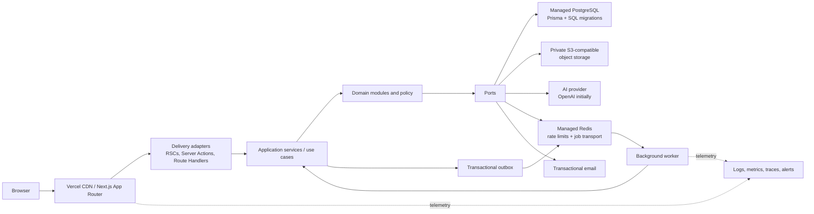
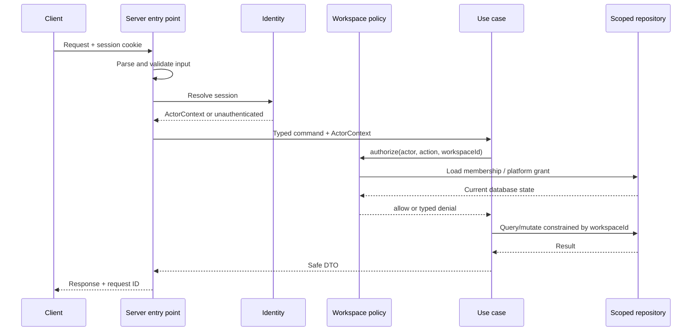
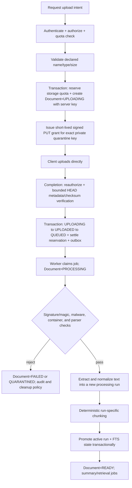
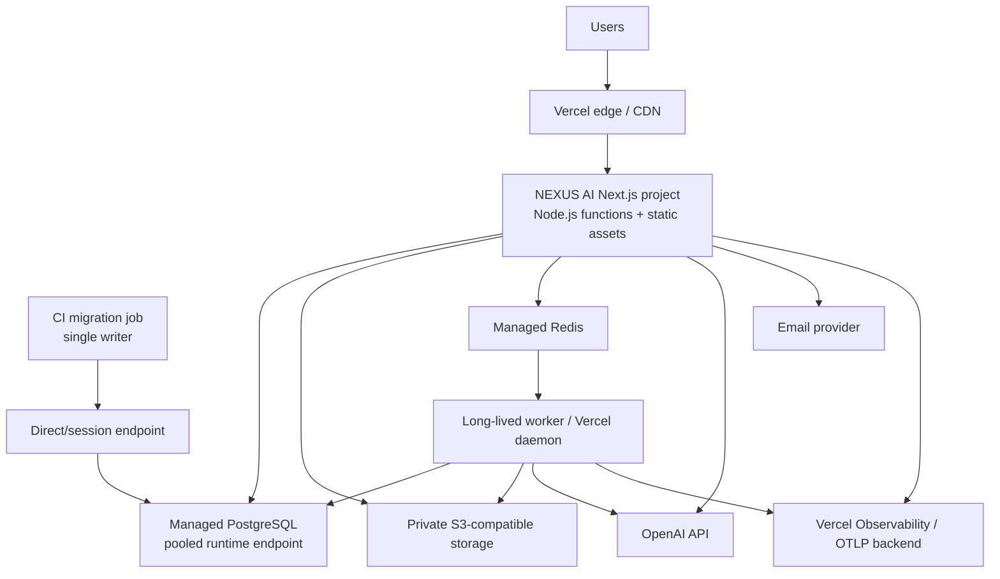

# NEXUS AI System Architecture

**Status:** Proposed baseline (Phase 0)

**Last verified:** 2026-11-07

**Scope:** Production-minded target architecture; no implementation exists yet

## 1. Purpose and current-state evidence

NEXUS AI is an AI productivity workspace for conversations, document intelligence, knowledge management, and controlled workflow automation. This document defines a modular-monolith target that can support an individual user first while making every product resource workspace-scoped from the beginning.

Repository inspection found an uninitialized Git repository with no commits, package manifest, application source, database schema, migrations, dependency lockfile, tests, or deployment configuration. The architecture below is therefore a proposal, not a description of implemented behavior. Phase 1 must create the project deliberately and verify every integration against the then-current official documentation.

### Goals

- Keep business rules independent of Next.js, Prisma, AI vendors, storage vendors, and queue vendors.
- Make tenant isolation and server-side authorization hard to bypass.
- Support streamed AI responses without letting clients become the source of truth for conversation history or usage.
- Treat documents, retrieved text, model output, workflow definitions, and client payloads as untrusted input.
- Use synchronous request handling only for bounded work; make expensive document and workflow work durable and idempotent.
- Preserve a credible path from one deployable application to separately scalable workers without prematurely creating microservices.

### Non-goals for the initial architecture

- Multi-region active/active writes.
- Arbitrary user code execution.
- A general-purpose public API or third-party plugin platform.
- Real-time collaborative editing.
- A separate vector database, search cluster, or event-streaming platform.
- Billing or payment processing.

## 2. Architecture overview

The system is a modular monolith: one codebase, one relational system of record, explicit module APIs, and two runtime entry points (the web application and a background worker). Next.js is a delivery adapter, not the place where business policy lives.



The App Router is the supported routing model and uses Server Components by default; Client Components are introduced only at interactive boundaries. Route Handlers are public HTTP endpoints and must perform their own validation, authentication, and authorization. Server Components should call application services directly rather than making an HTTP round trip to the application's own Route Handlers. These choices follow the current [Next.js App Router](https://nextjs.org/docs/app), [Server and Client Components](https://nextjs.org/docs/app/getting-started/server-and-client-components), and [Backend-for-Frontend](https://nextjs.org/docs/app/guides/backend-for-frontend) guidance.

## 3. Architectural rules

1. **Delivery is thin.** Pages, Server Actions, Route Handlers, queue consumers, and scheduled handlers translate protocols into typed use-case calls. They do not contain business policy or direct Prisma queries.
2. **Modules own behavior and data access.** A module exposes a small public facade. Other modules do not import its repositories or reach into its tables casually.
3. **Dependencies point inward.** Domain and application code cannot import React, Next.js, Prisma-generated types, an AI provider SDK, an S3 SDK, or a queue SDK.
4. **All untrusted input is parsed once at a boundary.** Internal code receives typed commands, not raw request bodies. Output is mapped to explicit DTOs rather than serializing database records.
5. **Authentication is not authorization.** A valid session identifies the actor; a policy decision still gates every tenant or platform operation.
6. **Workspace scope is explicit.** Every tenant-owned command, query, repository method, cache key, job, object key, and audit event includes a `workspaceId`.
7. **Database state is authoritative.** Client-provided roles, user IDs, token counts, prices, conversation history, document status, or workflow status are never trusted.
8. **Side effects are replay-safe.** Jobs, provider calls where practical, email sends, and finalization endpoints use idempotency keys and explicit state transitions.
9. **No secrets cross the server boundary.** Only intentionally public configuration may use `NEXT_PUBLIC_*`.
10. **Audit events and diagnostic logs are different.** Audit records describe security-relevant actions; operational logs diagnose software. Neither contains document text, prompts, session tokens, passwords, or provider secrets.

## 4. Logical layers and module boundaries

### 4.1 Layers

| Layer | Responsibility | May depend on |
|---|---|---|
| Delivery | Routing, protocol parsing, session acquisition, response mapping, UI composition | Application facades, shared contracts |
| Application | Use-case orchestration, transactions, authorization calls, idempotency, port coordination | Domain, ports |
| Domain | Entities, value objects, invariants, permission rules, state machines | Language/runtime only |
| Infrastructure | Prisma repositories, Better Auth adapter, AI SDK, object storage, Redis queue, mail, telemetry | Application port interfaces, vendor SDKs |

The module's `index.server.ts` is its server-only public facade. UI-only exports, if needed, use a separate `index.ts`. Import-boundary lint rules should prevent `app/` from importing infrastructure repositories and prevent one module from importing another module's internals.

### 4.2 Business modules

| Module | Owns | Public capabilities and boundary notes |
|---|---|---|
| Identity | Better Auth configuration; `User`, `Session`, `Account`, `Verification`, `UserProvisioning`, `AccountDeletionRequest`; profile and credential lifecycle | Session lookup, sign-up lifecycle hooks, verification/recovery delivery, durable personal-workspace provisioning, session revocation, and governed account-deletion initiation/status/cancellation. Better Auth owns password/session mechanics; product code must not reimplement them. |
| Workspaces | `Workspace`, `WorkspaceMember`, `WorkspaceInvitation` | Create `TEAM` workspaces and rename/switch authorized workspaces. Recoverable direct delete/restore, invitations, non-owner membership, and ownership transfer are `TEAM`-only collaboration capabilities. A `PERSONAL` workspace remains private with exactly its sole Owner and is removed only by governed account deletion. Invitations are part of the v1 team-workspace contract; domain restrictions, expiry, resend, and abuse policy remain configuration/product decisions. This module is the tenant authority used by every other product module. |
| Conversations | `Conversation`, `Message`, generation state | Create, list, rename, recoverable delete/authorized restore, append user message, stream/regenerate/cancel assistant response, search conversations. AI provider calls occur behind an application port. |
| Documents | `Document`, `DocumentProcessingRun`, immutable run-specific `DocumentChunk` sets, processing state | Upload intent/finalization, authorized download, extraction/chunk/index pipeline, retry, active-run promotion, recoverable delete/authorized restore/purge. Raw objects remain in private storage, not PostgreSQL. |
| Knowledge | `KnowledgeCollection`, `KnowledgeItem`, `KnowledgeTag`, `KnowledgeItemTag`, and source links | Curate, organize, search, retrieve, and associate knowledge with a workspace; recoverably delete and authorize restoration of knowledge items. It consumes search through a port, not by querying document tables directly. |
| Workflows | `Workflow`, immutable `WorkflowVersion`, `WorkflowExecution`, `WorkflowVersionDocument`, `WorkflowExecutionDocument`, execution events | Validate a declarative graph, publish, execute allowlisted nodes, cancel, inspect history, recoverably delete/authorize restoration, and index document dependencies for authorization/deletion checks. It never evaluates arbitrary JavaScript, shell, SQL, or model-generated code. |
| Usage | `UsageRecord`, `AiModelPrice`, `WorkspaceUsagePolicy`, `UsageQuotaPeriod`, `UsageReservation`, `WorkspaceStorageQuota` | Reserve/check AI and storage quota, normalize provider usage, record actual provider attempts and estimated cost, settle reservations, and aggregate workspace statistics without seeding price values. |
| Exports | Workspace-scoped `DataExportJob` and private artifact lifecycle | Members may request `MY_DATA` limited to their own portable data in one workspace; `WORKSPACE` is Owner-only. Status and download reauthorize every time. Private artifacts expire no later than seven days after `READY`, download grants last at most 60 seconds, and job metadata is purged no later than 30 days after artifact expiry. |
| Notifications | `Notification` | Create, list, mark read/unread, retention. Delivery channels beyond in-app are ports and later decisions. |
| Administration | Platform settings and platform-admin grants | Global user/usage/audit operations. A workspace role never grants platform administration. |
| Audit | `AuditLog` | Append-only security/business event recording and restricted querying. Other modules publish typed audit facts through this facade. |

Dashboard and settings are presentation/composition areas rather than independent domains: they query the public facades of the modules above. Search, AI, storage, queueing, mail, rate limiting, and observability are platform capabilities exposed as ports.

### 4.3 Cross-module communication

- A request-time use case may call another module's public application facade when a single transaction or immediate answer is required.
- Deferred or fan-out work is represented by a durable outbox event and handled asynchronously.
- Cross-module database joins are allowed only in dedicated read models owned by a composition/query layer; they must still apply workspace scope and may not mutate another module's tables.
- Domain events are plain versioned data. They do not contain full document content, prompts, secrets, or arbitrary serialized objects.
- Cyclic module dependencies are prohibited. Shared concepts such as opaque IDs, clocks, result types, pagination, and `ActorContext` live in a small shared kernel.

## 5. Proposed repository structure

This is a target for Phase 1 and subsequent milestones, not a request to create every empty directory immediately.

```text
nexus-ai/
├── docs/
│   ├── SYSTEM_ARCHITECTURE.md
│   ├── adr/                         # one file per accepted/superseded ADR later
│   └── runbooks/                    # deployment, recovery, incident procedures
├── prisma/
│   ├── schema.prisma                # if the selected compatible Prisma generation uses it
│   └── migrations/
├── public/
│   ├── icons/
│   └── images/
├── src/
│   ├── app/
│   │   ├── (marketing)/
│   │   ├── (auth)/
│   │   ├── (workspace)/             # authenticated product shell
│   │   ├── admin/
│   │   ├── api/
│   │   │   ├── auth/[...all]/
│   │   │   ├── v1/                 # versioned product HTTP surface
│   │   │   │   ├── workspaces/
│   │   │   │   ├── conversations/
│   │   │   │   ├── documents/
│   │   │   │   └── admin/
│   │   │   ├── webhooks/
│   │   │   └── internal/            # authenticated queue/cron callbacks only
│   │   ├── error.tsx
│   │   ├── global-error.tsx
│   │   └── not-found.tsx
│   ├── components/
│   │   ├── ui/
│   │   ├── layout/
│   │   └── feedback/
│   ├── modules/
│   │   ├── identity/
│   │   ├── workspaces/
│   │   ├── conversations/
│   │   ├── documents/
│   │   ├── knowledge/
│   │   ├── workflows/
│   │   ├── usage/
│   │   ├── exports/
│   │   ├── notifications/
│   │   ├── administration/
│   │   └── audit/
│   │       ├── domain/
│   │       ├── application/
│   │       ├── infrastructure/
│   │       ├── presentation/
│   │       └── index.server.ts
│   ├── platform/
│   │   ├── ai/
│   │   ├── auth/
│   │   ├── db/
│   │   ├── email/
│   │   ├── env/
│   │   ├── observability/
│   │   ├── queue/
│   │   ├── rate-limit/
│   │   ├── search/
│   │   ├── security/
│   │   └── storage/
│   ├── shared/
│   │   ├── contracts/
│   │   ├── kernel/
│   │   ├── testing/
│   │   └── validation/
│   ├── styles/
│   ├── generated/                   # generated Prisma client; never hand-edited
│   ├── instrumentation.ts
│   └── proxy.ts                     # optional redirect optimization, never an authz boundary
├── workers/
│   ├── main.ts
│   └── handlers/
├── tests/
│   ├── integration/
│   ├── e2e/
│   ├── fixtures/
│   └── security/
├── .env.example
├── next.config.ts
├── package.json
├── tsconfig.json
└── vercel.json                      # only when a setting cannot live with its route
```

Each module repeats the illustrated `domain/application/infrastructure/presentation` shape only when its complexity justifies it. Small modules should remain small; architecture is a dependency rule, not a mandate for empty folders.

Route groups organize layouts without changing public URLs:

| Route area | Intended paths | Access |
|---|---|---|
| `(marketing)` | `/`, `/features`, `/pricing`, `/about` | Public; static/cached where possible |
| `(auth)` | `/login`, `/register`, `/forgot-password` | Public, with authenticated-user redirect as UX only |
| `(workspace)` | `/dashboard`, `/workspace/**`, `/chat/**`, `/documents/**`, `/knowledge`, `/workflows/**`, `/usage`, `/notifications`, `/settings/**` | Valid session plus resource/workspace policy |
| `admin` | `/admin/**` | Valid session plus separate platform-admin grant |
| `api` | Auth, AI streams, uploads/downloads, webhooks, worker/cron callbacks | Endpoint-specific authentication, authorization, signatures, rate limits, and schemas |

## 6. Runtime entry points and request rules

### 6.1 Rendering and reads

- Marketing pages are static or cached when possible.
- Authenticated pages are Server Components by default and call server-only query facades directly.
- Interactive islands (chat composer, workspace switcher, workflow canvas, charts) are Client Components fed minimal serializable DTOs.
- Presentation uses CSS Modules, custom CSS, and CSS variables; Tailwind is excluded. Recharts is isolated to chart Client Components and Lucide React supplies icons so those dependencies do not spread into domain/application code.
- Dynamic/caching behavior is explicit for tenant data. Authenticated and user-specific data must never enter a shared public cache.
- Suspense/loading/error/empty states are part of each route contract.

### 6.2 Mutations

- Use Server Actions for same-origin form mutations tightly coupled to the UI.
- Use Route Handlers for streaming chat, uploads/downloads, auth callbacks, webhooks, queue callbacks, and endpoints intended for non-React clients.
- Both paths call the same application use case and repeat session, validation, authorization, rate-limit, and idempotency checks.
- Route Handlers return a consistent error envelope with a safe public code, message, request ID, and field errors where appropriate. Internal causes remain in server logs.

### 6.3 Runtime selection

Use the Node.js runtime for authenticated application routes, Prisma, Better Auth, AI streaming, document coordination, and queue callbacks. This minimizes adapter incompatibilities and supports TCP PostgreSQL drivers and document libraries. Edge execution is not an initial requirement and may be considered only for isolated stateless routes after measurement.

Next.js documents that some deployments run Route Handlers as functions with no shared in-memory state, a potentially read-only filesystem, and execution time limits. Therefore no correctness-critical state may live in process memory or local files ([Next.js Backend-for-Frontend caveats](https://nextjs.org/docs/app/guides/backend-for-frontend#caveats)).

## 7. Authentication and authorization

### 7.1 Authentication

- Better Auth is mounted at `/api/auth/[...all]` using its Next.js handler.
- Use database-backed, opaque cookie sessions. Session revocation, device/session management, email verification, and password recovery go through Better Auth APIs and hooks.
- Configure an explicit production base URL, exact trusted origins, secure host-only cookies, and a high-entropy secret with a documented rotation procedure. Do not disable CSRF or origin checks.
- Keep the initial session cookie cache disabled unless profiling shows a need. Database validation favors immediate revocation semantics; if caching is later enabled, its bounded staleness must be accepted explicitly.
- Auth emails go through a mail port and contain single-use, expiring Better Auth tokens/links; application logs never include the token or full link.

The official integration mounts `toNextJsHandler` in an App Router Route Handler and warns that cookie-only proxy checks are not a secure authorization boundary ([Better Auth Next.js integration](https://better-auth.com/docs/integrations/next)). Better Auth uses cookie-based sessions and supports database-backed session records ([session management](https://better-auth.com/docs/concepts/session-management)). Its current security reference describes origin validation, trusted origins, SameSite cookies, and CSRF safeguards; the disabling flags must remain off ([security reference](https://better-auth.com/docs/reference/security)).

### 7.2 Authorization pipeline



`ActorContext` contains server-derived `userId`, `sessionId`, request ID, and platform grants. It never accepts roles from request JSON, headers, URL parameters, or client session state. Resource lookups combine resource ID and workspace scope in the query so a check/use race cannot turn into cross-tenant access.

`proxy.ts` may perform an optimistic redirect when no session cookie exists, but every page, Server Action, Route Handler, job callback, and application use case remains protected at or near the data access. This follows Next.js guidance to perform authorization close to the data source and not rely only on top-level route checks ([Next.js authentication guide](https://nextjs.org/docs/app/guides/authentication)).

### 7.3 Initial role policy

| Capability | Owner | Admin | Member |
|---|:---:|:---:|:---:|
| View workspace and shared content | Yes | Yes | Yes |
| Create conversations, documents, knowledge items | Yes | Yes | Yes, subject to quota |
| Edit/delete own content | Yes | Yes | Yes |
| Manage any workspace content | Yes | Yes | No |
| Invite/remove Members | Yes | Yes | No |
| Invite/promote/demote/remove Admins | Yes | No | No |
| Transfer ownership or delete workspace | Yes | No | No |
| Configure workspace AI/workflow policy | Yes | Yes | No |
| Create/edit workflow drafts | Yes | Yes | No |
| Publish workflows | Yes | Yes | No |
| Execute published/allowed workflows | Yes | Yes | Yes, subject to policy/quota |
| Platform administration | Separate grant only | Separate grant only | Separate grant only |

This matrix governs `TEAM` workspaces. A `PERSONAL` workspace is the stricter special case: its sole Owner has ordinary content capabilities, but invitations, non-owner memberships, role/member management, ownership transfer, leave, and direct workspace deletion are denied. Governed account deletion is the only personal-workspace removal path.

Shared-edit semantics for member-created resources require a product decision before collaborative editing is implemented. Deny is the default when no policy rule exists. Ownership transfer, removal of the sole owner, self-demotion, and team-workspace deletion are transactionally protected invariants.

### 7.4 Defense in depth

The initial authority is application-level policy plus database foreign keys, unique constraints, transactions, and workspace-scoped repositories. PostgreSQL Row-Level Security is deferred: Prisma connection pooling and request identity propagation would need a rigorously transaction-scoped design. RLS can be added later as defense in depth, not as a substitute for application authorization.

## 8. Data architecture

### 8.1 System of record and tenancy

PostgreSQL is authoritative for identity metadata, workspaces, product entities, permissions, processing state, usage, notifications, workflow state, audit records, idempotency records, and the outbox. Object bodies live in private object storage; Redis is ephemeral coordination/queue infrastructure, not the only record of product state.

Every workspace-owned row carries a non-null `workspaceId`, even for a user's initial personal workspace. High-risk/high-volume child tables such as messages and document chunks should repeat `workspaceId` and use a composite foreign key to the same-scoped parent, preventing inconsistent tenant IDs at the database layer. A child that does not repeat the key must be loaded through a workspace-scoped parent query. Identity rows and deliberately user-global/platform rows are not tenant-owned and are the documented exceptions. After successful email verification and before first product access, the application idempotently creates one default personal workspace and sole Owner membership. `UserProvisioning` records that durable `PENDING -> RUNNING -> READY|FAILED` lifecycle. Use one transaction where the verified-registration hook supports it; otherwise a leased, retryable provisioner blocks product access until provisioning reaches `READY`. This avoids a later tenant-model migration when team features arrive.

### 8.2 Entity guidance

| Entity/group | Key constraints and lifecycle |
|---|---|
| Better Auth tables | Generate from the selected Better Auth version and review the migration. Do not hand-diverge from required fields without adapter-supported customization. Email normalization/uniqueness follows Better Auth behavior. |
| `UserProvisioning` | One durable row per verified user with a unique optional personal-workspace pointer, bounded attempts, retry/lease fields, safe failure code, and a `PENDING -> RUNNING` lifecycle terminating at `READY` or `FAILED`. The idempotent transaction creates or reuses the sole personal workspace, Owner membership, storage quota, preference/default link, and audit/outbox state; protected product access remains blocked until `READY`. |
| `AccountDeletionRequest` | One active request per user; scheduled/start/cancel/terminal timestamps, safe failure code, and a content-free reconciliation manifest. Active requests retain the user relation; terminal evidence is pseudonymized when the user is purged. |
| `Workspace` / `WorkspaceMember` / `WorkspaceInvitation` | Workspace kind is `PERSONAL` or `TEAM`; public creation produces only `TEAM`, while only verified-user provisioning creates `PERSONAL`. Membership is unique on `(workspaceId, userId)` and every workspace has exactly one effective Owner. A personal workspace remains private with only that Owner: invitation creation/acceptance, non-owner membership, ownership transfer, and direct deletion are rejected. Team invitations have explicit pending/accepted/revoked/expired state and digest-only tokens. Team-workspace deletion enters `PENDING_DELETION` and records its recovery/purge schedule; retained Owner authority may restore it before an irreversible purge claim. |
| `Conversation` / `Message` | Conversation is workspace-scoped. Messages have server IDs, sequence and same-conversation parent lineage, role, validated JSON parts, generation status, provider/model snapshot, and timestamps. Client message/generation IDs provide scoped idempotency. Regeneration adds lineage; it does not overwrite history. Cancellation persists `CANCEL_REQUESTED` before cross-instance signaling. Soft deletion is restorable by the creator or Admin during the unclaimed grace window. |
| `Document` / `DocumentProcessingRun` / `DocumentChunk` | Document stores immutable object key, sanitized display name, detected media type, byte size, checksum, active processing-run pointer, state, uploader, failure code, and pre-deletion status snapshot. Each retry creates an immutable run-specific chunk set with `(documentId, processingRunId, ordinal)` uniqueness; only a completely successful run is promoted. Citation snapshots preserve history when superseded chunks are later purged. Creator/Admin restoration recovers metadata, bytes/chunks, and the saved processing status before purge begins; object deletion is an idempotent side effect after the recovery window. |
| `KnowledgeCollection` / `KnowledgeItem` / `KnowledgeTag` / `KnowledgeItemTag` | Workspace-scoped hierarchy, item title/content/source/provenance, normalized tags, creator, soft-deletion lifecycle, and timestamps. Collection deletion is restricted until children/items are explicitly moved, unfiled, or deleted. A creator or Admin may restore a knowledge item during the unclaimed grace window after its collection/provenance invariants are revalidated. Search index updates are transactional or outbox-driven. |
| `UsageRecord` | Immutable provider-attempt record. `operationId` uniquely identifies an actual call; `(logicalOperationId, attempt)` groups retry attempts; provider request ID is optional diagnostic/deduplication data. Records carry actor/workspace, provider/model, token categories when reported, latency, status, and estimated-cost snapshot. Never trust client counts. |
| `AiModelPrice` / `WorkspaceUsagePolicy` / `UsageQuotaPeriod` / `UsageReservation` | Immutable effective-dated prices are operator-sourced; no defaults are invented. Nullable workspace limits mean unlimited. Non-negative consumed/reserved counters and a workspace-scoped database lock support atomic reservation, expiry release, and idempotent settlement. |
| `Notification` | Recipient user, optional workspace, type, validated payload, created/read/expired timestamps. Index unread queries by `(userId, readAt, createdAt)`. |
| `DataExportJob` | Durable, workspace-scoped `MY_DATA` or `WORKSPACE` snapshot job with requester, cutoff, schema version, idempotency record, bounded manifest, private object metadata/checksum, expiry, purge claim, and a `QUEUED -> RUNNING` lifecycle terminating at `READY` or `FAILED`; only `READY` expires to `EXPIRED`. A Member may export only their own portable workspace data; whole-workspace export requires the Owner. Polling and grant issuance reauthorize. Artifacts live privately for at most seven days after `READY`; grants last at most 60 seconds; metadata lives at most 30 days after artifact expiry. |
| `Workflow` / `WorkflowVersion` / `WorkflowExecution` / `WorkflowVersionDocument` / `WorkflowExecutionDocument` | Mutable workflow points to an immutable validated definition version. Normalized version/execution document joins bind dependencies to the same workspace and support deletion impact checks while JSON remains the immutable execution snapshot. Each execution references the generic actor/workspace/route-scoped `IdempotencyKey` and has a state machine, initiator, timestamps, cancellation marker, and bounded step-event/log records. An Admin may restore a workflow during the unclaimed grace window after name and active-version dependencies are revalidated. |
| `AuditLog` | Append-only actor, workspace, action, target type/ID, outcome, request ID, timestamp, and redacted metadata. Access is restricted and retention is policy-driven. |
| `OutboxEvent` and specialized durable run records | The outbox stores versioned event type, aggregate references, availability/status/attempt timestamps, and safe error classification. Durable business progress lives in `UserProvisioning`, `DocumentProcessingRun`, `WorkflowExecution`, `DataExportJob`, and `AccountDeletionRequest`; there is no generic relational `JobRun` in the initial model. Queue messages carry IDs and reload authoritative state. Large payloads remain in PostgreSQL/object storage and are referenced by ID. |

Use opaque, non-sequential externally visible IDs. The exact ID format is a Phase 2 decision aligned with Better Auth and Prisma capabilities. Every mutable record has `createdAt`/`updatedAt`; stateful records may add an integer version for optimistic concurrency.

### 8.3 Referential actions and deletion

- Use database cascades only for true aggregate children such as message rows under a conversation and chunks under a document.
- Do not cascade user deletion through owned workspaces, shared tenant data, object storage, provider data, or audit history.
- Workspace, conversation, document, knowledge-item, and workflow restoration is available only through an explicit authorized command during the soft-delete grace window. It locks the tombstone, requires an unexpired `purgeAfter` and null `purgeStartedAt`, revalidates uniqueness/parent/dependency invariants, increments the version, and audits the result; a deleted workspace must be restored before a child. Once cleanup claims the row, restoration is unavailable.
- Account deletion requires recent authentication/confirmation, immediate session revocation, an ownership-transfer/delete decision for sole-owned workspaces, an idempotent purge job, object deletion, provider-side deletion where applicable, and a final tombstone/pseudonymization step consistent with the retention policy.
- A private object is considered deleted only after storage confirms deletion; failed deletions remain visible to operations for retry.
- Audit records must avoid personal content and can be pseudonymized when the user is erased if retention requires keeping the security event.

### 8.4 Transactions and concurrency

Use short transactions for membership/ownership changes, message creation plus generation reservation, usage finalization, workflow state transitions, and state change plus outbox insert. Never hold a database transaction open while calling an AI provider, object store, email provider, or parser. External operations use a prepare/call/finalize state machine and idempotency keys.

Runtime application traffic uses the managed provider's pooled connection URL; schema migration tooling uses its direct/session-capable URL when required. Reuse a singleton Prisma client per warm runtime. Current Prisma guidance distinguishes pooled application traffic from direct migration/admin traffic ([PostgreSQL connection guidance](https://www.prisma.io/docs/orm/v7/core-concepts/supported-databases/postgresql), [connection pooling](https://www.prisma.io/docs/orm/v7/prisma-client/setup-and-configuration/databases-connections/connection-pool)).

## 9. AI architecture and chat flow

### 9.1 Provider abstraction

Application code depends on these conceptual ports rather than `@ai-sdk/openai` directly:

- `ModelCatalog`: stable application model keys, capabilities, context limits, enabled state, quota class, and pricing version.
- `LanguageModelGateway`: generate/stream with a provider-neutral request and normalized stream events.
- `EmbeddingGateway`: embed batches with model/dimension metadata; introduced only with semantic retrieval.
- `UsageNormalizer`: maps provider usage and finish/error reasons into product records.
- `PromptPolicy`: constructs trusted instructions, labels untrusted context, enforces limits, and controls allowed tools.

The infrastructure adapter may use AI SDK's provider registry and `streamText`; OpenAI is the first registered provider. The SDK exposes a standardized provider model and provider registry, but provider capabilities still differ and must be represented in the model catalog ([providers and models](https://ai-sdk.dev/docs/foundations/providers-and-models), [`createProviderRegistry`](https://ai-sdk.dev/docs/reference/ai-sdk-core/provider-registry), [OpenAI provider](https://ai-sdk.dev/providers/ai-sdk-providers/openai)). Clients submit a stable application model key, never an arbitrary provider/model string.

Tool definitions have validated schemas, an authorization-aware execution context, per-tool timeouts, output-size limits, and an allowlist per product feature. Model-requested tool arguments are untrusted. Tools cannot bypass use cases, read arbitrary URLs/files, execute code, or access a workspace not present in `ActorContext`.

### 9.2 Streaming conversation flow

```mermaid
sequenceDiagram
    participant UI as Chat UI
    participant RH as Chat Route Handler
    participant CS as Conversation service
    participant DB as PostgreSQL
    participant G as AI gateway
    participant U as Usage service

    UI->>RH: POST conversationId, one new message, model key, idempotency key
    RH->>RH: Validate, authenticate, rate-limit
    RH->>CS: Start generation
    CS->>DB: Authorize workspace; persist user message + pending generation + quota reservation
    CS->>DB: Load authoritative history and permitted retrieval context
    CS->>G: Stream trusted prompt + labeled untrusted context
    G-->>RH: Normalized stream events
    RH-->>UI: SSE/data stream
    G-->>CS: Finish/error + provider usage
    CS->>DB: Finalize assistant message/status idempotently
    CS->>U: Record normalized usage and release/settle reservation
```

Important rules:

- The server loads conversation history; the client cannot replace prior messages or inject another user's conversation.
- Persist the user message and a pending assistant-generation record before calling the provider.
- Persist completion, cancellation, timeout, and provider failure as explicit states. A retry or regeneration creates a new generation linked to its predecessor.
- Usage is a reservation followed by settlement so concurrent requests cannot bypass quota. Provider usage is authoritative when present; estimation is clearly marked when absent.
- Cancellation and provider failure still settle any usage that was actually incurred. A sweeper marks stale pending generations timed out and releases or reconciles abandoned reservations.
- Cancellation propagates an abort signal and marks the generation canceled. Because current AI SDK stream resumption is explicitly incompatible with abort behavior, initial chat favors the required cancellation feature and does **not** enable resumable streams. Interrupted streams remain recoverable as incomplete records and can be regenerated. Revisit only with a product decision ([AI SDK resumable streams](https://ai-sdk.dev/docs/ai-sdk-ui/chatbot-resume-streams)).
- Server-generated message IDs and persisted UI message validation are required for durable chat history ([AI SDK message persistence](https://ai-sdk.dev/docs/ai-sdk-ui/chatbot-message-persistence)).
- Provider errors are mapped to safe error codes; raw responses and prompts are not returned or logged.

### 9.3 Prompt-injection boundary

System/developer instructions are application-owned and immutable for a request. Document chunks, web content, knowledge items, conversation attachments, workflow input, and model output are wrapped as data with source identifiers and explicit untrusted-content labels. Retrieved text is never concatenated into the trusted instruction block as if it were policy. The model cannot elevate permissions; every tool call independently authenticates its actor context and authorizes its target.

Provider retention settings, regional processing, and whether OpenAI response storage is disabled must be decided before production data is sent. Provider-specific options stay inside the adapter.

## 10. Documents, object storage, and retrieval

### 10.1 Storage abstraction

`ObjectStorage` exposes bounded operations such as `createUploadIntent`, `head`, `openReadStream`, `createDownloadGrant`, and `delete`. Database rows store provider-neutral bucket/key/version metadata, never a permanent public URL. Object keys are generated server-side (for example, workspace/document IDs plus a random component) and never use the raw filename.

Required storage properties:

- Private bucket/store, encryption in transit and at rest, least-privilege credentials, lifecycle policies, and aligned region/data residency.
- Short-lived signed upload/download grants or authenticated server streaming; downloads always follow current database authorization.
- Exact CORS allowlist and content-disposition headers; no public ACL fallback.
- Separate quarantine and accepted prefixes/buckets, or an equivalent immutable status boundary.
- Checksums and immutable object versions to make retries and tamper detection reliable.

The selected implementation must actually expose the required S3-compatible API. Vercel-hosted alternatives that do not meet that contract are out of scope unless the storage requirement is changed through an ADR.

### 10.2 Upload and processing flow



The upload-intent transaction creates the authoritative `UPLOADING` row and server-generated key before any bearer grant exists. Enforce declared limits at intent/grant time and in storage policy where supported. Completion trusts neither the client nor declared MIME: it performs bounded server-side HEAD/metadata/checksum verification only, then atomically settles the storage reservation, advances `UPLOADING -> UPLOADED -> QUEUED`, and inserts the outbox event. Signature/magic/container validation and malware/parser work belong to the restricted worker, which first moves the document to `PROCESSING` and finishes at `READY`, `FAILED`, or `QUARANTINED`. `PENDING` and `REJECTED` are not document statuses.

Validate actual file signatures rather than trusting filename or browser MIME. Sanitize display names; never execute macros, embedded programs, JavaScript, links, or shell commands. Parsers run with time, memory, page, decompression, and output limits. A dedicated malware-scanning provider or isolated scanner is an open production decision, but the state machine reserves the quarantine gate.

The initial allowlist is PDF, DOCX, and plain-text documents with explicitly mapped extensions, MIME types, and signatures. Password-protected/encrypted documents and malformed archives fail with a safe, user-visible reason until a deliberately bounded handling path is designed.

Processing is versioned by extractor/chunker configuration. Reprocessing writes a new processing version and atomically promotes it after success so search never sees a half-rebuilt document.

### 10.3 Search abstraction

`SearchService` provides workspace-scoped operations over conversations, documents/chunks, and knowledge items. Its contract returns source type/ID, authorized display metadata, rank, safe snippet, and cursor. Callers cannot issue arbitrary SQL or omit tenant scope.

Initial search uses PostgreSQL full-text search with a stored/generated `tsvector` and GIN indexes, explicit text-search configuration, `websearch_to_tsquery`-style query parsing, ranking, pagination, and mandatory `workspaceId` predicates. PostgreSQL documents GIN indexes for full-text search and shows stored `tsvector` columns ([official full-text index guidance](https://www.postgresql.org/docs/current/textsearch-tables.html)). Search language/configuration and multilingual behavior must be chosen using representative data.

Semantic retrieval is a later adapter enhancement:

- Enable pgvector only when the use case and evaluation set justify it.
- Store embedding model, provider, dimension, source content hash, and chunk-processing version.
- Filter by workspace and document visibility before ranking or returning text.
- Backfill asynchronously and support re-embedding without blocking lexical search.
- Use hybrid lexical/vector scoring behind the same `SearchService` contract.

Prisma/vector support differs by major version and may require extensions or custom SQL; verify against the selected mutually compatible Prisma release before implementation ([Prisma PostgreSQL extension guidance](https://docs.prisma.io/docs/postgres/database/postgres-extensions)).

## 11. Background jobs and workflow execution

### 11.1 Reliable job handoff

The durable boundary is a transactional outbox. Phase 2 uses a lightweight database-backed dispatcher/scheduler that may invoke bounded email and lifecycle adapters directly and record completion. Phase 6 initially uses PostgreSQL atomic time buckets for generation limits and durable message-state polling for cross-instance cancellation; a process-local abort registry only reduces latency and is never the correctness boundary. Managed Redis remains the approved cutover when measured throughput, database contention, or cancellation latency requires it. Phase 8 adds the at-least-once Redis-backed heavy-job queue and isolated worker:

1. The request transaction changes product state and inserts a versioned `OutboxEvent`.
2. A dispatcher either performs an approved bounded Phase 2 adapter action or, once queue transport is enabled, publishes the event ID and minimal routing metadata to Redis.
3. A worker claims the job, reloads authoritative state, acquires an idempotency/lease record, and invokes the same application facade used by request-time code.
4. Success is recorded before acknowledgement. Transient failures retry with bounded exponential backoff and jitter; permanent or exhausted failures become visible in a failed-job view/alert.
5. A scheduled sweeper republishes undispatched/expired outbox records so a process crash cannot lose work.

Redis documents reliable job queues as a way to offload work and describes atomic claim/reclaim and stream consumer-group patterns ([Redis job queue guidance](https://redis.io/docs/latest/develop/use-cases/job-queue/)). Exact transport/library and managed Redis provider remain open. Queue semantics are at-least-once, so every handler must be idempotent; ordering must not be assumed unless the handler enforces an entity sequence.

A continuously polling Redis worker must not be hidden inside a request-scoped Vercel Function. Deploy it as a Vercel Daemon if that capability is production-ready for the selected plan at implementation time, or as a small long-lived Node worker on another managed runtime. The web and worker remain one modular-monolith codebase and release artifact. Vercel currently describes Daemons as background workers that can pull from queues, but this deployment product and its plan limits must be re-verified when the worker is introduced ([Vercel Daemons](https://vercel.com/docs/daemons)).

### 11.2 Job classes

- Document scan/extract/chunk/index/summarize and purge.
- Email verification/recovery notifications when compatible with Better Auth token lifetimes.
- Usage reconciliation and aggregate rollups.
- Search/embedding backfills.
- Account/workspace deletion.
- Portable export generation, expiry, private-artifact cleanup, and stale-job watchdog.
- Workflow executions and step retries.
- Notification fan-out and retention cleanup.

Jobs carry identifiers, not raw documents or complete prompts. Each type has a schema version, maximum attempts, timeout, concurrency class, idempotency key, and safe retry policy. Operations provides replay/cancel controls with audit events.

### 11.3 Controlled workflow engine

Workflow definitions are validated declarative DAGs with an explicit schema version. The initial catalog is limited to read-only or pure internal nodes such as prompt, summarize, retrieve, transform structured data, and conditional branch. Notification and every other side-effecting node are deferred until recipient authorization, exact user approval, idempotency, retry/compensation, privacy, and audit behavior are separately designed and approved. Each enabled node declares typed input/output schemas, timeout, retry policy, quota cost, and allowed secret references.

Before execution, validate graph size, cycles, reachability, node type allowlist, parameter bounds, and caller permissions. An execution snapshots the published definition and advances through persisted state transitions. Model output never becomes executable code. No node may accept arbitrary shell commands, JavaScript, SQL, filesystem paths, network destinations, or credentials. Future HTTP nodes require an egress allowlist, DNS/IP revalidation, redirect limits, response limits, and SSRF controls.

## 12. Deployment topology



### 12.1 Environment strategy

- **Local:** local PostgreSQL/Redis and S3-compatible emulator or dedicated development bucket; mock AI/mail adapters are explicit test/development modes and never pretend to call a real provider.
- **Test/CI:** ephemeral database and Redis, fake object/AI/mail adapters, deterministic clocks/IDs where useful.
- **Preview:** no production credentials or data. Prefer provider branch databases and isolated object prefixes/buckets; otherwise use one controlled non-production schema without automatic destructive migrations.
- **Staging:** production-like isolated services, redacted/synthetic data, deployment and migration rehearsal.
- **Production:** dedicated least-privilege services, backups/PITR, alerting, retention, and documented restore tests.

Keep compute, database, Redis, and storage regions close to reduce latency and egress, subject to data-residency requirements. Pin the Vercel function region accordingly. AI streaming route duration must fit the selected plan; document parsing and durable workflows belong in workers rather than relying on request duration. Vercel function limits and duration are plan/runtime dependent and must be checked during deployment design ([Vercel Functions limits](https://vercel.com/docs/functions/limitations)).

### 12.2 Database deployment

- Runtime connects through a pooled URL; migrations use the provider's appropriate direct/session connection.
- Exactly one CI deployment job applies reviewed, committed migrations before traffic depends on them.
- Production changes use expand/migrate/contract sequencing; destructive schema changes and large backfills do not run as an unreviewed build side effect.
- Backups and point-in-time recovery are enabled; restoration is tested, not merely configured.
- Preview builds never migrate production.

### 12.3 External service inventory

| Capability | Initial choice / status | Required production property |
|---|---|---|
| Web compute/CDN | Vercel | Node runtime, streaming support, configured region/duration, preview isolation |
| Relational DB | Managed PostgreSQL, provider open | Pooling, direct migration path, backups/PITR, TLS, pgvector availability later |
| Authentication | Better Auth in application | Compatible Prisma adapter, secure cookies, trusted origins, email flows |
| AI | OpenAI through Vercel AI SDK adapter | Server-side key, quotas, retention controls, timeouts, usage reporting |
| Object storage | Private S3-compatible provider, open | Signed operations, CORS, encryption, lifecycle, immutable keys, residency |
| Queue/rate limits | Managed Redis, provider/library open | TLS, durable queue semantics, atomic operations, metrics, eviction policy suitable for role |
| Worker runtime | Open decision | Long-lived or supported daemon/push consumption, controlled concurrency, same release |
| Email | Open decision | Verified domain, delivery webhooks, suppression handling, audit-safe templates |
| Telemetry | Vercel Observability plus optional OTLP/error backend | Logs, traces, metrics, alerting, retention/redaction |
| Malware scanning | Open decision before document production launch | Stream/bounded scan, signatures updated, quarantine integration |

## 13. Configuration and secrets

All configuration is parsed in a server-only environment module at startup/build with a schema that reports missing keys without printing values. Public configuration has a separate explicit allowlist. `.env.example` contains names and safe descriptions only.

| Category | Proposed variables (names may be refined in Phase 1) | Classification |
|---|---|---|
| Application | `APP_ENV`, `APP_BASE_URL`, allowed/trusted origins, feature flags | Config; only intentionally browser-readable values use `NEXT_PUBLIC_*` |
| Better Auth | `BETTER_AUTH_URL`, `BETTER_AUTH_SECRET` or versioned `BETTER_AUTH_SECRETS` | URL config; secret material is secret |
| PostgreSQL | `DATABASE_URL` (pooled runtime), `DIRECT_URL` or provider-equivalent migration URL | Secret |
| AI | `OPENAI_API_KEY`, default model key, allowed model keys, provider timeout/budget | Key is secret; catalog controls are config |
| Object storage | Endpoint, region, bucket, access key ID/secret, path-style flag, signed-URL TTL | Credentials are secret; endpoint/bucket policy is environment config |
| Redis/queue | `REDIS_URL`, queue namespace, concurrency/retry settings | URL is secret; tuning is config |
| Email | Provider key, verified `EMAIL_FROM`, reply-to/domain | Key is secret; sender is config |
| Observability | OTLP endpoint/headers, error-monitoring DSN, release/environment | Auth headers/tokens are secret |
| Security/limits | Upload bytes/pages, AI rate/quota, workflow limits, retention periods | Config, reviewed per environment |

Better Auth currently requires a high-entropy secret of at least 32 characters and supports a base URL environment variable ([installation](https://better-auth.com/docs/installation)). On Vercel, secrets/configuration are environment-specific and changes apply only to new deployments; production credentials must use the platform's non-readable Secret type and require redeployment after rotation ([Vercel environment variables](https://vercel.com/docs/environment-variables), [2026 Config/Secret change](https://vercel.com/changelog/environment-variables-now-use-config-and-secret-types)).

No preview environment receives production database, storage, Redis, email, or AI credentials. Rotate credentials with overlap where the integration supports it; rehearse Better Auth secret rotation before production.

## 14. Security controls

### Request and browser security

- Validate method, content type, body size, schema, pagination bounds, IDs, and state transitions.
- Use distributed rate limits for registration/login/recovery, AI generation, uploads, search, invitations, downloads, and workflow execution. Combine authenticated actor and privacy-aware IP signals where appropriate.
- Configure CSP, HSTS in production, `X-Content-Type-Options`, frame restrictions, referrer policy, permissions policy, and secure cache headers. Roll out CSP in report-only mode before enforcement if third-party scripts require discovery.
- Render Markdown with raw HTML disabled or strictly sanitized; sanitize generated link protocols and highlight code without evaluation.
- Do not reflect internal exception text, SQL/provider responses, storage keys, or authorization existence details.
- Protect webhook/internal callbacks with provider signatures or rotating credentials, timestamp/replay checks, strict body limits, and idempotency.

### Data and tenant security

- Query tenant resources by `(workspaceId, resourceId)` and return a non-enumerating not-found/forbidden policy.
- Re-authorize signed download creation and keep grants short-lived; object URLs are not authorization.
- Encrypt in transit, use managed at-rest encryption, and apply least-privilege service identities/bucket policies.
- Backups inherit retention/access controls and are included in deletion/restore threat analysis.
- Audit role changes, ownership transfer, document downloads/deletes, account/workspace deletion, workflow publish/execute, admin actions, and security-setting changes.

### AI and workflow security

- Enforce server-owned prompt hierarchy and label retrieved content as untrusted.
- Allowlist models/tools/nodes; schema-validate every model-generated structured value even when the provider advertises structured output.
- Apply token/context/output ceilings, timeouts, cancellation, concurrency limits, and per-user/workspace quotas.
- Never put provider keys, storage credentials, or reusable secrets in prompts or workflow definitions. Definitions reference secret IDs resolved server-side only for an approved node.
- No arbitrary code execution. Future sandboxed execution would require a separate threat model, isolated runtime, network/filesystem denial by default, resource quotas, and explicit approval; it is not part of this architecture.

## 15. Observability and operations

Use `src/instrumentation.ts` to register OpenTelemetry/server instrumentation; Next.js documents this hook and Vercel's OTEL integration ([Next.js instrumentation guide](https://nextjs.org/docs/app/guides/instrumentation)).

### Signals

- **Structured logs:** timestamp, level, service/runtime, environment, release, request/trace ID, route/use case, result code, latency, job/workflow IDs, provider/model key, and safe actor/workspace identifiers. Central redaction blocks cookies, authorization headers, reset/verification tokens, object grants, prompts, document text, and provider payloads.
- **Traces:** request to use case to database/provider/storage; queue publish-to-consume linkage; AI time-to-first-token and completion; document pipeline stages; workflow steps.
- **Metrics:** request latency/error/saturation, DB pool/query latency, auth failures, authorization denials, rate-limit hits, AI TTFT/completion/cancel/provider failure/token/cost, quota rejections, upload rejection, extraction time/failure, queue lag/retries/dead jobs, workflow duration/failure, and search latency/zero-result rate.
- **Audit:** separately stored immutable application events, queryable only by authorized workspace owners/admins or platform admins according to event scope.

### Operational requirements

- Alert on elevated error rates/latency, database saturation, queue lag/failed jobs, provider outage/rate limit, extraction failure spikes, unexpected usage/cost, and audit-pipeline failure.
- Establish service-level objectives only after baseline measurement; initial candidate indicators are authenticated request availability, AI stream start success/TTFT, and document time-to-ready.
- Provide runbooks for provider outage, compromised key rotation, stuck queue, failed migration, object/DB inconsistency, restore, account purge failure, and cost anomaly.
- Use release identifiers in all signals and deployment annotations. Source maps are private.
- Health/readiness and synthetic checks are dependency-aware: they test only services enabled and required for that deployed phase. Phase 1 checks process/public-page liveness without pretending PostgreSQL, Redis, storage, or AI exists; later phases add a bounded database query, storage configuration check, and queue-age check only when those dependencies become required. Checks expose no topology, credentials, or billable AI call.
- Vercel provides logs/metrics/traces, but retention and export requirements must be selected explicitly ([Vercel Observability](https://vercel.com/docs/observability)).

## 16. Testing architecture

- **Unit:** domain state machines including provisioning, restoration, and export expiry; role matrix; quota arithmetic; usage/cost normalization; chunking; workflow graph validation; prompt assembly; and redaction.
- **Integration:** real PostgreSQL migrations/repositories, Better Auth and `UserProvisioning` flows, transaction/outbox behavior, tombstone restore/purge races, export job/artifact cleanup, scoped authorization, full-text search, object-storage adapter contract, queue idempotency/retry, and provider adapter error mapping.
- **Contract:** each AI/storage/search/queue/mail adapter runs against a shared port test suite; external API fixtures are sanitized and versioned.
- **Security:** cross-workspace IDOR matrix for every resource route/use case, denial of invitations/non-owner membership/transfer/direct deletion for `PERSONAL`, restoration-role and purge-claim enforcement, export scope/role isolation and download reauthorization, privilege escalation, stale membership/session, CSRF/origin configuration, upload polyglots/oversize/decompression bombs, malicious Markdown, prompt injection, SSRF candidates, workflow limits, and log-secret leakage.
- **End to end:** registration/verification/provisioning/recovery, private sole-owner personal workspace creation and collaboration only through `TEAM`, workspace role changes, chat persistence/cancel/regenerate, document upload-to-ready/download, recoverable delete/authorized restore for team workspace, conversation, document, knowledge item, and workflow, `MY_DATA`/`WORKSPACE` export authorization and expiry, quota failure, notification state, account deletion, and platform-admin isolation.
- **Resilience:** provisioning lease/retry, provider timeouts/429/5xx, stream disconnect, duplicate delivery, worker crash after side effect, restore/purge races, export expiry/cleanup retries, object deletion failure, migration rollback plan, and database restore drill.

Tests use deterministic fakes only when testing application behavior. A fake adapter is visibly configured and never returns a response presented as a real external operation.

## 17. Architecture decisions (ADR summary)

These are proposed/accepted-for-planning decisions. Material changes should become individual ADR files.

### ADR-001 — Modular monolith with web and worker entry points

**Decision:** One repository and application model with explicit modules; deploy a Next.js web runtime and a worker runtime from the same release.

**Why:** The product has related transactions and a small initial team, while document/workflow processing still needs independent execution.

**Consequence:** Module boundaries need lint/tests; extraction to services remains possible at ports/events.

### ADR-002 — App Router, server-first UI, thin delivery adapters

**Decision:** Use App Router Server Components for reads, Client Components for interaction, Server Actions for same-origin UI mutations, and Route Handlers for streaming/files/integrations.

**Why:** Aligns with current Next.js primitives and avoids internal HTTP hops.

**Consequence:** Every entry point must call shared use cases and repeat security checks.

### ADR-003 — Workspace is the tenancy root

**Decision:** Create a personal workspace for every user and require `workspaceId` on all product resources from day one.

**Why:** Individual-first UX without a later team-tenancy rewrite.

**Consequence:** Even single-user queries require membership authorization and tenant-scope tests.

### ADR-004 — Better Auth database sessions; policy near data

**Decision:** Use Better Auth's Prisma adapter and database-backed cookie sessions. Proxy redirects are only UX; application policy and scoped repositories enforce access.

**Why:** Revocable sessions and a single server-side permission model.

**Consequence:** Auth/session database traffic must be pooled and observed; adapter schema is version-coupled.

### ADR-005 — Pin the latest mutually compatible stable dependency set

**Decision:** Do not install unconstrained independent `latest` versions. Phase 1 records and tests a compatibility matrix, then commits an exact lockfile. At verification time, Better Auth's official Prisma adapter page says its examples use Prisma 7 and that Prisma 8 is not yet supported, while Prisma 8 is current; therefore Prisma 7 is the planned compatibility baseline until that adapter support changes ([Better Auth Prisma adapter](https://better-auth.com/docs/adapters/prisma), [current Prisma documentation](https://www.prisma.io/docs)).

**Why:** “Current stable” applies to the interoperable stack, not to each package in isolation.

**Consequence:** Prisma 8 features and migration commands must not be copied into a Prisma 7 setup; upgrade later through a dedicated ADR/migration.

### ADR-006 — PostgreSQL first for relational data and search

**Decision:** Managed PostgreSQL is the system of record and initial full-text search engine; pgvector is a measured later extension behind `SearchService`.

**Why:** Fewer systems, transactional tenant filtering, adequate initial capabilities.

**Consequence:** Custom SQL migrations/indexes are reviewed; search scale and quality are monitored.

### ADR-007 — Vendor capabilities behind ports

**Decision:** Isolate AI, embedding, object storage, search, queue, email, clock, and telemetry integrations.

**Why:** Provider differences and credentials should not leak into domain code.

**Consequence:** Ports are deliberately capability-focused rather than lowest-common-denominator wrappers.

### ADR-008 — Transactional outbox and at-least-once jobs

**Decision:** Persist the intent to do background work with the state change, then publish to a Redis-backed queue; handlers are idempotent.

**Why:** Prevents lost work between database commit and queue publication.

**Consequence:** Adds dispatcher/sweeper/job-state operations and requires a long-lived or supported daemon worker.

### ADR-009 — Direct private upload with quarantine/finalization

**Decision:** Use short-lived grants to private storage, then verify the object and enqueue processing.

**Why:** Avoids buffering large untrusted files in web functions and preserves authorization/control.

**Consequence:** Finalization, abandoned-upload cleanup, CORS, scanner, and object/DB reconciliation are required.

### ADR-010 — Cancellation before stream resumption

**Decision:** Support cancellation and durable incomplete/final states; do not enable AI SDK resumable streams initially.

**Why:** The current SDK documents resumption and abort as incompatible, while cancellation is a product requirement.

**Consequence:** A disconnect may leave an incomplete generation that users regenerate; resumability needs a later product/technical decision.

### ADR-011 — Declarative, allowlisted workflows only

**Decision:** Workflows are validated persisted DAGs composed of application-owned node types.

**Why:** Controlled automation without creating a remote-code-execution product.

**Consequence:** New node types require security review, schemas, quotas, observability, and idempotency design.

## 18. Risks and open decisions

| Priority | Risk / decision | Required resolution or mitigation |
|---|---|---|
| Critical | Better Auth currently documents Prisma 8 as unsupported by its Prisma adapter | Phase 1 compatibility spike; pin Prisma 7-compatible stable packages and lockfile, or wait for verified adapter support. Do not mix Prisma 7 and 8 setup/migration guidance. |
| Critical | Tenant data exposure through an unscoped query/job/cache | Scoped repository contracts, deny-by-default policy, cross-tenant integration/e2e matrix, safe admin separation, code review checklist. |
| Critical | Prompt injection or dangerous workflow/tool action | Trusted/untrusted prompt separation, per-tool authz, allowlists, no code execution, SSRF controls, adversarial tests. |
| High | Managed PostgreSQL provider, region, pooling, preview branches, backup/RPO/RTO | Select before Phase 2; test pooled runtime/direct migrations and restoration. |
| High | Redis provider and distributed limiter/cancellation semantics | Phase 6 starts with database-backed coordination. Select Redis before load exceeds the reviewed PostgreSQL envelope; prove atomic enforcement, environment isolation, failure behavior, and observability during cutover. |
| High | Queue library and worker hosting on/alongside Vercel | Select before Phase 8; prove crash recovery, idempotency, concurrency, retries, and deployment compatibility. |
| High | S3-compatible provider and upload grant mechanism | Select before document work; verify true private access, signatures, CORS, checksums, lifecycle, and residency. |
| High | Malware scanning and parser isolation | Threat-model and choose scanner/isolation/resource limits before accepting production documents. |
| High | AI provider data retention, model catalog, pricing, quotas, and budget | Approve models and retention settings; version price data; add hard spend/concurrency protections before launch. |
| High | Account/workspace deletion and audit/backup retention conflict | Define legal/product retention, ownership transfer UX, deletion SLA, backup expiry, and evidence requirements. |
| Medium | Member shared-edit semantics and exactly-one-owner enforcement | Finalize role/action matrix and database/application invariant before workspace implementation. |
| Medium | Email provider, templates, deliverability, and link origin | Choose before Phase 2 auth completion; configure verified domain and delivery failure handling. |
| Medium | Multilingual lexical search quality | Pick configurations using product-language corpus; consider per-document configuration or fallback. |
| Medium | AI stream disconnect behavior and partial persistence | Instrument incomplete rates; design chunk/checkpoint persistence only if evidence warrants it. |
| Medium | Platform admin grant/bootstrap model | Define audited bootstrap, least privilege, MFA expectation, and emergency revocation before admin module. |
| Medium | PostgreSQL RLS | Reassess after scoped repository model is stable; add only with transaction-scoped identity and pooling tests. |
| Medium | Service-level objectives, RPO/RTO, retention, data residency | Product/operations must set numerical targets before production launch and vendor selection. |

## 19. Phase 1 implications and acceptance criteria

Phase 1 initializes and configures the project only. It must not pretend that database, authentication, AI, storage, or queue features work.

### Required Phase 1 work

1. Select and document a Node.js LTS and one package manager; commit its exact lockfile and package-manager declaration.
2. Run a compatibility spike using current official sources and package metadata for Next.js/React, Better Auth, Prisma/PostgreSQL adapter, Vercel AI SDK/OpenAI provider, Vitest, and Playwright. Record the matrix and pin the latest mutually compatible stable versions. In particular, resolve ADR-005 before installing Prisma/Better Auth.
3. Scaffold Next.js App Router with TypeScript, `src/`, ESLint, import alias, CSS Modules/custom CSS, and **no Tailwind**.
4. Enable strict TypeScript and meaningful lint rules, including server/client boundaries, import boundaries, hooks/accessibility, and no floating promises where supported.
5. Add only the minimal folder skeleton needed now; establish module/public-facade conventions and `server-only` protections.
6. Add scripts for development, lint, type-check, unit tests, e2e tests, production build, and formatting/checking if selected.
7. Add `.gitignore`, `.env.example`, and a schema-validated environment module with separate public/server configuration. No real secret enters Git.
8. Add a minimal global stylesheet/design-token foundation using the specified NEXUS AI palette; full design system remains Phase 3.
9. Configure accessible global error/not-found/loading foundations without implementing product features.
10. Establish Vitest and Playwright smoke tests and CI gates for install, lint, type-check, unit test, and production build.
11. Add baseline security headers/CSP planning and dependency/secret scanning in CI; do not weaken browser protections to make development convenient.
12. Document local prerequisites, environment setup, scripts, architecture link, and the explicit fact that external integrations are not configured yet.

### Phase 1 is complete only when

- A clean checkout installs reproducibly with the selected package manager.
- `lint`, `typecheck`, unit smoke tests, and `build` pass.
- A Playwright smoke test can run against the built application.
- The dependency tree contains no accidental Tailwind or duplicate incompatible React/Next versions.
- No secret, generated local environment file, database, build output, or Playwright artifact is tracked.
- The compatibility matrix cites the official integration documentation and the lockfile matches it.
- Preview/production environment expectations and future migration commands are documented but no database is mutated.

## 20. Official documentation baseline

These primary sources were checked for this Phase 0 plan. Re-check them at the milestone that installs or configures each integration because APIs, compatibility, platform limits, and deployment products change.

- [Next.js App Router](https://nextjs.org/docs/app)
- [Next.js Route Handlers](https://nextjs.org/docs/app/getting-started/route-handlers)
- [Next.js Backend-for-Frontend guide](https://nextjs.org/docs/app/guides/backend-for-frontend)
- [Next.js authentication guide](https://nextjs.org/docs/app/guides/authentication)
- [Next.js production checklist](https://nextjs.org/docs/app/guides/production-checklist)
- [Better Auth Next.js integration](https://better-auth.com/docs/integrations/next)
- [Better Auth Prisma adapter](https://better-auth.com/docs/adapters/prisma)
- [Better Auth session management](https://better-auth.com/docs/concepts/session-management)
- [Better Auth security reference](https://better-auth.com/docs/reference/security)
- [Prisma PostgreSQL guidance](https://www.prisma.io/docs/orm/v7/core-concepts/supported-databases/postgresql)
- [Prisma connection pooling](https://www.prisma.io/docs/orm/v7/prisma-client/setup-and-configuration/databases-connections/connection-pool)
- [AI SDK providers and models](https://ai-sdk.dev/docs/foundations/providers-and-models)
- [AI SDK text streaming](https://ai-sdk.dev/docs/ai-sdk-core/generating-text)
- [AI SDK tool calling](https://ai-sdk.dev/docs/ai-sdk-core/tools-and-tool-calling)
- [AI SDK chat persistence](https://ai-sdk.dev/docs/ai-sdk-ui/chatbot-message-persistence)
- [PostgreSQL full-text search tables and indexes](https://www.postgresql.org/docs/current/textsearch-tables.html)
- [Vercel Functions limits](https://vercel.com/docs/functions/limitations)
- [Vercel Daemons](https://vercel.com/docs/daemons)
- [Vercel environment variables](https://vercel.com/docs/environment-variables)
- [Vercel Observability](https://vercel.com/docs/observability)
